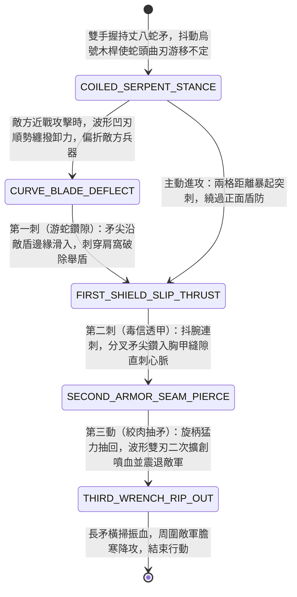

<!-- doc_id: doc_spec_0958 -->
# 野戰精銳步兵雙手長柄丈八蛇矛曲刃撥擋與蜿蜒透甲連刺狀態機規格書

> **文件編號**：`doc_spec_0958`
> **模組代碼**：`SERPENT-SPEAR-DEFLECT-MULTI-THRUST01`
> **對應 WBS**：`FORM-177`（M7 戰場進階機關、城防排叉推刺與精銳步兵丈八蛇矛）
> **單一真相來源（SSOT）**：本文件直接定義雙手長柄丈八蛇矛曲刃撥擋與蜿蜒透甲連刺之完整戰鬥狀態機，嚴禁於檔尾附加補丁。

---

## 一、 戰術定位與歷史兵器原型

在野戰衝鋒與陣地肉搏中，傳統直刃長槍刺入重甲或木盾易卡死，且槍尖軌跡單一易被預判格擋。**雙手長柄丈八蛇矛（Eighteen-Foot Serpent Spear / Zhangba Shemao）**（《晉書》載陳安與張飛所持絕世重矛）以獨特的「彎曲游蛇矛頭」開創了剛猛與詭譎並重的長兵戰技：
1. **丈八烏號木柄與百鍊曲刃蛇頭**：全矛長一丈八尺，矛桿以富彈性的烏號拓木纏藤製成；前端二尺精鋼矛頭鍛造成如毒蛇游動般的「三彎雙刃波形曲刃」，矛尖分叉如蛇信。
2. **曲刃纏撥卸力（Serpent-Curve Deflection）**：迎敵時抖動長柄，彎曲蛇形矛刃在空中畫出圓弧，凹曲處順勢卡住敵方刺來的長槍或大刀並向外抖開，借力打力使敵招落空露出腋下與咽喉空門。
3. **毒蛇吐信蜿蜒透甲連刺（Winding Armor-Piercing Multi-Thrust）**：刺擊時波形曲刃順著敵盾邊緣與胸甲交疊縫隙「滑溜鑽入」，抽回時波形雙刃在體內二次擴創絞碎內臟，瞬間打出狂暴的「抖槍三連刺」。

---

## 二、 觸發條件與兵種武備參數

| 參數項目 | 規格數值與限制條件 | 備註說明 |
| :--- | :--- | :--- |
| **適用兵種 / 武將** | 燕雲蛇矛親衛、精銳突擊重矛兵、武力 $\ge 90$ 之萬人敵猛將（如張飛、陳安） | 雙手長柄奇門重矛，自帶「咆哮破膽」特性 |
| **攻擊距離與範圍** | 近戰 `1 ~ 2 格`（具備 2 格中距離穿刺與隔位點殺能力） | 施展「蛇矛狂瀾三連刺」消耗戰技點（EP）22 |
| **曲刃破盾與擴創** | 無視敵方 `60%` 盾牌格擋率；每次命中必疊加 1 層「蛇信擴創」 | 具備 `WINDING_PIERCE`（蜿蜒透甲）與 `MULTI_HIT` 標籤 |
| **冷卻時間（CD）** | 「曲刃撥擋接蜿蜒三連刺」冷卻 `2 回合` | 被動常駐 `35%` 近戰兵器招架反擊率 |

---

## 三、 核心狀態機（State Machine）

---

## 四、 數值結算與戰鬥公式

### 1. 被動曲刃撥擋與反刺（Curve-Blade Deflection）
當蛇矛兵受到正前方 `1 ~ 2 格` 敵方近戰物理攻擊時：
- **纏撥卸力**：波形曲刃有 `35%` 機率（若我方武力高於敵方，提升至 `50%`）觸發 `CURVE_BLADE_DEFLECT`，使本次受到的近戰傷害降低 `65%`，並使攻擊者陷入「重心失衡（防禦力下降 `25%`，持續 1 回合）」。

### 2. 主動技：蜿蜒透甲三連刺（Winding Multi-Thrust）
對距離 `1 ~ 2 格` 的單一目標瞬間刺出三槍，每槍獨立判定暴擊並遞增破甲效果：
- **第一刺（游蛇鑽隙）**：沿盾緣滑入，無視目標舉盾格擋，造成 `80% ATK` 物理傷害，並強制解除目標本回合的「舉盾姿態」。
- **第二刺（毒信透甲）**：順甲縫直刺，無視目標 `50%` 物理防禦力（DEF），造成 `95% ATK` 穿刺傷害。
- **第三動（絞肉抽矛）**：旋柄猛抽擴創，基於目標已承受的前兩刺傷口，造成 `110% ATK` 傷害（必暴擊），並附加 `SERPENT_FANG_RUPTURE`（蛇信擴創大出血：每回合流失最大兵力 `9%`，且每次移動額外流失 `4%` 兵力，持續 2 回合）。
$$\text{TotalDamage}_{\text{3-hits}} = \text{ATK} \times \left(0.80 + 0.95_{\text{ignore 50\% DEF}} + 1.10 \times \text{CritMult}\right)$$

---

## 五、 反制手段與戰術克制

1. **雙手重鈍器（鐵骨朵 / 狼牙棒）硬砸矛桿**：蛇矛曲刃擅長撥開刀劍與直槍，但面對十八斤重狼牙棒（`doc_spec_0949`）或鐵骨朵當頭硬砸，烏號木桿難以卸去千斤垂直鈍擊，招架減傷效果減半。
2. **遠程十字交叉弩火網**：蛇矛為單點連刺破防極致的武器，缺乏大面積擋箭能力，遭多隊強弩兵側翼交叉射擊時損耗較高。

---

## 六、 驗收測試案例（Acceptance Tests）

| 測試案例 ID | 測試情境與輸入條件 | 預期狀態轉移與數值輸出 |
| :--- | :--- | :--- |
| **TC-SERPENT-01** | 敵方長槍兵對蛇矛兵（武力高於敵方）發動近戰突刺 | 50% 機率觸發 `CURVE_BLADE_DEFLECT` 曲刃撥擋，減傷 65% 並使敵方重心失衡降防 25% |
| **TC-SERPENT-02** | 蛇矛兵隔著 1 格對距離第 2 格的敵方重甲持盾將領施展「蜿蜒透甲三連刺」 | 依序打出 80%（破除舉盾）+ 95%（無視 50% 防禦）+ 110%（必暴擊）三連擊，附加 `SERPENT_FANG_RUPTURE` |
| **TC-SERPENT-03** | 中了 `SERPENT_FANG_RUPTURE` 的敵軍在回合內強行移動 2 格逃跑 | 除回合固定 9% 流血外，因傷口撕裂額外扣除 $2 \times 4\% = 8\%$ 最大兵力 |
