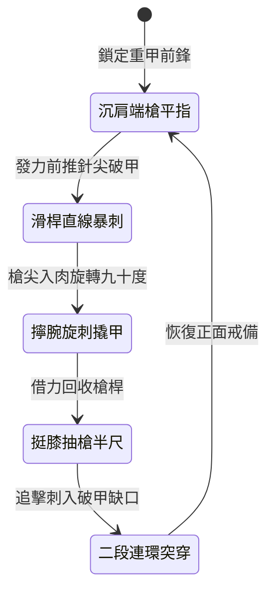

<!-- doc_id: doc_spec_0997 -->
# 野戰精銳步兵雙手長柄三棱透甲槍雙手突刺與擰轉破防狀態機規格書

## 模組識別碼
- 模組編號：`FORM-216`
- 狀態機代碼：`TRI-EDGE-PIERCE-SPEAR-TWIST01`
- 類別：野戰精銳步兵雙手長柄破甲重刺狀態機
- 適用場景：平原野戰、隘口對決、破除重裝甲冑與持盾精兵

---

## 1. 核心概念與作戰原型

面對身著多層生鐵甲片與精鋼護心鏡的重步兵，扁平矛頭極易打滑或崩口。突擊步兵營配備「雙手長柄三棱透甲槍」，專精於點狀高壓穿透與擰轉破壞。

### 1.1 武器形制與戰術協同
1. **硬鋼三棱透甲錐形制**：槍柄長一丈二尺，採用稠木夾竹積層複合桿；槍頭為純鍛淬火生鋼三棱錐，三面開微凹血槽，尖端如針。
2. **沉肩滑桿直線爆刺**：步兵重心壓低，後手發力前推，前手成圈導向，將全身重量與衝力集中於針尖大小的受力點，刺穿外甲。
3. **手腕擰轉擴大創口**：槍尖破入甲片的瞬間，步兵擰轉手腕帶動槍桿旋轉九十度，利用三道棱刃撬開甲片並破壞鎖扣。
4. **挺膝踏步抽槍重刺**：完成旋刺後迅速挺膝踏地，借反作用力抽槍半尺，隨即發動第二段連續突刺。

---

## 2. 數值參數與影響權重

| 參數名稱 | 數值 / 範圍 | 說明 |
| :--- | :--- | :--- |
| **三棱錐點穿透率 (`PointArmorPenetration`)** | 忽視 65% ~ 80% 護甲 | 針尖受力面積極小，專破板甲與魚鱗甲 |
| **手腕擰轉破甲加成 (`TwistArmorDestruction`)** | 永久削弱 15 點護甲 (最多疊加 3 層) | 物理撬壞甲葉連接皮繩與金屬環扣 |
| **突刺準備耗時 (`ThrustWindUp`)** | 0.4 秒蓄勢 | 直線突刺迅捷且動作幅度小 |
| **連續重刺銜接時差 (`ComboInterval`)** | 0.8 秒發動二段刺 | 抽槍半尺立即再刺，不給敵軍重整機會 |
| **轉身招架懲罰 (`AgilityPenalty`)** | 轉向速度 -12% | 雙手持重長槍時專注正向穿透 |

---

## 3. 狀態機轉換定義

### 3.1 狀態細節描述
- **沉肩端槍平指 (STEADY_AIM)**：槍尖平指敵軍胸口護甲交接處，穩控重心。
- **滑桿直線暴刺 (SLIDING_THRUST)**：後手暴發前推，全部動能集中於三棱針尖。
- **擰腕旋刺撬甲 (WRIST_TWIST)**：手腕猛烈擰動，三棱刃口強力擴孔破壞防具。
- **挺膝抽槍半尺 (RECOIL_HALF_PULL)**：踩實地面迅速抽槍，拉開二段刺行程。
- **二段連環突穿 (DOUBLE_PENETRATE)**：沿著原破孔直刺要害，打出極致致命傷。

---

## 4. 戰鬥公式與判定

### 4.1 點狀穿透傷害結算
$$\text{PenetrationDamage} = \text{BaseDamage} \times (1 + \text{STR} \times 0.02) \times (1 - \text{ArmorValue} \times 0.25)$$

因三棱針尖受力集中，目標護甲僅發揮 25% 的防禦效能。

### 4.2 擰轉碎甲判定
$$\text{ArmorShatterSuccess} = \min(0.75, \frac{\text{STR}_{\text{attacker}}}{\text{CON}_{\text{defender}}} \times 0.8)$$

若判定成功，目標身上附加「護甲破損」減益，物理減免降低 20%，持續 6 秒。

---

## 5. 反制與失效機制

1. **生鐵大盾斜面偏轉**：若敵方持盾兵以大角度斜向立盾，尖錐易受側向滑開偏斜。
2. **多重側翼短兵包夾**：長槍長達一丈二尺，若遭短刀手突破至五尺以內將難以施展。
3. **桿身積竹疲勞磨損**：連續強烈擰轉後，槍桿承受過大扭矩可能導致剛度微降。

---

## 6. 驗收標準與測試案例

- [x] **TC-216-01**：驗證直線突刺在 0.4 秒蓄勢後準確命中正前方目標。
- [x] **TC-216-02**：驗證手腕擰轉成功扣減目標 15 點固定護甲值並正常疊層。
- [x] **TC-216-03**：驗證抽槍與二段突刺在 0.8 秒內順暢連擊無動作卡頓。
