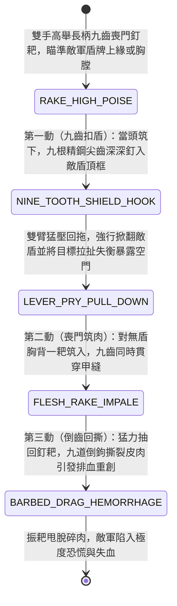

<!-- doc_id: doc_spec_0967 -->
# 野戰精銳步兵雙手長柄九齒喪門釘耙掀盾破防與倒齒撕肉狀態機規格書

> **文件編號**：`doc_spec_0967`
> **模組代碼**：`NINE-TOOTH-IRON-RAKE-SHIELD-PRY-TEAR01`
> **對應 WBS**：`FORM-186`（M7 戰場進階機關、城防千斤鐵柵與精銳步兵喪門釘耙）
> **單一真相來源（SSOT）**：本文件直接定義雙手長柄九齒喪門釘耙掀盾破防與倒齒撕肉之完整戰鬥狀態機，嚴禁於檔尾附加補丁。

---

## 一、 戰術定位與歷史兵器原型

在古代農兵轉化的精銳步兵與明代抗倭、三國山越/黃巾力士戰陣中，「長柄大鐵耙（九齒釘耙 / 喪門釘耙）」絕非演義小說杜撰，而是《武備志》與兵書記載極其兇悍的「破盾、鎖刃與大面積撕裂」實戰重兵器。**雙手長柄九齒喪門釘耙（Nine-Tooth Iron War-Rake / Sang-Men-Ba）** 專克「密集盾牆與藤甲皮鎧」：
1. **丈二鐵裹木柄與九齒倒鉤橫樑**：柄長八尺至一丈，前端橫裝一尺八寸寬的熟鐵厚樑，橫樑下方並列鍛造九根長五寸、略帶內彎倒鉤的三棱淬火精鋼尖齒，全重十六斤。
2. **九齒咬盾猛掀（Shield-Edge Pry & Flip）**：面對高舉木盾或藤牌的敵兵，釘耙手雙手高舉釘耙當頭筑下，九根精鋼尖齒同時深深釘入敵盾上緣；隨後雙臂借槓桿之力猛然往下一壓一拖，直接將敵軍盾牌強行掀開甚至連人帶盾拉趴在地，徹底撕開盾牆防線。
3. **九孔齊穿與倒齒撕肉（Nine-Hole Puncture & Flesh-Tearing）**：一旦敵兵失去盾牌遮蔽，釘耙迎面或貼背一耙筑入，九根尖齒同時刺穿甲葉扎入皮肉；回拉瞬間，九齒同拔帶出大片血肉，造成比單尖長槍慘烈數倍的「九孔排血重創」。

---

## 二、 觸發條件與兵種武備參數

| 參數項目 | 規格數值與限制條件 | 備註說明 |
| :--- | :--- | :--- |
| **適用兵種 / 武將** | 黃巾力士、山越破盾精兵、蠻族悍將或重裝農兵精銳 | 雙手長柄奇門兵器；對「藤甲 / 皮甲 / 木盾」具額外克制 |
| **攻擊距離與範圍** | 近戰 `1 格`（可利用一尺八寸寬耙頭橫向拉扯敵兵移位） | 施展「九齒掀盾撕肉」消耗戰技點（EP）18 |
| **破盾與多點穿刺** | 100% 撬開目標舉盾姿態；每次筑擊判定為 **9 齒同步穿刺** | 具備 `SHIELD_PRY`（掀盾拉拽）與 `NINE_TOOTH_BLEED` 標籤 |
| **冷卻時間（CD）** | 「喪門掀盾筑」主動技冷卻 `2 回合` | 被動：面對長槍刺擊時，可用九齒齒隙卡偏槍頭（閃避 `+20%`） |

---

## 三、 核心狀態機（State Machine）

---

## 四、 數值結算與戰鬥公式

### 1. 第一動：九齒扣盾與拉趴破防（Nine-Tooth Shield Pry & Pull）
當釘耙兵對正前方 `1 格` 目標施展主動戰技時：
- **強制掀盾與失衡**：九齒釘入盾緣回拖，`100%` 強制解除目標的「舉盾防禦 / 龜甲陣」狀態，並附加 `RAKE_PULLED_OFF_BALANCE`（被釘耙拉趴失衡：物理防禦力下降 `40%`、閃避率歸零，持續 1 回合）。
- **強制換位拉扯**：若釘耙兵身後 `1 格` 為空地，釘耙兵可選擇後退 1 格並將敵方前排目標強行拖離原本陣列 `1 格`，使其脫離友軍陣型保護圈。

### 2. 第二、三動：喪門筑肉與九孔排血（Nine-Hole Puncture & Tear）
掀開盾牌後，釘耙當胸筑入並猛力回撕，造成極高穿刺與撕裂複合傷害：
$$\text{Damage}_{\text{rake}} = \text{ATK} \times 2.15 \times \left(1 - \text{TargetDEF} \times 0.50\right) \times \text{LightArmorMult}$$
- **皮甲與藤甲特攻**：若目標穿戴「皮甲 / 藤甲 / 布衣（非重型鐵鎧）」，九齒極易刺入並勾斷藤條，$\text{LightArmorMult} = 1.45$。
- **九孔排血重創（Nine-Puncture Hemorrhage）**：回抽撕裂使目標附加 `NINE_HOLE_BLEED`（每回合固定流失最大兵力 `11%`，且因傷口呈九孔排狀極難止血，受到任何攻擊時額外承受 `15%` 易傷，持續 2 回合）。

---

## 五、 反制手段與戰術克制

1. **全身光滑重鐵鎧（明光鎧 / 具裝鐵騎）**：若敵軍身披無縫光滑的厚重精鋼板甲且不持木盾，九齒釘耙同時分散受力於九個點，反而不如單尖破甲錐容易刺穿厚鋼板（對重鐵甲傷害 `-20%`）。
2. **雙手大砍刀 / 青龍偃月刀順桿削指**：釘耙橫樑雖能擋槍，但若被敵方大刀順著木柄滑削而下，容易傷及持柄雙手。

---

## 六、 驗收測試案例（Acceptance Tests）

| 測試案例 ID | 測試情境與輸入條件 | 預期狀態轉移與數值輸出 |
| :--- | :--- | :--- |
| **TC-RAKE-01** | 釘耙兵攻擊正處於「舉盾防禦」之敵方藤甲刀盾兵 | 100% 掀開盾牌解除舉盾並降防 40%，緊接觸發 $1.45$ 倍藤甲特攻與 `NINE_HOLE_BLEED`（每回合損兵 11%） |
| **TC-RAKE-02** | 釘耙兵背後 1 格為空地，對敵方陣線前排將領施展「九齒扣盾拉扯」 | 釘耙兵後退 1 格並將敵將強行拖出敵陣 1 格，使其孤立受我方集火 |
| **TC-RAKE-03** | 釘耙兵攻擊不持盾之「重裝明光鎧鐵騎兵」 | 因九齒分散受力於光滑厚鐵甲，基礎穿刺傷害受到 20% 減免 |
