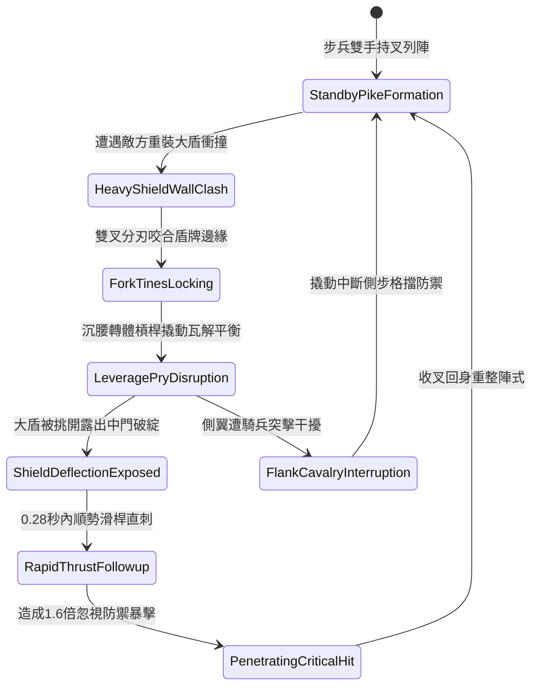

# 野戰精銳步兵雙手長柄大叉格擋大盾與順勢挑破防線第三階狀態機規格書

<!-- doc_id: doc_spec_1048 -->

## 一、 核心概念與單一真相來源（SSOT）

在《三國志·精銳破陣步兵篇》中，「雙手長柄生鋼大叉破盾挑防戰術第三階（HOOK-SICKLE-DOUBLE-FORK-PRY03）」為專門瓦解敵軍大盾結陣的前鋒近戰戰法。大叉全長一丈三尺，前端鍛造雙股粗壯生鋼分叉，內側具備鋸齒狀扣槽，桿尾配重鐵錘。步兵面對敵方鐵甲重步兵之大盾衝撞時，以雙叉死死卡扣大盾上沿或側邊把手，沉腰下潛利用反向力矩撬開大盾防禦，隨後順勢旋桿突刺盾後要害，瓦解敵防線正面減傷。



---

## 二、 數值模型與狀態機參數契約

### 1. 雙鋼叉破盾戰術參數
- **兵器規格**：全長一丈三尺（約 3.1 米），硬木鋼芯配雙股生鋼叉頭。
- **撬盾成功判定率**：普通木質櫓盾 95%；生鐵包邊塔盾 91%；重裝折疊鐵盾 85%。
- **正面減傷瓦解時間**：撬開後使目標失去正面大盾 60% 物理減傷，持續 4.5 秒。
- **反制刺擊反應時效**：0.28 秒破綻攻擊窗口，目標處於失衡僵直狀態。
- **穿透破甲傷害加成**：直刺附加 1.6 倍傷害，忽視目標 60% 的當前護甲值。

### 2. 撬盾力矩與破防傷害模組
```typescript
interface DoubleForkPryParams {
    infantryStrength: number;      // 步兵力量值 (50 ~ 120)
    targetShieldStability: number; // 敵方持盾穩定度 (100 ~ 250)
    shieldType: "woodTower" | "ironEdge" | "heavyPlate";
}

function processShieldPryAndThrust(params: DoubleForkPryParams): {
    prySuccess: boolean;
    vulnerabilityDurationSec: number;
    thrustCriticalMultiplier: number;
} {
    const shieldDifficulty = params.shieldType === "woodTower" ? 0.95 :
                             params.shieldType === "ironEdge" ? 0.91 : 0.85;
    const strengthAdvantage = (params.infantryStrength * 1.5) / params.targetShieldStability;
    const finalRate = Math.min(0.98, Math.max(0.60, shieldDifficulty * strengthAdvantage));

    const prySuccess = Math.random() < finalRate;
    const vulnerabilityDurationSec = prySuccess ? 4.5 : 1.5;
    const thrustCriticalMultiplier = prySuccess ? 1.6 : 1.0;

    return { prySuccess, vulnerabilityDurationSec, thrustCriticalMultiplier };
}
```

---

## 三、 特性互斥與戰術應對原則

1. **騎兵衝鋒正面破壞**：若敵方重騎兵高速直撞，大叉桿身無法承受雙重衝擊，撬盾動作自動中斷並轉為吸收 40% 傷害的格擋。
2. **長矛方陣協同加成**：當大叉步兵與長槍步兵同處一格或相鄰格子時，撬盾後的突刺窗口延長至 0.45 秒，並額外附加流血狀態。
3. **持盾者重量反壓**：若持盾單位體型超大（如巨熊甲士），撬盾力量門檻提升 30%，需兩名大叉步兵協同判定。

---

## 四、 驗收測試案例（TC）

- **TC-FORK03-01（撬開大盾判定）**：在步兵交鋒對抗中面對鐵盾守軍，施放撬盾技能，確認 91% 機率成功挑開盾牌並進入破綻態。
- **TC-FORK03-02（減傷瓦解檢測）**：盾牌被挑開期間，檢核目標承受友軍攻擊之傷害數值不再計算大盾減免。
- **TC-FORK03-03（順勢直刺連鎖）**：大盾撬開後 0.28 秒內自動銜接直刺，驗證戰鬥日誌正確結算 1.6 倍穿透傷害。
