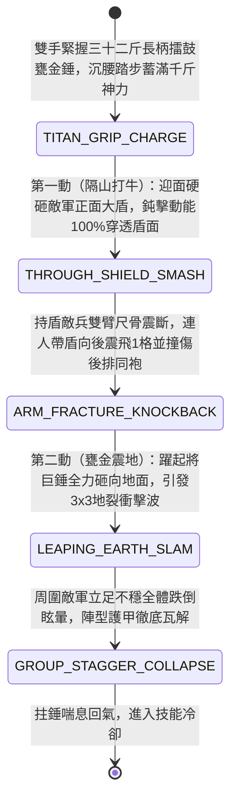

<!-- doc_id: doc_spec_0964 -->
# 野戰精銳步兵雙手長柄擂鼓甕金錘震地衝擊波與隔盾碎骨狀態機規格書

> **文件編號**：`doc_spec_0964`
> **模組代碼**：`GIANT-GOLDEN-WARHAMMER-SHOCKWAVE-CRUSH01`
> **對應 WBS**：`FORM-183`（M7 戰場進階機關、城防門洞地刺沸油與精銳步兵擂鼓甕金錘）
> **單一真相來源（SSOT）**：本文件直接定義雙手長柄擂鼓甕金錘震地衝擊波與隔盾碎骨之完整戰鬥狀態機，嚴禁於檔尾附加補丁。

---

## 一、 戰術定位與歷史兵器原型

在重甲步騎爭鋒中，《三國志·武帝紀》載曹操設「陷陣金錘力士」，曹仁、武安國等猛將亦以手執長柄大鐵錘破陣聞名。面對密不透風的「重裝鐵甲大盾牆」，刀槍無縫可入。**雙手長柄擂鼓甕金錘（Giant Golden Drum-Jar Warhammer）** 為神力猛將與金錘力士專用的「質量碾壓、隔盾碎骨與震地群控」超重型鈍器：
1. **水甕形熟銅包鐵實心巨錘**：柄長六尺（熟鐵棍外纏牛筋），前端鑄有形如戰鼓大水甕、外包黃銅金漆、內灌生鐵鉛汁的八棱實心巨錘頭，單柄重達三十二斤。
2. **隔盾傳導碎骨（Through-Shield Bone Shattering）**：三十二斤甕金錘迎面砸在敵軍大盾上時，即使盾牌未破，排山倒海的鈍擊動能也會直接透過盾面傳導至持盾者雙臂與胸骨，當場將盾後敵兵震得雙臂骨折、五臟碎裂飛出。
3. **雷霆震地衝擊波（Earth-Shaking Shockwave）**：雙手高舉甕金錘躍起全力砸地，恐怖撞擊震波使方圓一丈地面龜裂塌陷，周圍敵軍立足不穩全數震飛跌倒。

---

## 二、 觸發條件與兵種武備參數

| 參數項目 | 規格數值與限制條件 | 備註說明 |
| :--- | :--- | :--- |
| **適用兵種 / 武將** | 虎賁金錘力士、破陣重錘步兵、武力 $\ge 93$ 之天生神力猛將（如武安國、曹仁帳下力士） | 雙手超重型鈍器；自身移動力 `-1`（固定最高 2 格），但免疫擊退 |
| **攻擊距離與範圍** | 近戰 `1 格`；施展「雷霆震地錘」時波及自身周圍八格（`3 × 3`） | 施展「隔盾碎骨 / 震地波」消耗戰技點（EP）24 |
| **隔盾傳導特性** | 敵方若觸發「舉盾格擋」，非但無法減傷，反而承受 **135% 隔盾共振真傷** | 具備 `THROUGH_SHIELD_CRUSH` 與 `GROUND_SHOCKWAVE` 標籤 |
| **冷卻時間（CD）** | 「甕金破岳錘」主動技冷卻 `3 回合` | 普通攻擊常駐無視目標 `50%` 物理防禦力（DEF） |

---

## 三、 核心狀態機（State Machine）

---

## 四、 數值結算與戰鬥公式

### 1. 第一動：隔盾碎骨與撞飛連鎖（Through-Shield Bone Crush & Knockback）
對正前方 `1 格` 目標發動極限重錘猛砸：
$$\text{Damage}_{\text{hammer}} = \text{ATK} \times 2.25 \times \left(1 - \text{TargetDEF} \times 0.40\right)$$
- **隔盾共振反噬（Shield Resonance Penalty）**：若目標處於「舉盾格擋」或裝備盾牌，甕金錘的鈍擊震波會在盾牌與胸甲之間產生劇烈共振，**完全無視盾牌減傷**，並額外追加目標 `ShieldValue + TargetDEF × 0.9` 的隔盾內傷真傷，同時附加 `BILATERAL_ARM_FRACTURE`（雙臂震斷：攻擊力與防禦力同時下降 `45%`，持續 2 回合）。
- **保齡球撞飛連鎖**：主目標被 `100%` 向後強制震飛 `1 格`；若其身後緊貼著另一隊敵軍，則兩隊撞在一起無法後退，雙雙承受額外 `90% ATK` 的碰撞鈍擊傷害。

### 2. 第二動：擂鼓震地衝擊波（Earth-Shaking Shockwave）
重砸主目標後，巨錘順勢砸地，對自身周圍 `3 × 3` 範圍內所有敵軍釋放地裂震波：
- 造成 `115% ATK` 的範圍震盪傷害（對「城門 / 拒馬 / 塞門刀車」等工事建築造成 `250%` 結構震裂傷害）。
- 以 `75%` 機率使範圍內敵軍附加 `EARTHQUAKE_STUN`（震波跌倒眩暈 `1 回合`，閃避率歸零）。

---

## 五、 反制手段與戰術克制

1. **無盾高閃避輕裝刺客 / 游騎兵風箏**：甕金錘極其笨重，對不持盾且高機動的輕步兵、弓騎兵命中率天生下降 `25%`，且無法觸發「隔盾共振真傷」。
2. **雨天泥濘地吸收震波**：若在「雨天泥濘地形（如 `doc_spec_0883`）」施展第二動震地錘，鬆軟泥漿會吸收大半衝擊動能，使 `3 × 3` 震地波傷害與眩暈率雙雙減半。

---

## 六、 驗收測試案例（Acceptance Tests）

| 測試案例 ID | 測試情境與輸入條件 | 預期狀態轉移與數值輸出 |
| :--- | :--- | :--- |
| **TC-HAMMER-01** | 金錘力士對正前方「舉盾防禦之重甲刀盾兵（身後 1 格有敵方弓兵）」發動重砸 | 無視舉盾減傷，造成 225% 破甲傷 + 隔盾共振真傷，雙臂震斷降攻防 45%，並撞飛砸傷後方弓兵（90% 傷害） |
| **TC-HAMMER-02** | 在乾燥石地接續觸發 `LEAPING_EARTH_SLAM` 震地衝擊波，周圍有敵軍與拒馬 | 對 3x3 敵軍造成 115% 傷害與 75% 機率眩暈 1 回合，對拒馬造成 250% 結構震裂傷害 |
| **TC-HAMMER-03** | 在「雨天深泥濘地」施展震地衝擊波 | 受軟泥吸能影響，震地波範圍傷害降為 57.5%，眩暈機率降為 37.5% |
