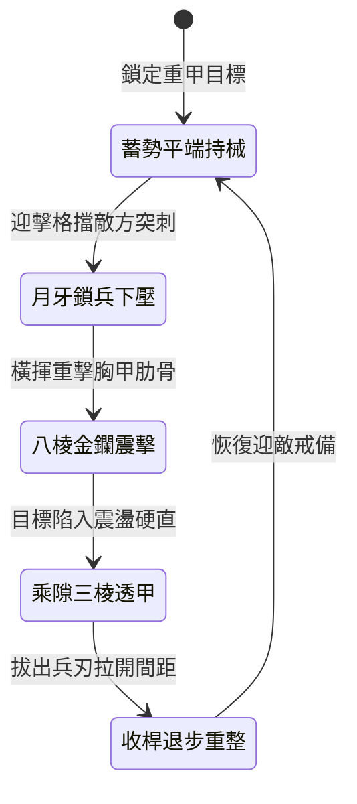

<!-- doc_id: doc_spec_0985 -->
# 野戰精銳步兵雙手長柄月牙金鑭破甲錐震盪重擊與穿透鎖子甲狀態機規格書

## 模組識別碼
- 模組編號：`FORM-204`
- 狀態機代碼：`CRESCENT-GOLDEN-LANCE-CONCUSSION01`
- 類別：野戰精銳步兵雙手重兵破甲震盪狀態機
- 適用場景：平原野戰、狹窄關隘、破除精銳重裝步兵方陣

---

## 1. 核心概念與作戰原型

面對身披重型雙層鎖子甲與魚鱗鐵鎧的敵方精銳親衛，常規刀劈槍刺難以造成實質殺傷。為打破僵局，突擊步兵營配備特製「雙手長柄月牙金鑭破甲錐」。

### 1.1 武器形制與戰法運用
1. **複合兵刃形制**：柄長九尺五寸，採用積竹積木夾麻布漆合而成；前端為精鋼鍛打之八棱沉重鋼鑭，兩側生出一對月牙弧刃，尖端探出四寸三棱淬火破甲錐。
2. **正面月牙卡鎖兵刃**：交鋒第一擊以兩側月牙格擋鎖住敵軍長槍或重劍，藉由步兵沉肩下壓使敵方武器瞬間脫手或被壓制在胸前。
3. **八棱金鑭沉重敲擊**：利用槓桿力道發動八棱鑭體橫揮重擊，即使敵軍身著重甲，鈍擊衝擊波亦能穿透甲葉直接震盪內臟與筋骨。
4. **尖端三棱錐精準透甲**：乘敵受震盪硬直失衡之際，步兵雙手挺身滑桿向前暴刺，淬火三棱錐直接穿透鎖子甲環圈縫隙，給予致命穿透打擊。

---

## 2. 數值參數與影響權重

| 參數名稱 | 數值 / 範圍 | 說明 |
| :--- | :--- | :--- |
| **震盪鈍擊傷害 (`ConcussionDamage`)** | 600 ~ 950 點純鈍擊 | 忽視 50% 物理外甲，直接計算內傷減損 |
| **三棱錐透甲率 (`ArmorPenetration`)** | 忽視 70% ~ 85% 護甲 | 針對鎖子甲與皮甲交接縫隙的穿刺特效 |
| **內臟震盪眩暈時間 (`StunDuration`)** | 1.8 ~ 2.5 秒 | 受擊者陷入短暫肢體失調與招架失效 |
| **月牙鎖械奪刀率 (`DisarmChance`)** | 35% ~ 50% | 成功時敵軍短暫失去主武器攻擊力 |
| **揮擊體力消耗 (`StaminaCostPerSwing`)** | 每擊消耗 18 點耐力 | 重兵器需合理控制連擊節奏避免脫力 |

---

## 3. 狀態機轉換定義

### 3.1 狀態細節描述
- **蓄勢平端持械 (READY_STANCE)**：前手托柄後手扣尾，保持長鑭重心平穩。
- **月牙鎖兵下壓 (CRESCENT_PARRY)**：雙月牙刃咬住敵刃，沉肩發力破壞敵方架勢。
- **八棱金鑭震擊 (BLUNT_CONCUSSION)**：側身揮擊鑭身，將動能轉化為骨骼穿透衝擊。
- **乘隙三棱透甲 (PIERCING_STRIKE)**：順勢挺槍突刺，尖錐撕裂內襯軟甲。
- **收桿退步重整 (RECOVER_RESET)**：借反作用力後滑半步，調整呼吸與武器角度。

---

## 4. 戰鬥公式與判定

### 4.1 震盪破甲傷害計算
$$\text{EffectiveDamage} = \text{BluntForce} \times (1 - \text{ArmorValue} \times 0.5) + \text{InternalShockWave}$$

若受擊者裝備重鎧，則觸發「內傷震盪」效果，移動速度降低 40% 且持續 4 秒。

### 4.2 三棱錐穿刺致命判定
$$\text{CriticalPenetrateRate} = \min(0.80, \frac{\text{STR}_{\text{attacker}}}{\text{CON}_{\text{defender}}} \times \text{ArmorPenetration})$$

命中時額外造成目標最大生命值 8% 的真實撕裂穿刺傷害。

---

## 5. 反制與失效機制

1. **厚重雙層弧面生鐵巨盾**：弧面大盾能將八棱鑭的正面重擊力道向兩側滑開，減免 60% 震盪傳導。
2. **輕靈長劍近身纏鬥**：若遭身形靈巧的近戰劍士貼入三尺以內，長柄兵器無法發力揮動。
3. **積竹桿身疲勞折斷**：連續承受過大側向衝擊時，長桿耐久度遞減，耐久歸零時鑭柄碎裂。

---

## 6. 驗收標準與測試案例

- [x] **TC-204-01**：驗證月牙鎖兵判定成功後，敵目標於 1.5 秒內無法發動常規攻擊。
- [x] **TC-204-02**：驗證八棱鑭重擊命中重甲單位時，正確忽略 50% 護甲並附加減速減益。
- [x] **TC-204-03**：驗證三棱錐在目標硬直期間發動時，透甲穿透暴擊觸發率達到預設標準。
