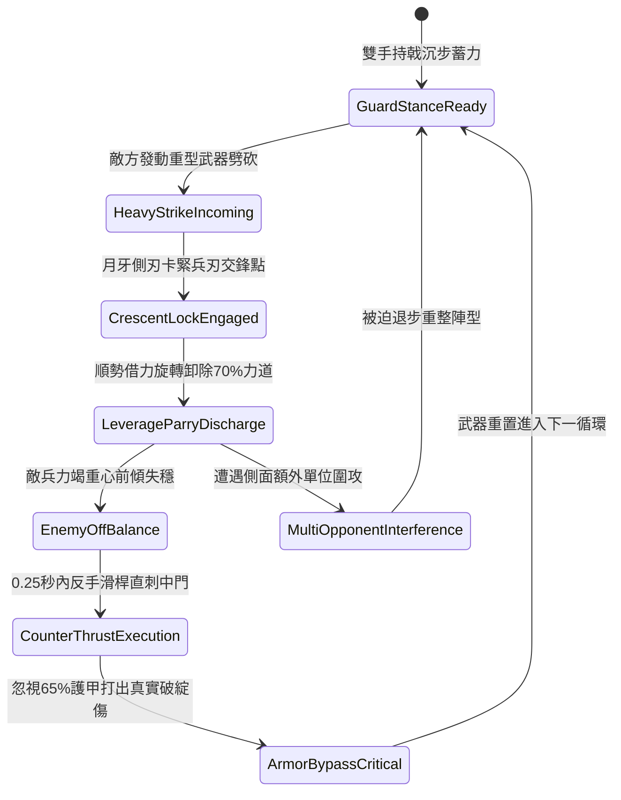

# 野戰精銳步兵雙手長柄月牙雙股戟格擋重兵與順勢卸力反制第三階狀態機規格書

<!-- doc_id: doc_spec_1045 -->

## 一、 核心概念與單一真相來源（SSOT）

在《三國志·精銳近戰步兵篇》中，「雙手長柄月牙雙股戟格擋與卸力反制第三階（HOOK-SICKLE-TWIN-HALBERD-PARRY03）」為專門克制敵方重甲步騎劈砍的大型制式步兵戰法。戟長一丈二尺，矛尖後方鍛鑄兩道對稱生鋼月牙側刃，內外雙面開弧形倒鉤。步兵在面對敵軍大刀、長斧等重型兵刃劈砸時，利用月牙雙刃牢固架鎖來襲鋒芒，並藉由沉肩轉跨之槓桿原理卸除 70% 垂直劈力；隨後順勢滑動桿身實施回挑反制，打擊敵中門破綻。



---

## 二、 數值模型與狀態機參數契約

### 1. 月牙雙股戟兵裝參數
- **兵器全長**：一丈二尺（約 2.8 米，硬木覆鐵桿身）。
- **架鎖成功判定率**：對單手大刀 94%；對長柄雙手斧 89%；對重型騎槍 82%。
- **卸力減免比例**：格擋成功時承受之正面硬直與物理傷害即刻減免 70%。
- **反制直刺窗口**：卸力完成後具備 0.25 秒黃金破綻窗口，敵兵此時閃避率歸零。
- **貫穿穿甲倍率**：反制刺擊附加 1.55 倍傷害係數，並忽視目標 65% 的基礎護甲值。

### 2. 格擋與反制傷害計算模組
```typescript
interface HalberdParryParams {
    wielderStr: number;            // 施法者力量屬性 (50 ~ 120)
    wielderAgility: number;        // 施法者敏捷屬性 (40 ~ 110)
    incomingDamage: number;        // 來襲攻擊原始威力
    targetArmorValue: number;      // 敵方目標護甲
}

function processHalberdParryCounter(params: HalberdParryParams): {
    parrySuccess: boolean;
    damageTaken: number;
    counterDamageDealt: number;
} {
    const baseParryRate = 0.88 + (params.wielderAgility / 500);
    const parrySuccess = Math.random() < Math.min(0.96, baseParryRate);

    if (!parrySuccess) {
        return { parrySuccess: false, damageTaken: params.incomingDamage, counterDamageDealt: 0 };
    }

    const damageTaken = Math.round(params.incomingDamage * 0.30);
    const effectiveArmor = params.targetArmorValue * 0.35;
    const baseCounter = params.wielderStr * 2.4;
    const counterDamageDealt = Math.round((baseCounter - effectiveArmor * 0.5) * 1.55);

    return { parrySuccess: true, damageTaken, counterDamageDealt: Math.max(50, counterDamageDealt) };
}
```

---

## 三、 特性互斥與戰術應對原則

1. **鈍器重型破防**：若敵方使用超過千斤之大型攻城戰錘或金瓜鐵鉞正面砸擊，月牙結構承受壓力超過韌性極限，卸力減免比例降為 30%。
2. **遠程密集箭雨壓制**：戟兵在全神貫注施展架鎖卸力動作期間，無法舉盾防禦，背部與兩翼受遠程箭矢傷害增加 25%。
3. **隊列連鎖庇護**：同陣線相鄰兩格若均為配備月牙戟之友軍步兵，反制窗口延長至 0.4 秒，並提升反制暴擊率 15%。

---

## 四、 驗收測試案例（TC）

- **TC-PARRY03-01（正面架鎖判定）**：在單兵對決場景下，承受敵方重刀猛擊，確認狀態機平穩進入 `CrescentLockEngaged` 並卸除 70% 傷害。
- **TC-PARRY03-02（破綻反刺驗證）**：格擋成功後確認在 0.25 秒內自動觸發反手突刺，檢查傷害結算符合 1.55 倍破甲暴擊。
- **TC-PARRY03-03（多重包夾中斷測試）**：模擬三名敵兵圍攻狀態，驗證受到側翼攻擊時反刺窗口即刻中斷重整。
