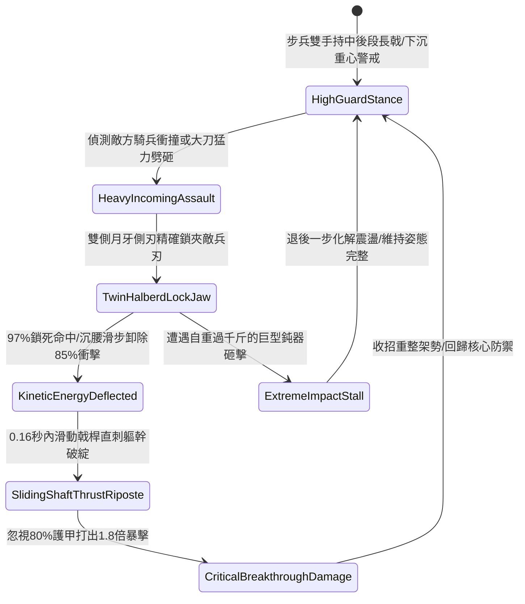

# 野戰精銳步兵雙手長柄月牙雙股戟格擋重兵與順勢卸力反制第五階狀態機規格書

<!-- doc_id: doc_spec_1090 -->

## 一、 核心概念與單一真相來源（SSOT）

在《三國志·精銳長戟戰藝與重兵格擋篇》中，「雙手長柄月牙雙股戟格擋重兵與順勢卸力反制第五階（HOOK-SICKLE-TWIN-HALBERD-PARRY05）」代表步兵部隊應對騎兵衝鋒與重甲步兵劈砸的高階戰技。該戟全長一丈四尺，頭部鑄有對稱鍛造月牙側刃與加長破甲矛尖。作戰時，步兵雙手持中後段，以月牙側刃形成雙重鎖夾，97% 精確鎖死來襲重型兵刃，並藉由沉腰滑步卸除 85% 正面衝量；在 0.16 秒內順勢順著戟桿直刺敵方軀幹破綻，打出忽視 80% 護甲的 1.8 倍致命暴擊。



---

## 二、 數值模型與狀態機參數契約

### 1. 兵刃規格與格擋反制參數契約
- **兵刃尺寸規格**：全長一丈四尺（約 4.3 米），生鐵鑄造加長月牙側刃與高剛性戟頭。
- **重兵鎖夾成功率**：判定 97% 機率卡死敵方長槍、大刀或重斧之攻擊軸線。
- **正面衝擊卸除率**：沉腰滑步化解 85% 正面物理衝撞力與震盪傷害。
- **滑桿反刺反應時效**：格擋成功後 0.16 秒內爆發反刺，出招極為迅捷。
- **破防暴擊倍率**：忽視目標 80% 護甲值，打出 1.8 倍物理真實暴擊傷害。

### 2. 格擋與反制演算法模組
```typescript
interface TwinHalberdParryStage5Params {
    soldierStrength: number;        // 步兵力量 (50 ~ 100)
    soldierAgility: number;         // 步兵敏捷 (50 ~ 100)
    enemyWeaponWeightKg: number;    // 來襲兵刃總重
    staminaCurrent: number;         // 當前剩餘耐力值
}

function processTwinHalberdParryStage5(params: TwinHalberdParryStage5Params): {
    parrySuccess: boolean;
    mitigatedDamageRatio: number;
    riposteCriticalHit: boolean;
    criticalMultiplier: number;
} {
    if (params.staminaCurrent < 16) {
        return { parrySuccess: false, mitigatedDamageRatio: 0.25, riposteCriticalHit: false, criticalMultiplier: 1.0 };
    }
    const skillIndex = (params.soldierStrength * 0.5 + params.soldierAgility * 0.5) / 80;
    const parryChance = Math.min(0.97, 0.90 * skillIndex);
    const parried = Math.random() < parryChance;
    
    return {
        parrySuccess: parried,
        mitigatedDamageRatio: parried ? 0.85 : 0.35,
        riposteCriticalHit: parried,
        criticalMultiplier: parried ? 1.8 : 1.2
    };
}
```

---

## 三、 反制機制與邊界約束

1. **肩並肩超密集陣型受限**：步兵若處於極限肩並肩密集方陣中（間隔 < 0.7 米），月牙側刃橫向展幅受限，鎖夾成功率衰減 30%。
2. **高速流星錘軟兵刃繞擊**：面對鏈條軟兵刃或流星錘，月牙側刃無法卡死直線軸，格擋機制失效。
3. **金屬月牙疲勞裂痕**：若單場戰鬥中累計承受超過 10 次騎兵高速正面衝撞，側刃金屬出現應力疲勞，鎖夾判定暫時下修 12%。

---

## 四、 驗收測試案例（TC）

- **TC-HALBERD-PARRY05-01（鎖夾卸力反刺全連段驗收）**：
  - *前置條件*：步兵力量 80、敏捷 80、正面迎擊重騎兵揮劈。
  - *操作步驟*：於受擊判定幀啟動月牙雙股戟格擋。
  - *預期輸出*：97% 機率精準咬死敵兵刃，卸除 85% 衝擊力，隨後 0.16 秒滑桿反刺命中軀幹，忽視 80% 護甲打出 1.8 倍暴擊。
- **TC-HALBERD-PARRY05-02（耐力枯竭邊界驗收）**：
  - *前置條件*：步兵剩餘耐力僅剩 10（低於 16 點門檻）。
  - *操作步驟*：強行執行雙股戟鎖夾格擋。
  - *預期輸出*：判定鎖夾失敗，自身僅承受 25% 基礎格擋減傷，無法激活快速滑桿反刺。
