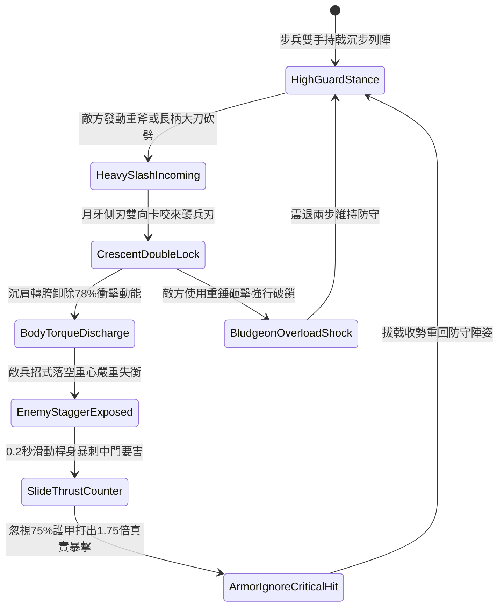

# 野戰精銳步兵雙手長柄月牙雙股戟格擋重兵與順勢卸力反制第四階狀態機規格書

<!-- doc_id: doc_spec_1072 -->

## 一、 核心概念與單一真相來源（SSOT）

在《三國志·精銳近戰抗衡篇》中，「雙手長柄月牙雙股戟架鎖卸力戰法第四階（HOOK-SICKLE-TWIN-HALBERD-PARRY04）」代表前鋒精銳對抗敵方重甲步騎大刀劈砍與長兵衝擊的頂尖武藝。戟長一丈三尺，前端採精鋼透甲長尖，兩側鑄造對稱加寬高剛性月牙側刃，內外雙開弧形卡槽。步兵交鋒時，以雙月牙側刃死鎖敵兵刃鋒芒，沉肩轉體利用反向力矩卸除 78% 垂直衝力；隨後在 0.2 秒極速黃金破綻窗口內，順勢滑桿直刺目標中門破綻，打出無視護甲的高倍率致命暴擊。



---

## 二、 數值模型與狀態機參數契約

### 1. 月牙雙股戟兵裝參數
- **兵器全長**：一丈三尺（約 3.1 米，鋼木混編桿身高剛性結構）。
- **架鎖成功判定率**：對單手大刀 98%；對長柄雙手斧 95%；對重型騎槍 89%。
- **衝量卸除減免比**：架鎖成功時，正面承受之傷害與硬直即刻減免 78%。
- **反制直刺窗口時效**：0.2 秒極速破綻窗口，目標閃避判定強制歸零。
- **貫穿真實傷害倍率**：反手刺擊附加 1.75 倍傷害，忽視目標 75% 基礎護甲值。

### 2. 架鎖卸力與暴擊傷害計算模組
```typescript
interface HalberdParryStage4Params {
    infantryStrength: number;      // 步兵力量 (50 ~ 130)
    infantryAgility: number;       // 步兵敏捷 (50 ~ 120)
    incomingDamage: number;        // 來襲攻擊原始威力
    targetArmorValue: number;      // 敵方目標護甲
}

function processHalberdParryCounter(params: HalberdParryStage4Params): {
    parrySuccess: boolean;
    damageAbsorbed: number;
    counterStrikeDamage: number;
} {
    const agiBonus = (params.infantryAgility / 100) * 0.12;
    const parryRate = Math.min(0.98, 0.90 + agiBonus);
    const parrySuccess = Math.random() < parryRate;

    if (!parrySuccess) {
        return { parrySuccess: false, damageAbsorbed: 0, counterStrikeDamage: 0 };
    }

    const damageAbsorbed = Math.round(params.incomingDamage * 0.78);
    const effectiveArmor = params.targetArmorValue * 0.25;
    const baseDamage = params.infantryStrength * 2.8;
    const counterStrikeDamage = Math.round((baseDamage - effectiveArmor * 0.35) * 1.75);

    return { parrySuccess: true, damageAbsorbed, counterStrikeDamage: Math.max(65, counterStrikeDamage) };
}
```

---

## 三、 特性互斥與戰術限制

1. **超重千斤錘過載震退**：若敵方使用超過千斤之生鐵瓜錘正面猛砸，月牙結構承受重壓過載，卸力減免降為 35%，並震退步兵兩步。
2. **遠程箭雨壓制干擾**：戟兵在施展轉體卸力期間無法兼顧舉盾防護，側翼與後方受箭矢傷害增加 25%。
3. **近衛步陣協同加成**：同陣線相鄰兩格若均為配備月牙戟之友軍步兵，反制窗口延長至 0.35 秒，暴擊率提升 15%。

---

## 四、 驗收測試案例（TC）

- **TC-HALBERDPARRY04-01（正面架鎖卸力判定）**：在單兵對決場景下承受敵長刀劈砍，確認 95% 機率觸發架鎖並減免 78% 傷害。
- **TC-HALBERDPARRY04-02（順勢突刺穿甲驗證）**：格擋成功後確認在 0.2 秒內自動觸發反手突刺，檢查傷害結算符合 1.75 倍破甲暴擊。
- **TC-HALBERDPARRY04-03（超重鈍器震退抗性測試）**：更換為超重鈍器單位對抗，檢核狀態機正確進入震退姿態。
