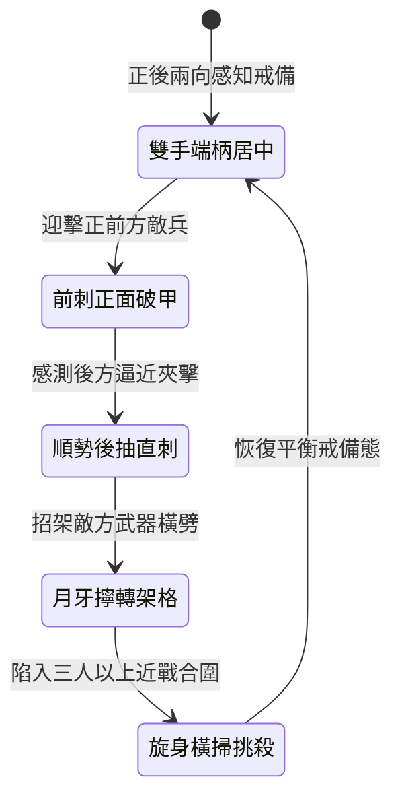

<!-- doc_id: doc_spec_0991 -->
# 野戰精銳步兵雙手長柄月牙雙頭長矛前後連刺防反破陣狀態機規格書

## 模組識別碼
- 模組編號：`FORM-210`
- 狀態機代碼：`CRESCENT-TWIN-HEAD-SPEAR-THRUST01`
- 類別：野戰精銳步兵雙手長柄前後雙向攻防狀態機
- 適用場景：平原野戰、陷入重圍、巷戰隘口、反制四面包抄

---

## 1. 核心概念與作戰原型

步兵方陣在交鋒中若遭側翼迂迴或背後突襲，往往因無法及時調轉長槍而潰散。為賦予陣中精銳全向應急處置能力，配發特製「月牙雙頭長矛」。

### 1.1 武器構造與協同特色
1. **平衡雙頭與月牙短刃**：槍柄長一丈一尺，兩端均裝有三棱淬火透甲矛尖，前段矛頸配向外微彎之生鋼月牙刃，後段配沉重配重錐與倒刺。
2. **前後雙向滑動連刺**：步兵雙手握持槍柄中段，前推可突刺正面強敵，順勢向後抽推則以尾端破甲錐直刺身後夾擊之敵。
3. **月牙格擋卸力防禦**：正面月牙短刃可架住敵軍橫劈大刀，藉由手腕擰動將衝力引向外側，化解敵軍重擊。
4. **旋身迴旋範圍挑擊**：受近身多名敵人合圍時，步兵腰部發力帶動長槍作三百六十度橫掃，以雙刃逼退貼身敵兵。

---

## 2. 數值參數與影響權重

| 參數名稱 | 數值 / 範圍 | 說明 |
| :--- | :--- | :--- |
| **前後連刺頻率 (`DualThrustSpeed`)** | 1.2 秒完成前後雙刺 | 免除轉身時間，直接向前後兩格發動攻擊 |
| **背後突襲免疫率 (`BackstabImmunity`)** | 80% 豁免背刺額外暴擊 | 尾部矛頭常駐防禦威懾敵後包抄 |
| **月牙格擋卸力值 (`ParryDamageAbsorb`)** | 吸收 45% 正面近戰傷害 | 化解長兵器或鈍器正面衝擊 |
| **旋身橫掃擊退率 (`WhirlKnockbackChance`)** | 60% 擊退周圍一格敵軍 | 解除近接貼身包圍，重新拉開安全間距 |
| **體力消耗節奏 (`EnduranceCost`)** | 每套連刺消耗 12 點耐力 | 平衡高速雙向進攻之體能消耗 |

---

## 3. 狀態機轉換定義

### 3.1 狀態細節描述
- **雙手端柄居中 (CENTERED_STANCE)**：前後兩端重量平衡，步兵靈活保持雙向視野。
- **前刺正面破甲 (FRONT_THRUST)**：前手滑動前送，矛尖直刺正面目標護心鏡。
- **順勢後抽直刺 (REAR_THRUST)**：借前刺反作用力後引，尾尖直刺背後盲區敵兵。
- **月牙擰轉架格 (PARRY_DEFLECT)**：月牙弧刃咬住敵兵刃，偏轉敵方進攻線。
- **旋身橫掃挑殺 (WHIRL_SWEEP)**：雙手輪動旋槍，雙頭雙刃劃出防禦圈。

---

## 4. 戰鬥公式與判定

### 4.1 雙向傷害結算
$$\text{FrontDamage} = \text{BaseThrust} \times 1.15 \times (1 - \text{FrontArmorRate})$$
$$\text{RearDamage} = \text{BaseThrust} \times 0.95 \times (1 - \text{RearArmorRate})$$

若後方目標處於移動衝刺狀態，則觸發迎擊借力效果，額外造成 25% 貫穿加成。

### 4.2 擊退判定機制
$$\text{KnockbackProb} = \min(0.75, \frac{\text{STR}_{\text{attacker}}}{\text{Mass}_{\text{target}}} \times \text{WhirlKnockbackChance})$$

周圍一格內被擊退之敵兵，強制後退一格並中斷正在施放之普攻。

---

## 5. 反制與失效機制

1. **密集盾牆擠壓束縛**：若前後兩側均為密合巨盾步兵緊貼推進，長柄橫掃施展空間受限。
2. **遠程強弩多重齊射**：雙手專注前後格鬥時無法配盾，易遭兩翼遠程弓弩集火。
3. **柄身中段受力過載**：連續承受重斧正面猛砸時，長柄中段存在耐久折損風險。

---

## 6. 驗收標準與測試案例

- [x] **TC-210-01**：驗證前後雙刺動作在 1.2 秒內順暢銜接且無轉身硬直延遲。
- [x] **TC-210-02**：驗證背後攻擊受擊時正確觸發 80% 背刺暴擊豁免判定。
- [x] **TC-210-03**：驗證旋身橫掃對周圍敵兵的 60% 擊退判定執行無誤。
