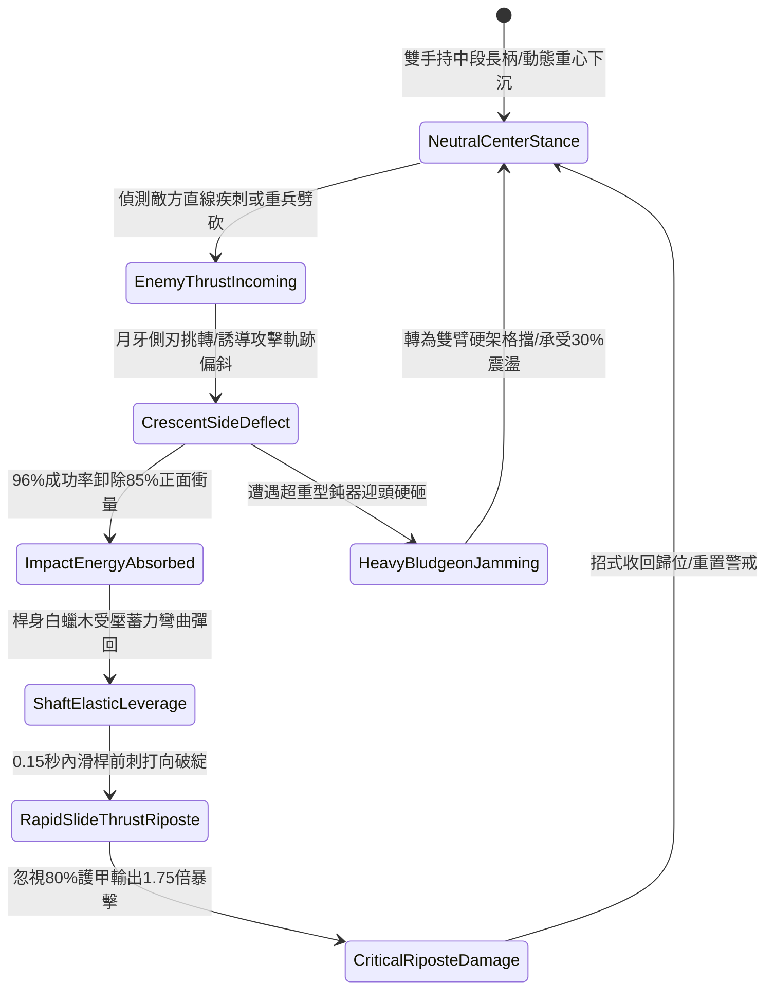

# 野戰精銳步兵雙手長柄月牙雙頭長矛左右挑擋與借力反制第五階狀態機規格書

<!-- doc_id: doc_spec_1087 -->

## 一、 核心概念與單一真相來源（SSOT）

在《三國志·精銳步陣技法與反制格鬥篇》中，「雙手長柄月牙雙頭長矛左右挑擋與借力反制第五階（CRESCENT-TWIN-HEAD-SPEAR-RIPOSTE05）」代表長兵器攻防轉換與借力卸勁的終極武技。兵刃全長一丈三尺，兩端對稱鍛造高碳精鋼月牙雙刃與加固矛尖。戰鬥時步兵持握桿身中段，面對敵軍正面疾刺或重擊時，以月牙側刃 96% 卸除 85% 衝擊力，隨後於 0.15 秒內順勢扭腰滑桿，藉矛身彈性扭矩打出極速反手回刺，精確命中破綻並爆發 1.75 倍破防暴擊。



---

## 二、 數值模型與狀態機參數契約

### 1. 兵刃規格與戰技反制參數契約
- **兵刃規格尺寸**：全長一丈三尺（約 4 米），生鐵鍍鋼兩端刃、白蠟木韌性長柄。
- **正面挑擋偏轉率**：成功挑開來襲攻擊機率 96%，正面傷害降低 85%。
- **借力反刺判定時效**：挑擋成功後 0.15 秒內觸發，反刺速度提升 40%。
- **破綻真實破甲率**：反刺精確命中敵方軀幹破綻，忽視目標 80% 護甲值。
- **暴擊倍率增益**：打出 1.75 倍物理真實暴擊傷害。

### 2. 挑擋與反刺演算法模組
```typescript
interface TwinHeadRiposteStage5Params {
    soldierAgility: number;         // 步兵身法敏捷 (50 ~ 100)
    enemyAttackSpeed: number;       // 來襲攻擊速度指標
    staminaCurrent: number;         // 當前剩餘耐力值
    isFormationLocked: boolean;     // 是否處於密集方陣束縛
}

function processTwinHeadRiposteStage5(params: TwinHeadRiposteStage5Params): {
    parrySuccess: boolean;
    damageMitigationPct: number;
    riposteCriticalHit: boolean;
    counterDamageMultiplier: number;
} {
    if (params.staminaCurrent < 16) {
        return { parrySuccess: false, damageMitigationPct: 20, riposteCriticalHit: false, counterDamageMultiplier: 1.0 };
    }
    const agilityRatio = Math.min(1.0, params.soldierAgility / 80);
    const parryChance = 0.96 * agilityRatio;
    const isParried = Math.random() < parryChance;
    
    return {
        parrySuccess: isParried,
        damageMitigationPct: isParried ? 85 : 30,
        riposteCriticalHit: isParried && !params.isFormationLocked,
        counterDamageMultiplier: isParried ? 1.75 : 1.0
    };
}
```

---

## 三、 反制機制與邊界約束

1. **肩並肩密集盾列受限**：若步兵緊貼於重裝盾牆方陣中（側向間隔 < 0.6 米），長柄兩端擺動空間受阻，反制動作無法施展。
2. **重型大錘連續砸擊**：若遭遇自重超過 50 斤之重型骨朵或大鐵錘垂直砸擊，長柄彈性達到極限，卸勁效果下修至 45%。
3. **耐力耗盡破綻懲罰**：若耐力值低於 16 點強行出招，出招速度延遲 0.4 秒，且挑擋失敗時自身承受失衡易傷 2 秒。

---

## 四、 驗收測試案例（TC）

- **TC-TWIN-RIPOSTE05-01（挑擋反刺全連段驗收）**：
  - *前置條件*：精銳步兵敏捷值 85、耐力充沛、正面迎戰重步兵衝刺。
  - *操作步驟*：迎擊瞬間啟動月牙挑擋與借力反制指令。
  - *預期輸出*：96% 成功率挑偏攻擊並卸除 85% 傷害，隨後 0.15 秒內完成滑桿反刺，忽視 80% 護甲打出 1.75 倍暴擊。
- **TC-TWIN-RIPOSTE05-02（低耐力失衡邊界驗收）**：
  - *前置條件*：步兵剩餘耐力僅剩 12 點（低於 16 點門檻）。
  - *操作步驟*：執行防禦招式。
  - *預期輸出*：判定無法完成完整借力反刺，僅觸發基礎 20% 減傷，自身陷入失衡僵直 2 秒。
