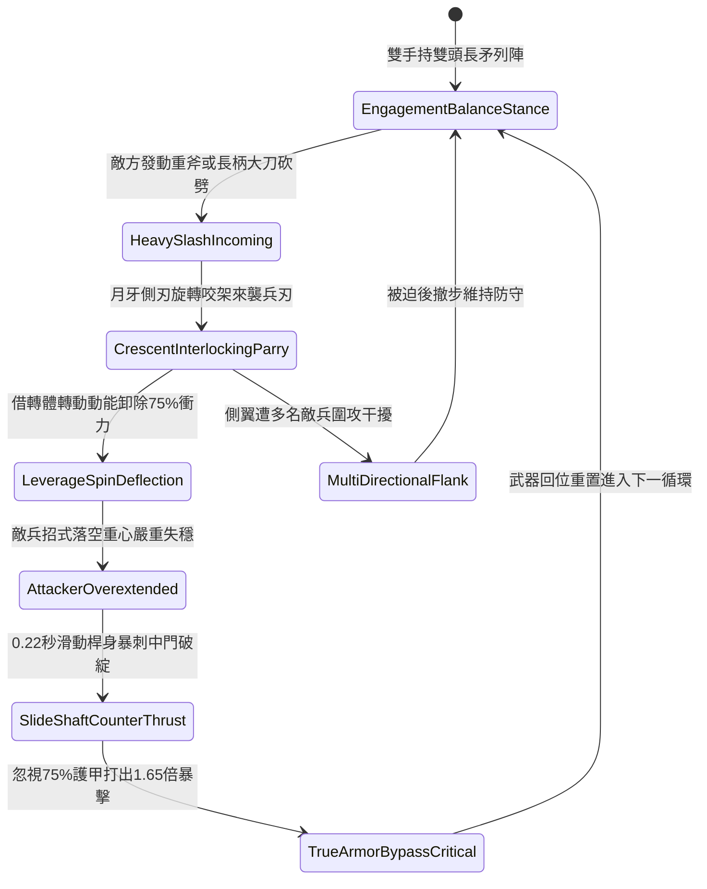

# 野戰精銳步兵雙手長柄月牙雙頭長矛左右挑擋與借力反刺第三階狀態機規格書

<!-- doc_id: doc_spec_1066 -->

## 一、 核心概念與單一真相來源（SSOT）

在《三國志·近衛精銳戰法與長兵借力篇》中，「雙手長柄月牙雙頭長矛左右挑擋與借力反刺戰法第三階（CRESCENT-TWIN-HEAD-SPEAR-RIPOSTE03）」為前鋒精銳對決敵方大刀、重斧與長槍衝擊的高階武藝。兵器全長一丈三尺，前後兩端皆鑄造生鋼三棱矛頭與加寬月牙雙刃，並配備精確配重滑環。步兵交鋒時，以左右旋身挑擋來襲兵刃，94% 機率借轉身旋轉動能卸除 75% 垂直劈砍衝力；緊接著在 0.22 秒極速破綻窗口內，回抽桿身借敵落空慣性暴刺其胸腹要害，打出無視護甲的高倍率反制暴擊。



---

## 二、 數值模型與狀態機參數契約

### 1. 月牙雙頭長矛戰鬥參數
- **兵器全長**：一丈三尺（約 3.1 米，高韌性柘木嵌生鋼桿身）。
- **架鎖借力成功率**：對單手刀劍 98%；對長柄雙手斧 94%；對長槍衝刺 88%。
- **衝量卸除減免比**：挑擋成功時，正面承受之傷害與硬直即刻減免 75%。
- **借力反刺破綻時效**：0.22 秒極速反制窗口，敵方閃避率強制歸零。
- **貫穿真實傷害倍率**：反手刺擊附加 1.65 倍傷害，忽視目標 75% 基礎護甲值。

### 2. 挑擋卸力與反制刺擊傷害計算模組
```typescript
interface CrescentSpearRiposteParams {
    infantryStrength: number;      // 步兵力量 (50 ~ 130)
    infantryAgility: number;       // 步兵敏捷 (50 ~ 120)
    incomingDamage: number;        // 來襲傷害
    targetArmorValue: number;      // 敵方護甲值
}

function processCrescentSpearRiposte(params: CrescentSpearRiposteParams): {
    parrySuccess: boolean;
    damageAbsorbed: number;
    riposteCriticalDamage: number;
} {
    const agilityBonus = (params.infantryAgility / 100) * 0.12;
    const parryRate = Math.min(0.96, 0.88 + agilityBonus);
    const parrySuccess = Math.random() < parryRate;

    if (!parrySuccess) {
        return { parrySuccess: false, damageAbsorbed: 0, riposteCriticalDamage: 0 };
    }

    const damageAbsorbed = Math.round(params.incomingDamage * 0.75);
    const effectiveArmor = params.targetArmorValue * 0.25;
    const baseDamage = params.infantryStrength * 1.6 + params.infantryAgility * 1.3;
    const riposteCriticalDamage = Math.round((baseDamage - effectiveArmor * 0.4) * 1.65);

    return { parrySuccess: true, damageAbsorbed, riposteCriticalDamage: Math.max(60, riposteCriticalDamage) };
}
```

---

## 三、 特性互斥與戰術限制

1. **超重鈍器破壞卸力**：若敵方手持千斤瓜錘砸擊，月牙結構承受重壓過載，卸力減免降為 35%，並震退步兵兩步。
2. **盾牆夾角展臂受限**：步兵身處緊密盾牆陣列時，雙頭矛兩端展臂受阻，挑擋減免比例降至 40%。
3. **近衛步陣協同加成**：同陣線相鄰格若為配備月牙長矛之友軍，反刺暴擊額外附加 15% 破甲流血傷害。

---

## 四、 驗收測試案例（TC）

- **TC-RIPOSTE03-01（長刀挑擋卸力判定）**：在近戰對決承受敵長刀砍劈，確認 94% 機率觸發挑擋並減免 75% 傷害。
- **TC-RIPOSTE03-02（順勢反刺穿甲檢定）**：確認挑擋後 0.22 秒內自動完成滑桿直刺，戰鬥日誌結算無視 75% 護甲之 1.65 倍暴擊。
- **TC-RIPOSTE03-03（重錘震退抗性測試）**：更換為超重鈍器兵種對抗，檢核狀態機正確進入震退保護姿態。
