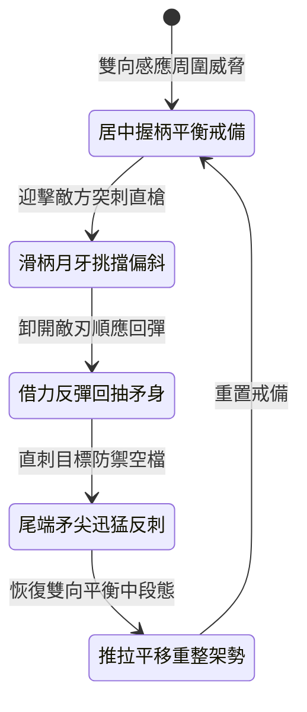

<!-- doc_id: doc_spec_1012 -->
# 野戰精銳步兵雙手長柄月牙雙頭長矛左右挑擋與回抽直刺狀態機規格書

## 模組識別碼
- 模組編號：`FORM-231`
- 狀態機代碼：`CRESCENT-TWIN-HEAD-SPEAR-PARRY01`
- 類別：野戰精銳步兵雙手長柄靈巧攻防狀態機
- 適用場景：平原野戰、隘口混戰、應對多方向長兵圍攻與精準反擊

---

## 1. 核心概念與作戰原型

混戰中，持常規單頭長槍的步兵在刺出後若被敵兵閃過，抽槍間隙極易遭到身側敵軍反刺。為賦予步兵靈活的左右防禦與連續刺殺能力，配發「月牙雙頭長矛」。

### 1.1 武器形制與戰法協同
1. **平衡雙頭與對稱月牙刃**：槍柄長一丈一尺，兩端各配有三面開刃的淬火矛頭，矛頸兩側均裝有一對小巧生鋼月牙護刃，全槍重心精準落在桿身中央。
2. **左右滑柄挑擋卸力**：步兵雙手在槍柄中段滑動，利用月牙刃向左或向右輕快挑開敵方突刺兵刃，藉弧面偏轉敵軍進攻力道。
3. **借反彈力回抽直刺**：挑開敵方長槍的同時，順應回彈慣性迅速向後抽動長矛，以另一端矛尖直刺身側露出的破綻。
4. **前後雙端連續突殺**：步兵無須大幅度轉身，僅憑雙臂推拉即可實現前後左右全方位快速銜接刺擊。

---

## 2. 數值參數與影響權重

| 參數名稱 | 數值 / 範圍 | 說明 |
| :--- | :--- | :--- |
| **左右挑擋成功率 (`ParryDeflectRate`)** | 72% ~ 85% | 順暢偏轉來自正前或兩側的長兵直刺 |
| **反擊直刺觸發時差 (`CounterAttackSpeed`)** | 0.35 秒超快銜接 | 藉助回彈慣性發動近乎零延遲的反刺 |
| **反擊穿透傷害 (`CounterPiercingDamage`)** | 520 ~ 750 點穿刺 | 命中未防備部位忽視 45% 基礎護甲 |
| **挑擋吸收衝擊傷害 (`DamageAbsorption`)** | 吸收 55% 近戰傷害 | 月牙弧刃卸除正面重擊之動能 |
| **動作耐力消耗節奏 (`EnduranceEconomy`)** | 每套攻防消耗 10 點耐力 | 輕量平衡設計大幅降低體能負擔 |

---

## 3. 狀態機轉換定義

### 3.1 狀態細節描述
- **居中握柄平衡戒備 (BALANCED_GUARD)**：雙手握持長桿中央三分之一區域，前後兩端自由活動。
- **滑柄月牙挑擋偏斜 (CRESCENT_PARRY)**：前手迅速滑移，月牙刃磕擊敵兵刃，偏開進攻線。
- **借力反彈回抽矛身 (RECOIL_PULL)**：順勢向後抽拉矛桿，蓄力發動二段打擊。
- **尾端矛尖迅猛反刺 (REVERSE_THRUST)**：利用尾矛暴刺身側或回刺原本目標，一擊必穿。
- **推拉平移重整架勢 (RESET_FLOW)**：雙手恢復平衡位置，靈活轉換防守重心。

---

## 4. 戰鬥公式與判定

### 4.1 挑擋偏轉判定
$$\text{DeflectChance} = \min(0.85, \frac{\text{DEX}_{\text{attacker}}}{\text{DEX}_{\text{target}}} \times \text{ParryDeflectRate})$$

若判定成功，敵方攻擊動作立即落空，且其下一擊冷卻時間延長 1.2 秒。

### 4.2 反刺穿透傷害結算
$$\text{CounterDamage} = \text{CounterPiercingDamage} \times 1.30 \times (1 - \text{ArmorValue} \times 0.55)$$

在挑擋成功後的 0.8 秒黃金時間內命中的直刺，享受 1.3 倍傷害加成。

---

## 5. 反制與失效機制

1. **超重型鈍器正面猛砸**：若遭遇巨錘或重鐧當頭重砸，輕巧月牙刃難以完全卸除超大動能。
2. **多重弓弩遠程齊射**：步兵專注雙手長矛靈巧刺殺時無法配盾，對密集箭雨防護力較弱。
3. **過度狹窄地形施展受限**：若戰鬥通道寬度不足四尺，前後雙頭長矛揮動容易撞牆。

---

## 6. 驗收標準與測試案例

- [x] **TC-231-01**：驗證月牙挑擋在敵方攻擊判定到達 0.2 秒內流暢結算。
- [x] **TC-231-02**：驗證挑擋成功後，反刺動作在 0.35 秒內自動銜接觸發。
- [x] **TC-231-03**：驗證反刺傷害正確享受 1.3 倍增益與忽視 45% 護甲效果。
