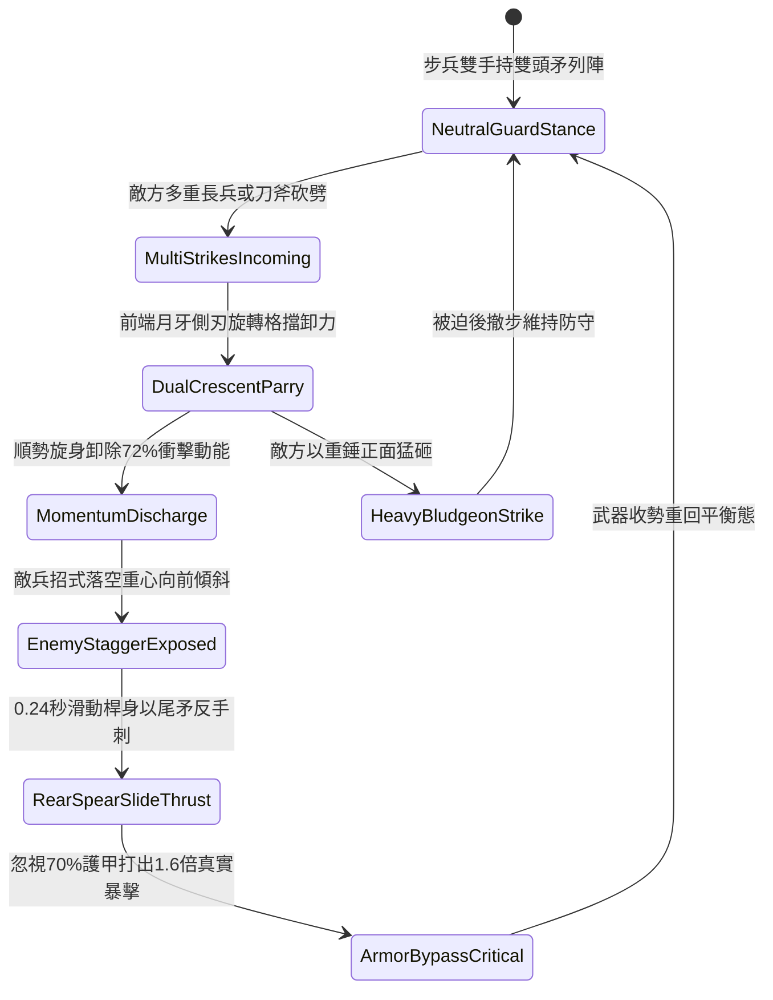

# 野戰精銳步兵雙手長柄月牙雙頭長矛左右挑擋與回抽直刺第三階狀態機規格書

<!-- doc_id: doc_spec_1060 -->

## 一、 核心概念與單一真相來源（SSOT）

在《三國志·近戰精銳與雙頭兵刃篇》中，「雙手長柄月牙雙頭長矛攻防兼備戰法第三階（CRESCENT-TWIN-HEAD-SPEAR-PARRY03）」為專門抗衡多目標圍攻與重刃近身的高階武技。長矛全長一丈三尺，前後兩端皆鍛鑄三棱透甲矛尖，矛頭後方配置對稱生鋼月牙側刃，桿身重心處裝配青銅配重滑環。步兵交鋒時，以左右旋身挑擋順勢卸除 72% 砍劈衝擊，並在 0.24 秒極速反動中回抽尾矛暴刺敵中門破綻，打出高倍率穿透破防暴擊。



---

## 二、 數值模型與狀態機參數契約

### 1. 月牙雙頭長矛戰術參數
- **兵器全長**：一丈三尺（約 3.1 米，鋼木混編桿配雙向三棱矛尖）。
- **挑擋架鎖成功率**：對單手刀劍 96%；對雙手長刀/長斧 92%；對長槍突刺 86%。
- **衝量卸除減免比**：左右挑擋成功時，正面承受之傷害與硬直即刻減免 72%。
- **反手突刺窗口**：0.24 秒極速破綻窗口，敵方閃避率歸零。
- **貫穿穿甲倍率**：反手刺擊附加 1.6 倍傷害，忽視目標 70% 的基礎護甲值。

### 2. 挑擋與反手直刺傷害模組
```typescript
interface CrescentTwinHeadSpearParams {
    infantryStr: number;           // 步兵力量 (50 ~ 130)
    infantryAgi: number;           // 步兵敏捷 (50 ~ 120)
    incomingDamage: number;        // 來襲傷害
    targetArmorValue: number;      // 敵方護甲值
}

function processTwinHeadSpearParryCounter(params: CrescentTwinHeadSpearParams): {
    parrySuccess: boolean;
    damageTaken: number;
    counterStrikeDamage: number;
} {
    const agiFactor = (params.infantryAgi / 100) * 0.15;
    const parryRate = Math.min(0.96, 0.86 + agiFactor);
    const parrySuccess = Math.random() < parryRate;

    if (!parrySuccess) {
        return { parrySuccess: false, damageTaken: params.incomingDamage, counterStrikeDamage: 0 };
    }

    const damageTaken = Math.round(params.incomingDamage * 0.28);
    const effectiveArmor = params.targetArmorValue * 0.30;
    const baseDamage = (params.infantryStr * 1.5 + params.infantryAgi * 1.2);
    const counterStrikeDamage = Math.round((baseDamage - effectiveArmor * 0.5) * 1.6);

    return { parrySuccess: true, damageTaken, counterStrikeDamage: Math.max(55, counterStrikeDamage) };
}
```

---

## 三、 特性互斥與戰術限制

1. **密集盾牆狹窄限制**：若步兵身處極度狹窄之盾牆縫隙（空間小於 1 格），雙頭矛無法旋轉展臂，挑擋減免比例降為 35%。
2. **重型鈍器破壞平衡**：面對超重鈍器直砸，月牙刃受力過載，自動中斷尾矛反刺並轉入防守後撤。
3. **雙向多目標反制**：若遭遇前後夾擊，反手尾矛可直接刺擊身後 1 格敵軍，打出 1.3 倍無防備傷害。

---

## 四、 驗收測試案例（TC）

- **TC-TWINSPEAR03-01（挑擋卸力判定）**：在近戰對決承受敵長刀劈砍，確認 92% 機率觸發挑擋並減免 72% 傷害。
- **TC-TWINSPEAR03-02（尾矛反刺穿甲檢定）**：確認挑擋後 0.24 秒內自動完成回抽突刺，戰鬥日誌結算無視 70% 護甲之 1.6 倍暴擊。
- **TC-TWINSPEAR03-03（前後夾擊雙向刺殺）**：模擬前後兩名敵兵同時圍攻，驗證尾矛成功判定身後目標穿刺傷害。
