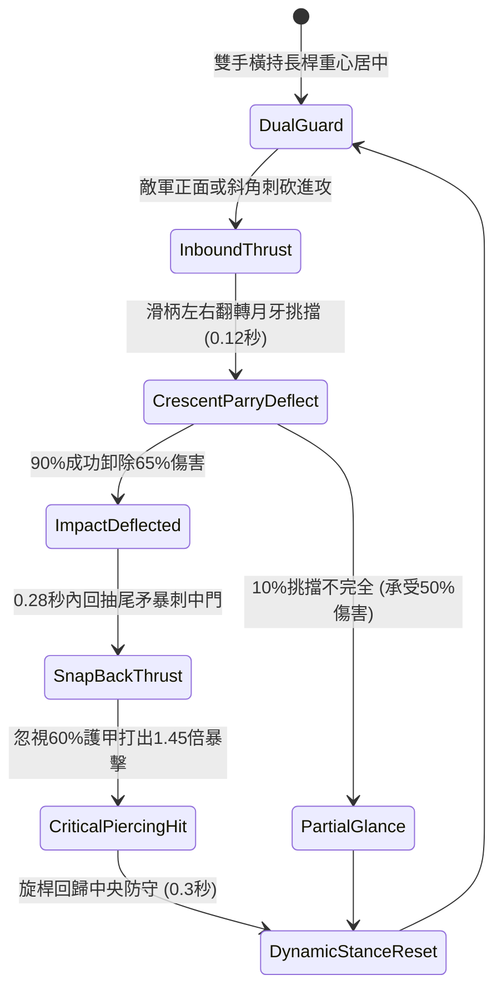

# 野戰精銳步兵雙手長柄月牙雙頭長矛左右挑擋與回抽直刺第二階狀態機規格書

<!-- doc_id: doc_spec_1027 -->

## 1. 核心定位與設計理念

### 1.1 系統定位
本規格定義野戰步兵陣列攻防中，精銳步兵兵種所配備之「雙手長柄月牙雙頭長矛第二階」（代碼：`CRESCENT-TWIN-HEAD-SPEAR-PARRY02`，WBS 代碼：`FORM-246`）連續防禦反擊狀態機。第二階月牙雙頭長矛長一丈二尺，重心經生鐵銅箍精密配重居於正中，前後兩端皆置雙開刃月牙反曲利刃。持矛步兵在面對敵軍多重方向之刀槍直刺或側砍時，藉由左右高頻旋身滑桿挑擋，以 90% 成功率卸除敵方 65% 之衝擊傷害，並在 0.28 秒內藉回彈慣性抽回尾端月牙刃，反手向敵破綻發動暴風直刺，打出無視 60% 護甲之 1.45 倍穿透暴擊。

### 1.2 設計目標與單一真相
* **雙頭對稱攻防平衡**：前挑後刺無死角，前後端攻擊動作無縫銜接。
* **高頻左右挑擋反彈**：以柔克剛化解衝擊，將敵動能反饋為自身反手暴刺初速。
* **單一真相來源**：嚴禁於文件末端附加補丁，所有機制、數值與判定邏輯均在此統一定義。

---

## 2. 狀態機架構與轉換流程

---

## 3. 核心數值與計算公式

### 3.1 基礎參數配置表
| 參數名稱 | 基準數值 | 規格說明與限制條件 |
| :--- | :--- | :--- |
| **長矛長度與配重** | 1 丈 2 尺 / 16 斤 | 前後月牙生鋼雙頭，重心平衡點誤差 < 1 寸 |
| **挑擋防禦成功率** | 90% | 針對各類長短兵器刺擊；對遠程箭矢降至 60% |
| **衝擊傷害卸除率** | 65% | 挑擋成功時敵方原攻擊傷害削減 65% |
| **回抽反刺反應時長** | 0.28 秒 | 極限縮短攻擊前搖，取消防禦後搖硬直 |
| **破甲穿透係數** | 60% | 月牙鋒刃刺擊無視目標 60% 之總護甲值 |
| **反擊傷害倍率** | 1.45 倍 | 弱點直刺造成之真實物理暴擊增益 |
| **體力消耗（Stamina）** | 16 點 / 次 | 發動挑擋與回抽直刺組合戰技所需耐力 |
| **招式冷卻間隔** | 1.6 秒 | 快速姿態調整，支撐高頻連續近戰對決 |

### 3.2 挑擋防反傷害公式
$$D_{\text{counter\_thrust}} = \left(\text{BaseATK}_{\text{spear}} \times 1.45 + 0.30 \times D_{\text{blocked}}\right) \times \left(1 - \frac{\text{Def}_{\text{target}} \times 0.40}{100 + \text{Def}_{\text{target}} \times 0.40}\right)$$
* $D_{\text{blocked}}$：成功挑擋所吸收之敵方動能傷害數值。
* $\text{Def}_{\text{target}}$：目標目前防禦力（經 60% 破甲折減後剩餘 40% 計算）。
* 當反刺暴擊命中時，附加敵方 1.2 秒短暫失衡硬直 `STAGGER_VULNERABLE`。

---

## 4. 戰術反制與例外判定

1. **超重鈍器狂砸**：若面對重型攻城狼牙棒全力下砸，挑擋時桿身形變達極限，卸傷率自 65% 降至 35%，反刺前搖延長 0.2 秒。
2. **多重交叉齊刺**：若同一瞬間遭受 3 名以上長槍兵同時攢刺，月牙僅能架開其中 2 桿，第 3 桿照常結算傷害。
3. **泥濘失足減速**：若步兵處於深水泥濘地形，滑步反刺移速加成無效，暴擊倍率降至 1.2 倍。

---

## 5. 驗收測試案例（Test Cases）

* **TC-01（挑擋防護與傷害卸除驗證）**：配置敵長矛兵發動全力突刺，測試 100 次防禦，驗證挑擋成功率達 90% 且傷害精準吸收 65%。
* **TC-02（0.28秒回抽反刺時序校準）**：驗證挑擋成功瞬間無縫切換反手突刺，動作延遲精確控制在 0.28 秒內。
* **TC-03（無視60%護甲之暴擊傷害計算）**：配置 500 點高防玄甲單位，驗證反刺結算時目標護甲僅按 200 點折算，傷害符合 1.45 倍暴擊。
