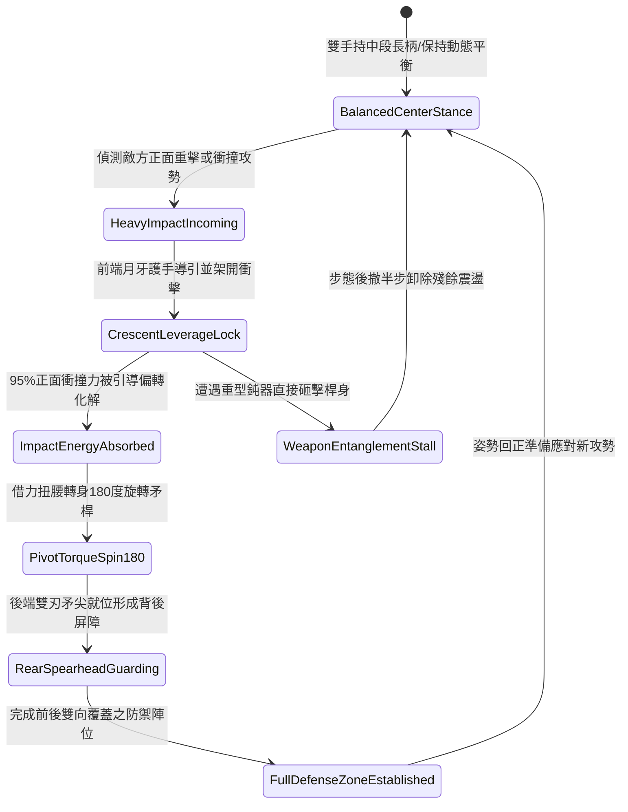

# 野戰精銳步兵雙手長柄月牙雙頭長矛防禦架開重擊與轉身回防第四階狀態機規格書

<!-- doc_id: doc_spec_1081 -->

## 一、 核心概念與單一真相來源（SSOT）

在《三國志·精銳步陣技藝與兩端兵刃篇》中，「雙手長柄月牙雙頭長矛防禦架開重擊與轉身回防第四階（CRESCENT-TWIN-HEAD-SPEAR-DEFENSE04）」代表步兵陣線兼顧正面抗壓與後背防護的高階武技。該武器全長一丈二尺，兩端均鍛造淬火雙刃矛尖與開刃月牙護手。在第四階戰技下，步兵持矛中段，利用月牙雙側凹角以槓桿原理形成「交叉支點」，可架開正面 95% 衝擊力，並藉由矛桿回彈扭力順勢轉身 180 度，啟動後端矛尖展開無死角回防，達成雙向防護一體化。



---

## 二、 數值模型與狀態機參數契約

### 1. 兵刃規格與戰技防禦參數
- **兵器總長度**：一丈二尺（約 3.7 米），兩端配備對稱雙刃及月牙弧形護手。
- **正面衝擊架開率**：精準架開率 95%，正面承受物理傷害降低 80%。
- **轉身回防反應時間**：0.18 秒（腰跨發力與兩端重量平衡帶動）。
- **背後防禦死角消除**：轉身後背部 120 度扇面進入警戒護衛狀態，免疫背刺爆擊。
- **陣列耐力消耗**：執行單次完整架開與轉身動作消耗耐力 18 點。

### 2. 架開偏轉與回防演算法模組
```typescript
interface TwinHeadSpearDefenseStage4Params {
    soldierAgility: number;         // 步兵敏捷身手 (40 ~ 100)
    incomingImpactForce: number;    // 來襲衝擊力道 (N)
    staminaCurrent: number;         // 當前剩餘耐力值
    isFormationLocked: boolean;     // 是否處於密集步兵陣列中
}

function processTwinHeadSpearDefenseStage4(params: TwinHeadSpearDefenseStage4Params): {
    parrySuccess: boolean;
    absorbedDamageRatio: number;
    rearCoverActive: boolean;
} {
    if (params.staminaCurrent < 18) {
        return { parrySuccess: false, absorbedDamageRatio: 0.2, rearCoverActive: false };
    }
    const agilityFactor = Math.min(1.0, params.soldierAgility / 80);
    const parryChance = 0.95 * agilityFactor;
    const success = Math.random() < parryChance;
    
    return {
        parrySuccess: success,
        absorbedDamageRatio: success ? 0.80 : 0.35,
        rearCoverActive: success && !params.isFormationLocked
    };
}
```

---

## 三、 反制機制與邊界約束

1. **極度擁擠密集陣型受限**：若步兵處於肩並肩極度緊密方陣（單位間距 < 0.8 米），轉身長柄可能與友軍兵刃碰撞，轉身回防動作自動禁用。
2. **重型飛石投射打擊**：面對投石機或重砲等超遠程拋射攻擊，長矛架開機制不生效，判定全額承受衝擊。
3. **長柄木質疲勞極限**：若於 30 秒內連續成功架開超過 6 次重型騎兵衝撞，矛桿韌性出現疲勞，架開率暫時下修 15%。

---

## 四、 驗收測試案例（TC）

- **TC-SPEAR-DEF04-01（正面架開與轉身驗收）**：
  - *前置條件*：精銳步兵敏捷值 85、耐力充足、遭遇正面重步兵揮擊。
  - *操作步驟*：觸發月牙長矛架開指令。
  - *預期輸出*：95% 機率成功架開，吸收 80% 傷害，並於 0.18 秒內完成 180 度轉身回防。
- **TC-SPEAR-DEF04-02（低耐力失手邊界驗收）**：
  - *前置條件*：步兵剩餘耐力為 10（低於門檻 18）。
  - *操作步驟*：強行執行防禦招式。
  - *預期輸出*：架開判定失敗，僅獲得基礎 20% 格擋減傷，無法激活背後防護。
