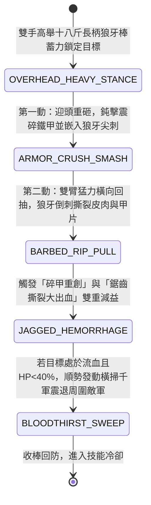

<!-- doc_id: doc_spec_0949 -->
# 野戰精銳步兵雙手長柄狼牙棒重擊碎甲與倒刺撕裂流血狀態機規格書

> **文件編號**：`doc_spec_0949`
> **模組代碼**：`SPIKED-MACE-ARMOR-SHATTER-BLEED01`
> **對應 WBS**：`FORM-168`（M7 戰場進階機關、城防網罩與精銳步兵重鈍器破甲）
> **單一真相來源（SSOT）**：本文件直接定義雙手長柄狼牙棒重擊碎甲與倒刺撕裂流血之完整戰鬥狀態機，嚴禁於檔尾附加補丁。

---

## 一、 戰術定位與歷史兵器原型

面對身披雙層鐵札甲或魚鱗重鎧的敵軍重裝步騎，單純的刀劍劈砍難以破防，而純圓頭鈍器（如鐵骨朵）雖能震傷內腑卻缺乏持續放血能力。**雙手長柄狼牙棒（Two-Handed Long-Handled Spiked Wolf-Teeth Mace）** 完美結合了「重鈍器碎甲震盪」與「尖刺貫穿放血」雙重殺傷機制：
1. **重棗木鑲生鐵狼牙錘頭**：柄長六尺五寸，前端錘頭長二尺，以堅韌重棗木外包熟鐵皮，周身密植四十枚一寸半長的三棱淬火生鐵狼牙尖刺，全重達十八斤。
2. **鈍擊碎甲與尖刺穿透合一**：雙手高舉揮砸時，十八斤的沉重慣性會先將敵軍鐵甲甲片砸得凹陷崩裂（鈍擊破甲）；緊接著四十枚三棱狼牙尖刺順勢刺穿凹陷的甲葉扎入皮肉（穿刺真傷）。
3. **回抽撕裂放血**：砸中敵軀後，步兵雙臂猛力橫向回抽狼牙棒，帶倒鉤的狼牙刺會連同碎裂的甲片與皮肉一併扯下，造成極難包紮的「鋸齒撕裂大出血」。

---

## 二、 觸發條件與兵種武備參數

| 參數項目 | 規格數值與限制條件 | 備註說明 |
| :--- | :--- | :--- |
| **適用兵種 / 武將** | 重裝破甲步兵（狼牙重步）、蠻族精銳力士、武力 $\ge 86$ 之猛將 | 需雙手持握，不可配盾，自身遠程抗性 `-15%` |
| **攻擊距離與範圍** | 近戰 `1 格`（大振橫掃時可波及目標左右相鄰 `1 格`） | 兵器極重，揮擊消耗戰技點（EP）15 |
| **武器重量與特性** | 重達 `18 斤`（雙手重鈍穿刺複合兵器）；基礎破甲率 `45%` | 同時具備 `BLUNT`（鈍擊）與 `PIERCE`（穿刺）雙標籤 |
| **冷卻時間（CD）** | 「碎甲撕裂三連」主動技冷卻 `2 回合` | 普通攻擊常駐附帶「狼牙出血」1 層 |

---

## 三、 核心狀態機（State Machine）

---

## 四、 數值結算與戰鬥公式

### 1. 第一動：迎頭重砸碎甲（Armor-Crush Smash）
雙手猛砸敵方目標，結合鈍擊與穿刺雙重判定：
$$\text{Damage}_{\text{smash}} = \text{ATK} \times 1.85 \times \left(1 - \text{TargetDEF} \times (1 - 0.45)\right)$$
- **重甲額外碎裂加成**：若目標為「重甲單位（基礎 DEF 排名前 25%）」，重砸衝擊波與鐵甲產生剛性碰撞，額外造成目標 `DEF × 0.8` 的真實震盪傷害，並使目標防禦力（DEF）永久下降 `30%`（最多疊加 2 次）。

### 2. 第二動：回抽倒刺撕裂（Barbed Rip & Jagged Hemorrhage）
重砸命中後立即接續橫向回抽，100% 觸發撕裂傷害：
- **撕裂傷害**：造成 `75% ATK` 的無視防禦物理傷害。
- **鋸齒撕裂大出血（Jagged Hemorrhage）**：由於狼牙刺呈三棱倒鉤狀，造成的傷口無法自然止血，附加 `3 層` 狼牙流血（每層每回合流失最大兵力 `3.5%`，共 `10.5%`，持續 2 回合），且傷口受鐵鏽污染，受到的治療與兵力恢復效果降低 `65%`。

### 3. 嗜血橫掃連鎖（Bloodthirst Sweep）
若目標在承受上述兩動後仍存活，但同時處於「防禦破損」與「狼牙流血」狀態，狼牙棒步兵士氣大振，立即對目標及左右相鄰格（共 3 格）追加一次 `110% ATK` 的橫掃痛擊，並有 `50%` 機率將副目標擊退 1 格。

---

## 五、 反制手段與戰術克制

1. **高閃避輕步兵與長槍先制**：狼牙棒揮動前搖較大（重心在前端），面對高閃避的輕裝劍士命中率下降 `20%`；且若正面衝擊未被破壞的長槍方陣，會在揮棒前先承受長槍先制穿刺。
2. **弓弩遠程風箏**：因雙手持棒無法持盾，在開闊地遭弓弩手集火時損耗較快，需搭配前排盾車或毒煙車掩護推進。

---

## 六、 驗收測試案例（Acceptance Tests）

| 測試案例 ID | 測試情境與輸入條件 | 預期狀態轉移與數值輸出 |
| :--- | :--- | :--- |
| **TC-MACE-01** | 狼牙棒步兵對敵方「重甲陷陣營」發動迎頭重砸 | 無視 45% 防禦造成 185% 傷害，額外觸發 `0.8 × DEF` 真傷，且目標永久降防 30% |
| **TC-MACE-02** | 重砸命中後自動接續 `BARBED_RIP_PULL` 回抽撕裂 | 追加 75% 無視防禦傷害，附加 3 層狼牙流血（每回合損兵 10.5%）與減療 65% |
| **TC-MACE-03** | 目標承受前兩動後未死且帶有破甲+流血，左右各有 1 隊敵軍 | 自動觸發 `BLOODTHIRST_SWEEP`，對 3 格敵軍追加 110% 橫掃傷害並判定 50% 擊退 |
