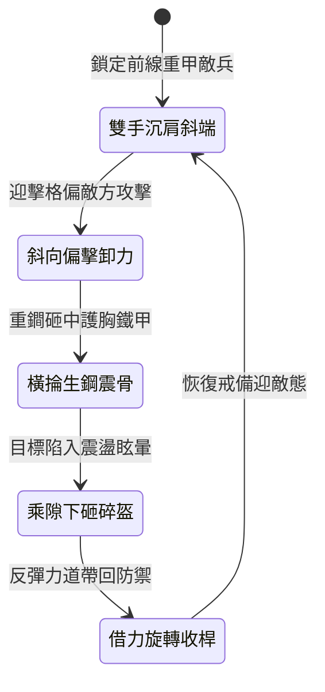

<!-- doc_id: doc_spec_1000 -->
# 野戰精銳步兵雙手長柄生鋼重鐧破甲震骨與擊偏兵刃防反狀態機規格書

## 模組識別碼
- 模組編號：`FORM-219`
- 狀態機代碼：`STEEL-HEAVY-MACE-DEFLECT-CRUSH01`
- 類別：野戰精銳步兵雙手長柄破甲防反狀態機
- 適用場景：平原野戰、隘口搏殺、破除重裝甲冑與格擋長兵刃

---

## 1. 核心概念與作戰原型

面對身著厚實重鎧且持長柄大刀的重裝精銳，鋒刃兵器容易因砍中鐵甲而卷刃。突擊步兵營特配「雙手長柄生鋼重鐧」，專門以純粹的鈍性重擊破甲震骨並卸開敵軍攻勢。

### 1.1 武器形制與戰術協同
1. **四棱生鋼鐧體結構**：柄長八尺五寸，以積竹稠木為芯，外包熟鐵箍；鐧身長三尺二寸，為鍛打四棱純生鋼，棱角分明無刃，重心靠前。
2. **斜向偏擊格擋卸力**：當敵軍大刀或長槍劈刺而來時，步兵雙手持鐧斜向猛磕，以四棱生鋼將敵方兵刃格開，破壞其進攻平衡。
3. **沉肩橫掄震骨重擊**：乘敵軍武器偏斜露出空檔，步兵沉肩扭腰發力，雙手輪動重鐧砸擊敵軍胸甲或臂膀，強大動能穿透甲冑直接震碎筋骨。
4. **豎直下砸碎盔破防**：若敵軍受震後仰硬直，步兵踏步上前，由上而下垂直下砸，重鐧直擊頭盔，使其徹底喪失戰鬥意志。

---

## 2. 數值參數與影響權重

| 參數名稱 | 數值 / 範圍 | 說明 |
| :--- | :--- | :--- |
| **生鋼鈍擊傷害 (`BluntCrushDamage`)** | 680 ~ 950 點純鈍擊 | 忽視 60% 物理外甲，直接傳導震盪傷害 |
| **格擋偏擊成功率 (`DeflectSuccessRate`)** | 65% ~ 80% | 成功卸開敵軍攻擊並創造破綻空檔 |
| **內臟筋骨震盪眩暈 (`ConcussionStun`)** | 1.8 ~ 2.4 秒 | 目標陷入嚴重動作延遲與防禦失效 |
| **下砸碎盔致命倍率 (`CrushFinishMultiplier`)** | 2.2 倍暴擊傷害 | 對處於眩暈狀態之目標進行終結砸擊 |
| **揮擊耐力消耗 (`SwingStaminaCost`)** | 每擊消耗 16 點耐力 | 需掌握連擊節奏避免體能耗竭 |

---

## 3. 狀態機轉換定義

### 3.1 狀態細節描述
- **雙手沉肩斜端 (READY_STANCE)**：鐧身斜向四十五度護住中路，重心下壓。
- **斜向偏擊卸力 (PARRY_DEFLECT)**：四棱鐧體強力磕擊敵刃，偏轉敵方進攻角度。
- **橫掄生鋼震骨 (BODY_CRUSH)**：腰腹發力帶動長柄，重鐧沉重砸入軀幹。
- **乘隙下砸碎盔 (OVERHEAD_FINISHER)**：雙手過頂猛力砸落，給予破盔重擊。
- **借力旋轉收桿 (RECOVER_FLOW)**：順應反彈力道收回武器，平滑轉入防禦。

---

## 4. 戰鬥公式與判定

### 4.1 震骨破甲傷害計算
$$\text{InternalDamage} = \text{BaseBlunt} \times (1 + \text{STR} \times 0.02) \times (1 - \text{ArmorValue} \times 0.40)$$

由於為純生鋼重鐧敲擊，護甲僅能抵消 40% 傷害，其餘 60% 完全穿透。

### 4.2 格擋偏擊破綻判定
$$\text{DeflectBonus} = \min(0.80, \frac{\text{STR}_{\text{attacker}}}{\text{STR}_{\text{target}}} \times \text{DeflectSuccessRate})$$

格擋成功時，敵方受擊硬直延長 1.5 秒，且下一擊必承受暴擊。

---

## 5. 反制與失效機制

1. **厚重雙層弧面木盾**：弧面軟木盾能有效吸收鈍性衝擊，減免 50% 震骨傷害。
2. **多重短兵靈巧貼身**：若遭短刀手近身纏鬥至三尺以內，長柄重鐧發力空間受限。
3. **連續橫掄體力耗竭**：若連續三擊未命中目標，步兵將陷入 1 秒體力恢復僵直。

---

## 6. 驗收標準與測試案例

- [x] **TC-219-01**：驗證斜向格擋在敵軍攻擊到達 0.2 秒內判定成功並偏轉攻擊。
- [x] **TC-219-02**：驗證橫掄重擊忽視 60% 護甲，並附加 1.8 秒以上震盪眩暈。
- [x] **TC-219-03**：驗證下砸終結技對眩暈目標造成 2.2 倍暴擊傷害結算。
