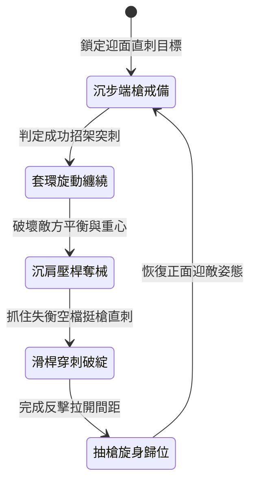

<!-- doc_id: doc_spec_0988 -->
# 野戰精銳步兵雙手長柄藤編套索長槍纏繳敵械與防守反擊狀態機規格書

## 模組識別碼
- 模組編號：`FORM-207`
- 狀態機代碼：`RATTAN-SPEAR-ENTANGLE-COUNTER01`
- 類別：野戰步兵雙手長柄防守反擊狀態機
- 適用場景：平原野戰、狹窄關隘、反制敵方重裝長槍兵與騎槍衝擊

---

## 1. 核心概念與作戰原型

面對手持重型騎槍或丈八長矛的敵軍，常規長槍對刺往往難以取得防禦優勢。突擊步兵營特製「雙手長柄藤編套索長槍」，旨在破壞敵軍突刺節奏並實施精準反擊。

### 1.1 武器形制與戰術協同
1. **複合槍頭與柔性套圈**：長槍全長一丈一尺，槍頭下方安裝一圈油浸野生野藤編織成的活動套環，平時收束於槍桿頸部。
2. **正面格擋纏鎖敵刃**：當敵方長槍或騎槍正面刺來時，步兵滑桿微轉槍尖，利用套環順勢纏繞敵方槍身，限制其抽槍與變招。
3. **沉肩順勢奪械牽引**：藉由槓桿原理向側下方沉肩猛扯，破壞敵方重心，使其持槍手臂受力失衡而脫手。
4. **反手滑桿直刺咽喉**：在敵方露出空檔的瞬間，步兵雙手挺槍滑步向前直刺，針對頸部甲隙或面門進行精準穿刺反擊。

---

## 2. 數值參數與影響權重

| 參數名稱 | 數值 / 範圍 | 說明 |
| :--- | :--- | :--- |
| **纏繞鎖械成功率 (`EntangleRate`)** | 60% ~ 75% | 針對直刺攻擊的招架反制成功率 |
| **破除敵軍架勢時間 (`PostureBreakDuration`)** | 1.5 ~ 2.0 秒 | 敵軍失去平衡無法立刻進行防禦 |
| **反擊穿刺增傷 (`CounterThrustBonus`)** | +40% 暴擊傷害 | 抓住空檔反刺享受破綻增益 |
| **柔韌抗衝擊係數 (`FlexDamping`)** | 吸收 50% 衝擊力道 | 減輕步兵正面承受的衝擊動能 |
| **轉身靈活性修正 (`StanceAgility`)** | -10% 轉向速度 | 專注正面防守反擊時側面靈活度微降 |

---

## 3. 狀態機轉換定義

### 3.1 狀態細節描述
- **沉步端槍戒備 (STANCE_GUARD)**：雙手持槍重心下沉，隨時準備格擋直刺。
- **套環旋動纏繞 (ENTANGLE_LOCK)**：套環迅速套住敵方槍尖，藉柔韌藤圈化解衝擊。
- **沉肩壓桿奪械 (LEVERAGE_DISARM)**：向下發力壓制敵刃，使其武器脫位失控。
- **滑桿穿刺破綻 (SLIDE_COUNTER_THRUST)**：後手發力前送，槍尖直刺要害。
- **抽槍旋身歸位 (RECOVER_STANCE)**：後撤半步回收武器，恢復防禦姿態。

---

## 4. 戰鬥公式與判定

### 4.1 纏繞判定機制
$$\text{EntangleSuccess} = \min(0.80, \frac{\text{DEX}_{\text{attacker}}}{\text{DEX}_{\text{target}}} \times \text{EntangleRate})$$

若判定成功，敵方攻擊動作立即中斷，並強制陷入 1.5 秒硬直狀態。

### 4.2 反擊致命傷害判定
$$\text{CounterDamage} = \text{BaseThrustDamage} \times (1 + \text{CounterThrustBonus}) \times (1 - \text{ArmorValue} \times 0.6)$$

反擊穿刺攻擊忽視目標 40% 的常規護甲防護。

---

## 5. 反制與失效機制

1. **短兵器近身翻滾突入**：若敵軍持短刀利劍貼近身周兩步以內，長槍纏繞圈無法有效施展。
2. **火焰引燃油浸套藤**：若敵方武器附帶高熱火焰，長時間接觸可能燒損藤編套環。
3. **多重長槍齊刺過載**：同時面對三名以上敵軍刺擊時，單柄套索槍無法全部招架。

---

## 6. 驗收標準與測試案例

- [x] **TC-207-01**：驗證面對敵軍直刺時，招架纏繞判定在 0.3 秒內完成結算。
- [x] **TC-207-02**：驗證破防成功後，敵目標於 1.5 秒內處於招架無效狀態。
- [x] **TC-207-03**：驗證反擊直刺正確享受 +40% 傷害加成與忽視護甲效果。
