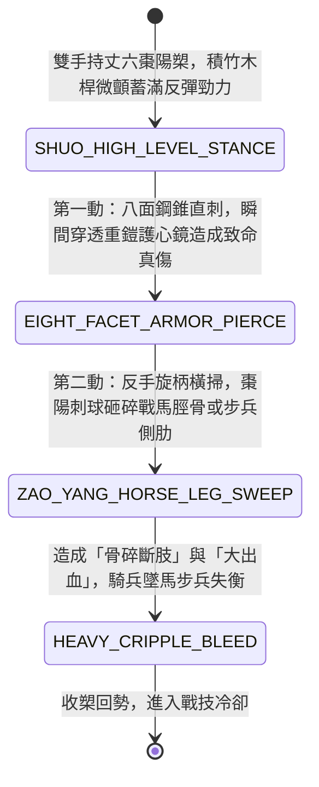

<!-- doc_id: doc_spec_0970 -->
# 野戰精銳步兵雙手長柄金頂棗陽槊重刺破重鎧與橫掃折馬脛狀態機規格書

> **文件編號**：`doc_spec_0970`
> **模組代碼**：`GOLDEN-TOP-SHUO-HEAVY-ARMOR-PIERCE01`
> **對應 WBS**：`FORM-189`（M7 戰場進階機關、城防斷軸陷阱與精銳步兵棗陽槊）
> **單一真相來源（SSOT）**：本文件直接定義雙手長柄金頂棗陽槊重刺破重鎧與橫掃折馬脛之完整戰鬥狀態機，嚴禁於檔尾附加補丁。

---

## 一、 戰術定位與歷史工程原型

在漢末三國與魏晉南北朝戰場上，「槊（馬槊與步槊）」為門閥世家武將與頂級驍騎的標誌性終極重兵（《三國志》載公孫瓚、程普等善持長槊），造價高昂、製作需歷時數年。**雙手長柄金頂棗陽槊（Golden-Top Zao-Yang Shuo / Heavy Armor-Piercing Lance）** 融合了「八面破甲槊頭」與「帶刺棗陽重球」：
1. **丈六積竹木複合桿**：槊桿長一丈六尺，以堅韌拓木為芯，外纏細篾與油絲魚膠，層層髹漆，剛柔並濟，受衝擊不折且蓄滿彈性。
2. **八面精鋼破甲錐與生鐵棗核輪**：槊尖為長二尺的八面精鋼破甲錐（八面起脊，極度鋒銳）；錐下鑄有一顆形似熟棗、密布尖刺的生鐵「棗陽球」，兼具突刺破甲與鈍擊砸碎馬骨雙重機能。
3. **衝陣破玄甲與反手斷馬脛**：刺擊時，八面槊尖如熱刀切牛油般輕易刺穿敵軍雙層鐵札玄甲；反手一擺橫掃，沉重的棗陽刺球直接砸向戰馬脛骨，將戰馬掃斷前肢，使敵將摔落受俘。

---

## 二、 觸發條件與兵種武備參數

| 參數項目 | 規格數值與限制條件 | 備註說明 |
| :--- | :--- | :--- |
| **適用兵種 / 武將** | 幽州突騎、門閥宿衛槊士、武力 $\ge 91$ 之頂級名將（如程普、公孫瓚） | 雙手長兵，兼具 `1 ~ 2 格` 穿刺與橫掃能力 |
| **攻擊距離與範圍** | 近戰 `1 ~ 2 格`（可隔排突刺，橫掃時波及正面扇形 `2 格`） | 施展「棗陽裂甲破馬」消耗戰技點（EP）20 |
| **極限破甲與碎骨** | 基礎無視目標 `65%` 物理防禦力；對騎兵追加 `50%` 斷脛判定 | 具備 `EXTREME_PIERCE` 與 `BONE_CRUSHER` 雙標籤 |
| **冷卻時間（CD）** | 主動戰技冷卻 `2 回合` | 被動：正面承受騎兵衝鋒時，自帶「架槊迎刺」先制判定 |

---

## 三、 核心狀態機（State Machine）

---

## 四、 數值結算與戰鬥公式

### 1. 八面破甲錐直刺（Eight-Facet Armor-Piercing Thrust）
對距離 `1 ~ 2 格` 單一目標發動極限穿刺：
$$\text{Damage}_{\text{thrust}} = \text{ATK} \times 2.20 \times \left(1 - \text{TargetDEF} \times (1 - 0.65)\right)$$
- **玄甲崩解（Armor Collapse）**：破甲錐八面鋒刃在穿透鐵甲時撕裂甲片編繩，目標物理防禦力永久下降 `35%`（最多疊加 2 次）。

### 2. 棗陽刺球橫掃斷馬脛（Zao-Yang Horse-Leg Sweep）
直刺命中後立即連動反手橫掃：
- **騎兵斷脛摔地**：若目標為騎兵，棗陽刺球造成額外 `120% ATK` 鈍擊傷害，並有 `80%` 機率直接折斷戰馬前腿，強制觸發 `HORSE_LEG_SNAPPED`（騎兵部隊移動力降至 1 格，且騎兵武將摔落受傷，武力暫時下降 `15` 點）。
- **步兵肋骨粉碎**：若目標為步兵，棗陽刺球砸碎側肋，附加每回合流失 `9%` 兵力的大出血。

---

## 五、 反制手段與戰術克制

1. **貼身近戰短兵纏鬥**：棗陽槊長達丈六，一旦被手持短鐵戟（`doc_spec_0961`）或環首刀的死士貼身欺入半步以內，長桿施展受限，攻擊力下降 `30%`。
2. **鉤鐮槍回拉斷桿**：若敵方鉤鐮槍兵（`doc_spec_0892`）合力鉤扯槊桿，易打亂槊手蓄力節奏。

---

## 六、 驗收測試案例（Acceptance Tests）

| 測試案例 ID | 測試情境與輸入條件 | 預期狀態轉移與數值輸出 |
| :--- | :--- | :--- |
| **TC-SHUO-01** | 棗陽槊手攻擊正前方 2 格處身披重甲的敵方將領 | 八面錐穿透，無視 65% 防禦造成 220% 傷害，目標永久降防 35% |
| **TC-SHUO-02** | 對衝鋒而來的具裝重騎兵發動連動橫掃 | 棗陽球命中戰馬，80% 機率折斷馬腿，騎兵移動力降為 1 格且敵將武力 -15 |
| **TC-SHUO-03** | 敵方雙鐵戟兵貼身至半步發動纏鬥 | 因貼身距離過近，棗陽槊無法發揮長桿優勢，攻擊力結算減免 30% |
