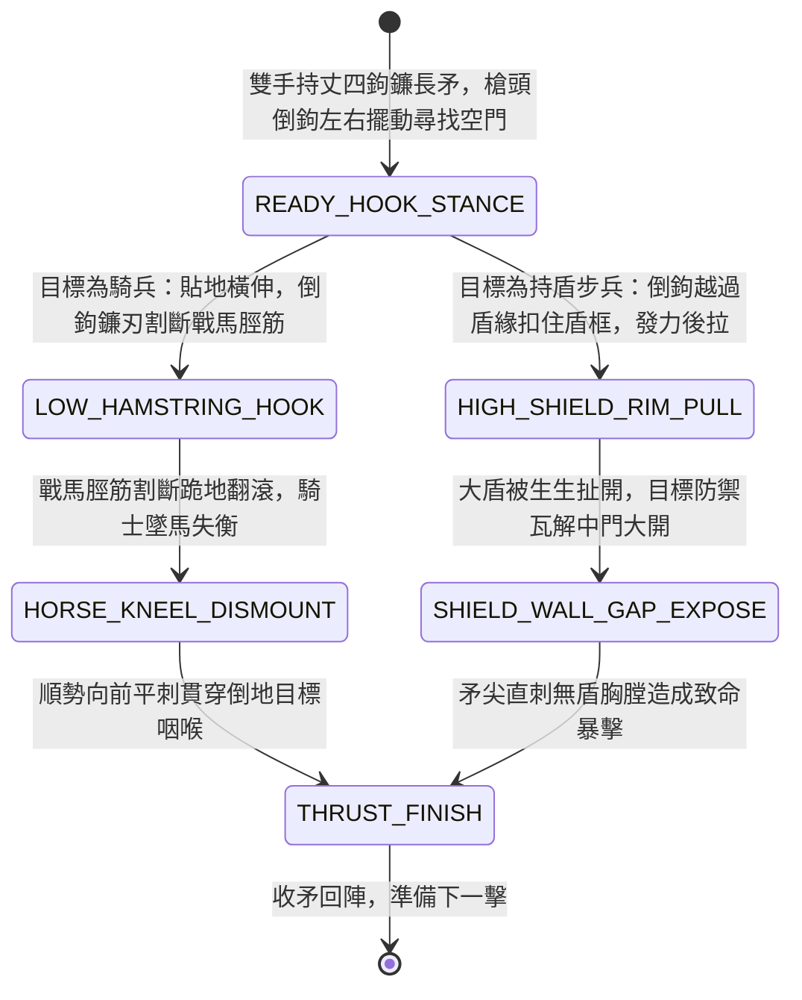

<!-- doc_id: doc_spec_0976 -->
# 野戰精銳步兵雙手長柄鉤鐮長矛下割馬足與回拉破盾狀態機規格書

> **文件編號**：`doc_spec_0976`
> **模組代碼**：`HOOK-SICKLE-PIKE-HAMSTRING-SHIELD-PULL01`
> **對應 WBS**：`FORM-195`（M7 戰場進階機關、城防排爪翻板與精銳步兵鉤鐮長矛）
> **單一真相來源（SSOT）**：本文件直接定義鉤鐮長矛下割馬足與回拉破盾之完整戰鬥狀態機，嚴禁於檔尾附加補丁。

---

## 一、 戰術定位與歷史工程原型

在步騎混戰與陣地攻防中，普通直矛只能正面直線刺擊，一旦遭遇持大盾龜縮或高速掠過的騎兵，極易刺空或被盾牌滑開。《通典》與宋代兵書記載「鉤鐮槍 / 鉤鐮矛」為大破金國鐵浮屠與西涼鐵騎之神兵。**雙手長柄鉤鐮長矛（Hook-Sickle Pike / Gou-Lian-Mao）** 將「兩丈長矛直刺」與「側向回彎倒鉤鐮」合為一體：
1. **丈四白蠟矛桿與倒鉤生鋼矛頭**：矛長一丈四尺，前端為長一尺五寸的精鋼雙刃矛尖；矛尖下部側面凸出一柄弧形內彎、鋒利如剃刀的生鋼橫鐮，兼具刺、割、鉤三種戰術機能。
2. **低位伏地割斬馬足（Hamstring Slice）**：面對騎兵衝鋒時，鉤鐮手後撤半步沉腰低伏，矛桿貼地伸入戰馬馬蹄之間，利用回拉之力，以側向橫鐮精準割斷戰馬後腳脛筋，使戰馬瞬間跪地。
3. **高位鉤扯大盾破防（Shield-Rim Pull）**：面對步兵盾牆時，鉤鐮越過大盾頂部或側緣，橫鐮扣住盾牌內框發力後拽，將敵軍大盾硬生生扯開，露出胸膛讓後排友軍長槍齊刺。

---

## 二、 觸發條件與兵種武備參數

| 參數項目 | 規格數值與限制條件 | 備註說明 |
| :--- | :--- | :--- |
| **適用兵種 / 武將** | 精銳鉤鐮步兵、大戟士、擅長反騎破盾之名將（如徐晃部曲、岳家軍先驅型武將） | 雙手長柄兵器，攻擊距離 `1 ~ 2 格` |
| **攻擊距離與範圍** | 近戰 `1 ~ 2 格`（可隔位穿刺與隔位鉤盾） | 施展「回拉破盾割足」消耗戰技點（EP）16 |
| **反騎與破盾特性** | 對騎兵自帶「割足斷筋」判定；對持盾步兵 `100%` 強制破除格擋姿態 | 具備 `ANTI_CAVALRY_HAMSTRING` 與 `SHIELD_PULL` 雙標籤 |
| **冷卻時間（CD）** | 主動戰技冷卻 `2 回合` | 被動：常駐對騎兵傷害提升 `35%` |

---

## 三、 核心狀態機（State Machine）

---

## 四、 數值結算與戰鬥公式

### 1. 割斬馬足與強制落馬（Hamstring Slice & Dismount）
當目標為「各類騎兵」時，觸發低位割足打擊：
$$\text{Damage}_{\text{cavalry}} = \text{ATK} \times 2.15 \times \left(1 + 0.35_{\text{AntiCavalry}}\right) \times \left(1 - \text{TargetDEF} \times 0.40\right)$$
- **100% 斷筋跪倒**：目標戰馬移動力立即降為 `1 格`（持續 2 回合），且騎兵部隊防禦力永久下降 `30%`。

### 2. 回拉破盾與空門暴擊（Shield-Pull & Exposure Thrust）
當目標為「持盾單位」時，觸發高位回拉破防：
- **破除盾牌防禦**：`100%` 解除目標舉盾狀態，並附加 `EXPOSED_CHEST`（中門大開：物理防禦力下降 `40%`，受到穿刺攻擊暴擊率 `+50%`，持續 1 回合）。
- **後續直刺傷害**：同一回合內緊接矛尖直刺，造成 `135% ATK` 的忽視防禦暴擊穿刺傷。

---

## 五、 反制手段與戰術克制

1. **具裝重鐵馬甲覆蓋馬脛**：若戰馬佩戴「生鐵全覆式馬甲（甲騎具裝）」，護脛鐵片可擋開倒鉤鐮刃，割足傷害減免 `50%`。
2. **雙手重斧順矛桿劈斷**：若敵方大斧兵（`doc_spec_0952`）迎面下劈，木質矛桿有被劈斷風險。

---

## 六、 驗收測試案例（Acceptance Tests）

| 測試案例 ID | 測試情境與輸入條件 | 預期狀態轉移與數值輸出 |
| :--- | :--- | :--- |
| **TC-HOOK-01** | 鉤鐮長矛手對正前方 2 格處衝鋒之輕騎兵施展割足戰技 | 觸發低位割足，造成 2.15x1.35 倍傷害，戰馬 100% 斷筋跪地，移動力降為 1 格 |
| **TC-HOOK-02** | 對龜甲舉盾之敵方重盾步兵施展回拉破盾 | 橫鐮咬住盾框後拉，100% 解除舉盾，目標降防 40% 且緊接承受直刺暴擊傷 |
| **TC-HOOK-03** | 攻擊佩戴全覆式生鐵馬脛甲的重甲騎兵 | 割足被馬甲擋開，傷害減免 50%，斷筋判定機率降為 40% |
