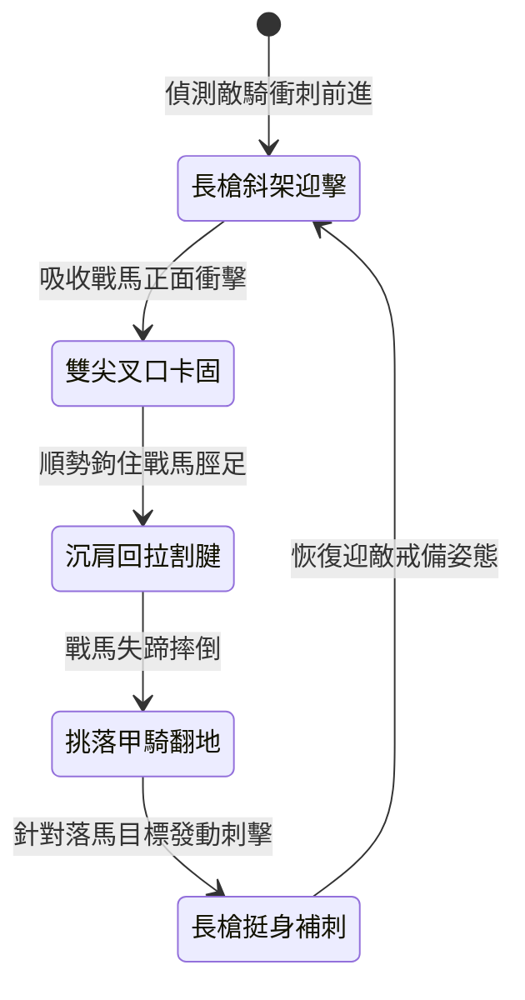

<!-- doc_id: doc_spec_0994 -->
# 野戰精銳步兵雙手長柄鉤鐮雙尖大槍挑破重甲與割裂衝鋒戰馬脛足狀態機規格書

## 模組識別碼
- 模組編號：`FORM-213`
- 狀態機代碼：`HOOK-SICKLE-TWIN-PIKE-HAMSTRING01`
- 類別：野戰精銳步兵雙手長柄克騎破甲狀態機
- 適用場景：平原野戰、反騎兵陣地、正面交鋒、重創衝鋒鐵騎

---

## 1. 核心概念與作戰原型

面對身著重甲的具裝鐵騎，常規長槍在承受正面衝撞時容易折斷。為破解重騎兵的破陣衝鋒，突擊步兵營配備「雙手長柄鉤鐮雙尖大槍」。

### 1.1 武器形制與戰術協同
1. **複合雙尖與倒鉤結構**：槍身全長一丈二尺，前端為雙尖對稱分叉的破甲精鋼槍頭，兩側各配有一柄弧形生鐵倒鉤鐮刀。
2. **正面叉槍架住馬鞍**：交鋒第一擊以雙尖叉口卡住戰馬前胸護甲或馬鞍，化解正面衝撞力道，迫使高速衝刺的戰馬停頓。
3. **下壓鉤鐮割斷脛足**：戰馬衝勢受阻停頓的瞬間，步兵沉肩下壓槍桿，倒鉤鐮刀精準勾住戰馬前脛，用力回拉割斷筋腱。
4. **戰馬失蹄重創騎士**：戰馬受創翻滾倒地，重甲騎士被甩落馬下陷入暈眩，後排步兵順勢補刺破除重鎧。

---

## 2. 數值參數與影響權重

| 參數名稱 | 數值 / 範圍 | 說明 |
| :--- | :--- | :--- |
| **迎擊架槍減傷 (`BracingAbsorb`)** | 吸收 65% 正面衝撞傷害 | 化解戰馬衝擊帶來的踩踏傷害 |
| **割腱斷足成功率 (`HamstringRate`)** | 70% ~ 85% | 迫使衝鋒停頓之戰馬直接倒地 |
| **落馬倒地硬直時間 (`DismountStun`)** | 2.5 ~ 3.5 秒 | 重裝騎兵墜馬後無法迅速站立 |
| **破甲穿刺增傷 (`ArmorPenetrationBonus`)** | 忽視 50% 基礎護甲 | 雙尖集中受力提升對厚重鎧甲的穿透力 |
| **陣型站位密度要求 (`FormationDensity`)** | 步兵間隔 1.2 米 | 保證足夠的長桿下壓揮拉空間 |

---

## 3. 狀態機轉換定義

### 3.1 狀態細節描述
- **長槍斜架迎擊 (BRACING_STANCE)**：槍桿斜插地面，步兵重心下沉，鎖定衝鋒騎兵。
- **雙尖叉口卡固 (FORK_LOCK)**：雙尖咬住馬頸或鞍橋，成功卸除衝鋒慣性。
- **沉肩回拉割腱 (HOOK_CUT)**：步兵借腰力後扯，倒鉤鐮刀割切馬蹄腱部。
- **挑落甲騎翻地 (HORSE_COLLAPSE)**：戰馬失控摔倒，騎士被拋出重摔在地。
- **長槍挺身補刺 (FOLLOW_UP_THRUST)**：滑桿上前直刺，給予落馬目標重創。

---

## 4. 戰鬥公式與判定

### 4.1 衝擊阻絕判定
$$\text{BracingSuccess} = \min(0.85, \frac{\text{InfantryStrength} \times 1.2}{\text{CavalryMomentum}})$$

判定成功時，騎兵單位衝鋒速度清零，衝鋒傷害減免 65%。

### 4.2 割腱倒地判定
$$\text{CollapseSuccess} = \text{HamstringRate} \times (1 - \text{BardingArmorRate} \times 0.4)$$

判定成功時，戰馬陷入「殘廢倒地」狀態，騎士脫離坐騎並損失 25% 當前生命。

---

## 5. 反制與失效機制

1. **具裝全覆蓋生鐵脛甲**：若敵方配備全包覆式防護脛甲，割腱機率降低 35%。
2. **游騎側翼長程箭雨**：架槍姿態專注正面迎敵，易遭側翼輕騎箭雨干擾。
3. **步兵過度密集自絆**：若隊列站位小於 1 米，長桿下拉容易受到身旁戰友阻礙。

---

## 6. 驗收標準與測試案例

- [x] **TC-213-01**：驗證正面迎擊騎兵衝鋒時，能化解至少 65% 踩踏傷害並阻斷衝鋒。
- [x] **TC-213-02**：驗證沉肩回割動作對受阻戰馬的割腱判定率維持在 70%~85% 區間。
- [x] **TC-213-03**：驗證落馬騎士正確承受 2.5 秒以上倒地起身硬直。
