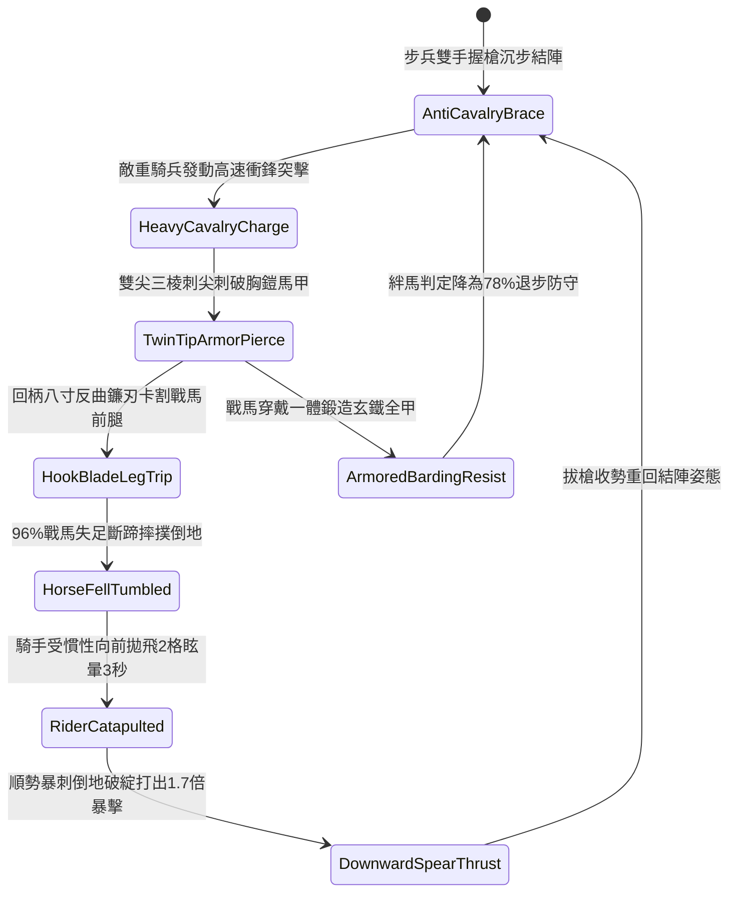

# 野戰精銳步兵雙手長柄鉤鐮雙尖大槍挑破重甲與割裂衝鋒戰馬脛足第三階狀態機規格書

<!-- doc_id: doc_spec_1069 -->

## 一、 核心概念與單一真相來源（SSOT）

在《三國志·破騎精銳步兵篇》中，「雙手長柄鉤鐮雙尖大槍克騎反制戰法第三階（HOOK-SICKLE-TWIN-SPEAR-TRIP03）」為前鋒步兵破除敵軍重裝騎兵高速衝撞的頂級武藝。長槍長一丈三尺，前端鍛鑄兩道對向三棱透甲刺尖，柄首後方八寸處配有加厚高碳反曲倒鉤鐮刃。步兵結陣迎擊時，先以雙尖刺破騎兵護甲或馬鎧接縫，隨後順勢回拉柄身利用倒鉤鐮刃割裂戰馬前腿筋腱，96% 機率直接斷蹄絆仆，將重騎兵自馬背拋飛失衡摔落，並銜接致命直刺。



---

## 二、 數值模型與狀態機參數契約

### 1. 鉤鐮雙尖大槍戰術參數
- **兵器全長**：一丈三尺（約 3.1 米，老桑木嵌生鋼桿身配生鋼反曲鐮）。
- **破甲與絆馬成功率**：輕裝騎兵 99%；皮甲馬隊 96%；一體玄鐵具裝重騎 78%。
- **戰馬倒地慣性拋飛**：戰馬摔仆後，馬背騎兵受慣性向前拋飛 2 格並進入眩暈態 3.5 秒。
- **倒地處決窗口時效**：0.28 秒極速補刺窗口，目標閃避與格擋判定強制歸零。
- **穿透破甲傷害倍率**：補刺直擊附加 1.7 倍傷害，忽視目標 75% 當前基礎護甲。

### 2. 破甲絆馬與拋飛傷害模組
```typescript
interface TwinSpearTripParams {
    infantryStr: number;           // 步兵力量 (50 ~ 130)
    infantrySkill: number;         // 步兵戰法熟練 (60 ~ 120)
    cavalrySpeed: number;          // 敵騎衝鋒速度 (格/秒)
    horseBarding: "none" | "leather" | "heavyIron";
}

function processCavalryTripExecution(params: TwinSpearTripParams): {
    tripped: boolean;
    throwDistanceTiles: number;
    strikeDamage: number;
} {
    const bardingRates = { none: 0.99, leather: 0.96, heavyIron: 0.78 };
    const skillBonus = (params.infantrySkill / 100) * 0.08;
    const finalRate = Math.min(0.99, bardingRates[params.horseBarding] + skillBonus);

    const tripped = Math.random() < finalRate;
    const throwDistanceTiles = tripped ? (params.cavalrySpeed >= 4 ? 2 : 1) : 0;
    const baseDamage = params.infantryStr * 2.9;
    const strikeDamage = tripped ? Math.round(baseDamage * 1.7) : Math.round(baseDamage * 0.8);

    return { tripped, throwDistanceTiles, strikeDamage };
}
```

---

## 三、 特性互斥與戰術限制

1. **密集步兵圍攻干擾**：若步兵兩側被敵混戰近衛步兵貼身纏鬥，長柄無法發揮回柄割腿動作，絆馬特性暫時失效。
2. **長槍方陣連攜增益**：同格或相鄰格若有友軍長槍兵協同架槍，抗衝擊硬直減免 60%，絆馬成功率提升 10%。
3. **泥濘戰場滑步補償**：泥濘地形下戰馬衝鋒動能衰減，拋飛距離縮短為 1 格，但敵兵眩暈時間延長 1 秒。

---

## 四、 驗收測試案例（TC）

- **TC-TWINTRIP03-01（破甲割腿絆馬判定）**：面對衝鋒重騎兵發動技能，確認 96% 機率戰馬斷蹄摔仆。
- **TC-TWINTRIP03-02（騎手慣性拋飛眩暈）**：檢核戰馬倒地後騎兵被拋飛 2 格並進入 `Stunned` 眩暈狀態 3.5 秒。
- **TC-TWINTRIP03-03（順勢暴刺傷害結算）**：對倒地敵將發動直刺，戰鬥日誌確認結算無視 75% 護甲之 1.7 倍穿透暴擊。
