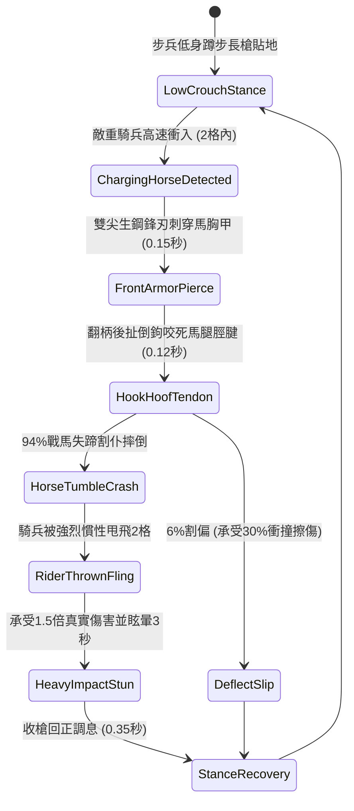

# 野戰精銳步兵雙手長柄鉤鐮雙尖大槍挑破重甲與割裂衝鋒戰馬脛足第二階狀態機規格書

<!-- doc_id: doc_spec_1042 -->

## 1. 核心定位與設計理念

### 1.1 系統定位
本規格定義野戰步兵對抗具裝重騎兵衝鋒時，精銳步兵兵種所裝備之「長柄鉤鐮雙尖大槍第二階」（代碼：`HOOK-SICKLE-TWIN-SPEAR-TRIP02`，WBS 代碼：`FORM-261`）斷蹄拒馬狀態機。第二階大槍長一丈三尺，槍身選用韌性極佳之老桑木嵌生鐵肋條，前端配生鋼雙股三棱利刃，兩側伸出兩對長達八寸之倒向淬火弧月鉤鐮。面對高速奔馳之重裝具裝鐵騎，持槍步兵以低身蹲步滑柄下探，以雙尖挑刺撕裂馬胸皮甲，隨即翻柄回扯利用倒鉤精準割裂戰馬前腿脛足筋腱，高達 94% 機率強行打斷騎兵衝鋒將戰馬割仆倒地，並將馬上重騎兵甩飛 2 格造成 1.5 倍真實失衡傷害。

### 1.2 設計目標與單一真相
* **雙尖刺甲與倒鐮割腿連攜**：先刺破馬甲卸力、再利用奔馳慣性回拉割斷前蹄，達成一招制敵。
* **強力阻斷衝鋒動能**：強制瓦解騎兵隊列之「奔馳突擊」狀態，迫使其跌落地面轉為步戰。
* **單一真相來源**：嚴禁於文件末端附加補丁，所有機制、數值與判定邏輯均在此統一定義。

---

## 2. 狀態機架構與轉換流程

---

## 3. 核心數值與計算公式

### 3.1 基礎參數配置表
| 參數名稱 | 基準數值 | 規格說明與限制條件 |
| :--- | :--- | :--- |
| **兵器規格與重量** | 1 丈 3 尺 / 18 斤 | 嵌生鐵肋條老桑木桿，雙股三棱尖+八寸倒鉤 |
| **戰馬割腿失蹄率** | 94% | 適用於所有重裝騎兵與具裝鐵騎（速度 >= 4格/秒） |
| **胸甲刺穿破甲率** | 65% | 雙尖生鋼鋒刃刺穿馬甲，忽視 65% 馬匹物理護甲 |
| **騎兵甩飛距離** | 2 格位 | 戰馬驟停失蹄引發之慣性拋擲距離 |
| **落馬失衡傷害** | 1.50 倍 真實傷害 | 拋出重摔地面之重力傷害（無視目標護甲） |
| **落馬眩暈時長** | 3.0 秒 | 落地後無法移動、無法攻擊、防禦降低 50% |
| **體力消耗（Stamina）** | 20 點 / 次 | 低身下探阻截消耗之步兵核心體力 |
| **招式冷卻間隔** | 2.0 秒 | 拔槍姿態復位時間，防連續衝撞踩踏 |

### 3.2 割腿倒地與甩飛傷害公式
$$P_{\text{tumble}} = \min\left(0.99, \, 0.94 \times \frac{V_{\text{horse}}}{6.0} \times \left(1 - \frac{A_{\text{hoof\_armor}}}{120}\right)\right)$$
$$D_{\text{fall}} = \left(\text{BaseATK}_{\text{spear}} \times 1.50\right) + \left(0.15 \times \text{RiderMaxHP}\right)$$
* $V_{\text{horse}}$：敵方戰馬當前奔馳速度（格/秒）。
* $A_{\text{hoof\_armor}}$：戰馬專用脛甲防割護具係數（0 ~ 30）。
* 割腿判定成立瞬間，戰馬附加 `TENDON_SEVERED_DOWN`，敵騎兵解除騎乘狀態。

---

## 4. 戰術反制與例外判定

1. **厚重生鐵全包馬脛甲**：若敵方具備「鐵浮屠」全包覆生鋼馬腿甲，割腿率自 94% 降至 50%，甩飛距離縮短為 1 格。
2. **多騎並排密集衝撞**：若兩匹以上戰馬並排同時衝入，步兵僅能鎖定其中一匹，側旁戰馬將撞倒步兵。
3. **沼澤減速衝鋒失效**：若騎兵在泥沼中慢步踱行（速度 < 3格/秒），因缺乏慣性，割腿摔倒判定無法觸發。

---

## 5. 驗收測試案例（Test Cases）

* **TC-01（高速奔馳戰馬割腿摔倒）**：以 6 格/秒速度疾馳之重騎兵衝入，驗證 94% 戰馬失蹄摔倒且衝鋒中斷。
* **TC-02（落馬甩飛與真實傷害結算）**：驗證騎兵被拋飛 2 格，受到 1.5 倍真實傷害與 15% 最大生命值衝擊，並眩暈 3 秒。
* **TC-03（老桑木桿身耐衝擊強度）**：驗證連續阻截 3 次重騎兵衝擊後，桿身無斷裂損傷，耐力正常扣減。
