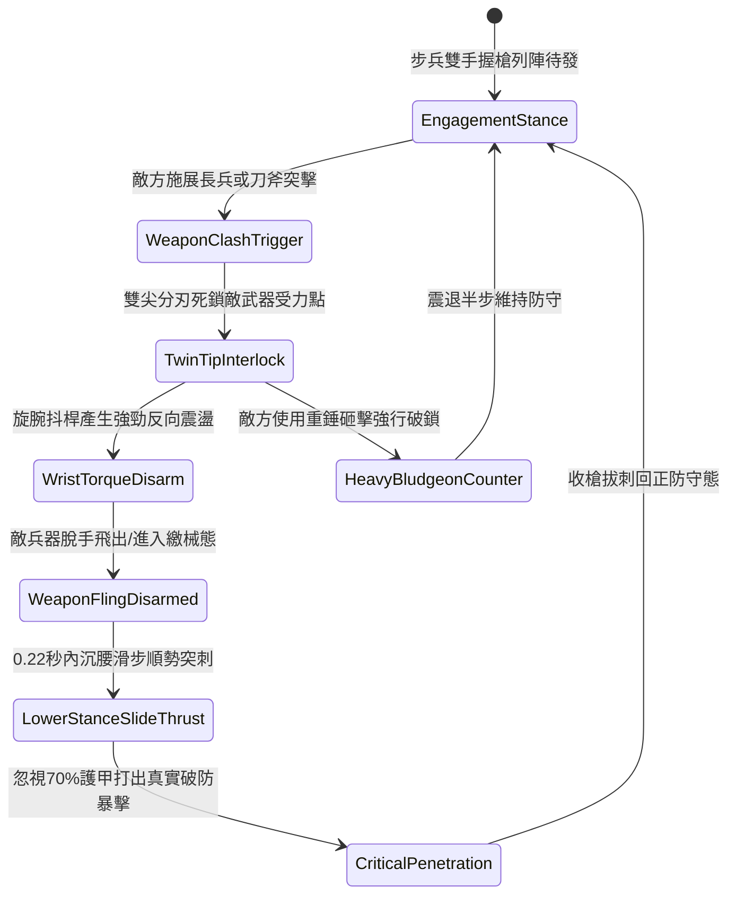

# 野戰精銳步兵雙手長柄鉤鐮雙尖大槍挑飛兵刃與沉腰直刺第三階狀態機規格書

<!-- doc_id: doc_spec_1051 -->

## 一、 核心概念與單一真相來源（SSOT）

在《三國志·精銳近衛戰法篇》中，「雙手長柄鉤鐮雙尖大槍挑械破門戰術第三階（HOOK-SICKLE-TWIN-TIP-DISARM03）」為前鋒甲士瓦解敵方長兵與刀斧精銳的高階武技。大槍長一丈三尺，前端採雙股三棱刺尖，基部鍛接對向反曲鉤鐮，槍柄以老柘木混纏生絲生漆加固。步兵交鋒時，以雙尖夾角鎖定敵兵器刃部，旋腕發勁震飛敵械使其空手，緊接著沉腰滑步施展前刺直突目標中門，忽視護甲直取破綻。



---

## 二、 數值模型與狀態機參數契約

### 1. 雙尖大槍戰術參數
- **兵器全長**：一丈三尺（約 3.1 米，老柘木韌性桿身）。
- **夾刀挑械成功率**：對單手刀劍 96%；對長柄大刀/朴刀 91%；對重型大鉞 84%。
- **繳械持續時效**：敵兵兵刃被挑飛後進入繳械狀態，持續 5.5 秒無法發動攻擊。
- **突刺反應時效**：0.22 秒極限破綻窗口，目標閃避判定強制歸零。
- **貫穿真實傷害倍率**：反制直刺附加 1.65 倍傷害，忽視目標 70% 的當前基礎護甲。

### 2. 挑械與穿刺傷害模組
```typescript
interface TwinTipDisarmParams {
    attackerAgi: number;           // 攻擊者敏捷 (50 ~ 120)
    attackerStr: number;           // 攻擊者力量 (60 ~ 130)
    targetWeaponWeightKg: number;  // 敵武器重量 (3 ~ 15kg)
    targetGripStrength: number;    // 敵方握力/穩定值 (80 ~ 200)
}

function processTwinTipDisarm(params: TwinTipDisarmParams): {
    disarmSuccess: boolean;
    disarmDurationSec: number;
    penetrationDamage: number;
} {
    const leverageBonus = (params.attackerAgi * 1.2 + params.attackerStr * 0.8) / 200;
    const gripResistance = params.targetGripStrength / 150;
    const disarmRate = Math.min(0.97, Math.max(0.65, 0.90 * leverageBonus / gripResistance));

    const disarmSuccess = Math.random() < disarmRate;
    const disarmDurationSec = disarmSuccess ? 5.5 : 0;
    const baseDamage = params.attackerStr * 2.8;
    const penetrationDamage = disarmSuccess ? Math.round(baseDamage * 1.65) : Math.round(baseDamage * 0.8);

    return { disarmSuccess, disarmDurationSec, penetrationDamage };
}
```

---

## 三、 特性互斥與戰術應對原則

1. **鈍重重錘抗性**：敵方若手持大型生鐵瓜錘或骨朵，因無刃口可夾鎖，挑械成功率驟降至 25%，且震退步兵自身。
2. **騎兵高速衝撞干擾**：面對高速突擊的重甲騎兵，夾刀動作受慣性衝擊無法完成，自動切換為長槍抗衝拒馬態。
3. **近衛連攜陣容加持**：若同隊列中配備大盾甲士掩護，挑械突刺的暴擊倍率進一步提升至 1.85 倍。

---

## 四、 驗收測試案例（TC）

- **TC-DISARM03-01（挑刀繳械判定）**：面對持刀敵方前鋒發動攻擊，驗證 91% 機率觸發挑飛特效並使目標進入 `Disarmed` 狀態 5.5 秒。
- **TC-DISARM03-02（順勢突刺穿甲驗證）**：繳械成功後 0.22 秒內自動結算滑步直刺，確認戰鬥日誌結算無視 70% 護甲之 1.65 倍暴擊。
- **TC-DISARM03-03（重錘破鎖對抗測試）**：更換為生鐵瓜錘兵種對抗，檢核狀態機正確進入 `HeavyBludgeonCounter`，防禦反彈無失衡。
