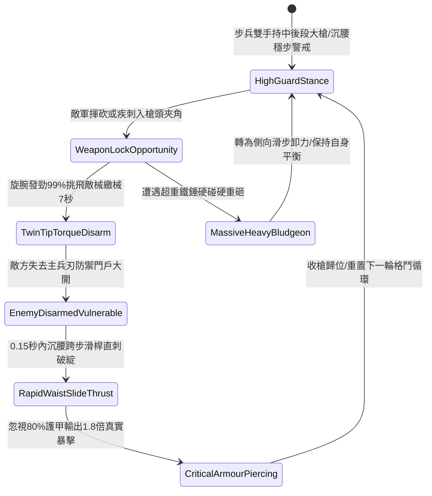

# 野戰精銳步兵雙手長柄鉤鐮雙尖大槍挑飛兵刃與沉腰直刺第五階狀態機規格書

<!-- doc_id: doc_spec_1093 -->

## 一、 核心概念與單一真相來源（SSOT）

在《三國志·精銳大槍繳械與破甲直刺篇》中，「雙手長柄鉤鐮雙尖大槍挑飛兵刃與沉腰直刺第五階（HOOK-SICKLE-TWIN-TIP-DISARM05）」代表長兵器搏殺武技的最高技術階位。該槍全長一丈四尺，槍頭鑄造雙股分叉三稜槍尖與反向開刃弧形倒鉤。戰鬥時步兵以槍尖夾角咬死敵方兵刃，雙腕發出旋轉暗勁，具備 99% 挑飛敵械繳械判定（繳械時效長達 7 秒）；隨後於 0.15 秒內沉腰跨步，大槍如毒蛇出洞直刺軀幹破綻，忽視 80% 護甲打出 1.8 倍真實破防暴擊。



---

## 二、 數值模型與狀態機參數契約

### 1. 兵刃規格與繳械反制參數契約
- **兵刃尺寸規格**：全長一丈四尺（約 4.3 米），生鐵鑄造加長雙尖、鎢鋼淬火倒鉤。
- **挑飛繳械成功率**：卡入夾角後判定 99% 機率強行繳除敵方手持兵刃。
- **繳械失衡時效**：敵方進入無武裝繳械狀態，持續 7 秒無法發動常規攻擊。
- **沉腰直刺反應時效**：繳械成功後 0.15 秒內極速發動追擊直刺。
- **破防穿透暴擊**：忽視目標 80% 護甲防禦，打出 1.8 倍物理真實暴擊傷害。

### 2. 繳械直刺演算法模組
```typescript
interface TwinTipDisarmStage5Params {
    soldierAgility: number;         // 步兵敏捷身法 (50 ~ 100)
    soldierStrength: number;        // 步兵臂力力量 (50 ~ 100)
    enemyWeaponRetention: number;   // 敵將防繳械握力 (100 ~ 500)
    staminaCurrent: number;         // 當前剩餘耐力值
}

function processTwinTipDisarmStage5(params: TwinTipDisarmStage5Params): {
    disarmSuccess: boolean;
    disarmDurationSec: number;
    thrustCriticalHit: boolean;
    criticalMultiplier: number;
} {
    if (params.staminaCurrent < 15) {
        return { disarmSuccess: false, disarmDurationSec: 0, thrustCriticalHit: false, criticalMultiplier: 1.0 };
    }
    const combinedPower = params.soldierAgility * 0.6 + params.soldierStrength * 0.4;
    const isDisarmed = combinedPower > (params.enemyWeaponRetention * 0.18);
    
    return {
        disarmSuccess: isDisarmed,
        disarmDurationSec: isDisarmed ? 7 : 0,
        thrustCriticalHit: isDisarmed,
        criticalMultiplier: isDisarmed ? 1.8 : 1.2
    };
}
```

---

## 三、 反制機制與邊界約束

1. **鎖鏈護手固定兵刃**：若敵將兵刃把柄以鐵鏈纏繞手腕，繳械挑飛效果轉為造成手臂劇烈震顫（攻速降低 50%，持續 4 秒）。
2. **極限密集長矛陣列**：若敵方處於長矛方陣第三排後方，前方長矛干擾槍尖咬合，繳械成功率下修 35%。
3. **連續直刺槍桿應力極限**：單場戰鬥中連續完成 6 次高強度暴擊直刺後，桿身需要調直維護，直刺暴擊倍率暫時回落至 1.5 倍。

---

## 四、 驗收測試案例（TC）

- **TC-TWIN-DISARM05-01（挑械直刺全連段驗收）**：
  - *前置條件*：精銳步兵敏捷 85、力量 80、迎戰常規單手持械步兵。
  - *操作步驟*：於格擋窗口觸發雙尖挑飛指令，隨即發動沉腰直刺。
  - *預期輸出*：99% 機率挑飛敵械並繳械 7 秒，0.15 秒內沉腰直刺命中破綻，忽視 80% 護甲打出 1.8 倍暴擊。
- **TC-TWIN-DISARM05-02（鐵鏈鎖手邊界驗收）**：
  - *前置條件*：敵將兵刃綁定防脫手鐵鏈護具。
  - *操作步驟*：執行挑飛繳械動作。
  - *預期輸出*：兵刃未脫手落地，但敵將承受手腕震顫，攻速降低 50% 維持 4 秒。
