# 野戰精銳步兵雙手長柄鉤鐮雙尖大槍挑飛兵刃與沉腰直刺第四階狀態機規格書

<!-- doc_id: doc_spec_1075 -->

## 一、 核心概念與單一真相來源（SSOT）

在《三國志·精銳近衛武藝與繳械篇》中，「雙手長柄鉤鐮雙尖大槍挑械破門武技第四階（HOOK-SICKLE-TWIN-TIP-DISARM04）」代表前鋒精銳瓦解敵方長兵與刀斧精銳的頂尖技巧。大槍長一丈三尺，前端採雙股三棱刺尖，基部鍛接淬火高碳反曲雙向鉤鐮，槍柄以老柘木混纏生絲生漆加固。步兵交鋒時，以雙尖夾角鎖定敵兵器刃部，旋腕抖桿產生強烈反向震盪，98% 震飛敵械使其空手繳械；緊接著在 0.2 秒極限窗口內沉腰前刺，忽視護甲直取破綻。

```mermaid
stateDiagram-v2
    [*] --> EngagementStance: 步兵雙手持槍列陣待發
    EngagementStance --> WeaponStrikeClash: 敵方施展長兵或刀斧突擊
    WeaponStrikeClash --> TwinTipInterlock: 雙尖分刃死鎖敵武器受力點
    TwinTipInterlock --> TorqueDisarmVibration: 旋腕抖桿產生反向高頻震顫
    TorqueDisarmVibration --> WeaponDisarmedFling: 98%敵兵器脫手飛出進入繳械態
    WeaponDisarmedFling --> DeepStanceSlideThrust: 0.2秒內沉腰滑步順勢突刺
    DeepStanceSlideThrust --> CriticalArmorBypassHit: 忽視75%護甲打出1.7倍真實暴擊
    CriticalArmorBypassHit --> EngagementStance: 收槍拔刺回正防守姿態
    TwinTipInterlock --> HeavyHammerSmashCounter: 敵方使用重錘砸擊強行破鎖
    HeavyHammerSmashCounter --> EngagementStance: 震退半步維持防守
```



---

## 二、 數值模型與狀態機參數契約

### 1. 雙尖大槍戰術參數
- **兵器全長**：一丈三尺（約 3.1 米，老柘木韌性桿身配淬火反曲鉤鐮）。
- **夾刀挑械成功率**：對單手刀劍 98%；對長柄雙手斧 94%；對重型大鉞 88%。
- **繳械持續時效**：敵兵兵刃被挑飛後進入繳械狀態，持續 6.0 秒無法發動攻擊。
- **突刺反應時效**：0.2 秒極限破綻窗口，目標閃避判定強制歸零。
- **貫穿真實傷害倍率**：反制直刺附加 1.7 倍傷害，忽視目標 75% 的當前基礎護甲。

### 2. 挑械與穿刺傷害計算模組
```typescript
interface TwinTipDisarmStage4Params {
    attackerAgi: number;           // 攻擊者敏捷 (50 ~ 130)
    attackerStr: number;           // 攻擊者力量 (60 ~ 130)
    targetWeaponWeightKg: number;  // 敵武器重量 (3 ~ 18kg)
    targetGripStrength: number;    // 敵方握力/穩定值 (80 ~ 220)
}

function processTwinTipDisarmStage4(params: TwinTipDisarmStage4Params): {
    disarmSuccess: boolean;
    disarmDurationSec: number;
    penetrationDamage: number;
} {
    const leverageBonus = (params.attackerAgi * 1.3 + params.attackerStr * 0.7) / 200;
    const gripResistance = params.targetGripStrength / 160;
    const disarmRate = Math.min(0.98, Math.max(0.68, 0.92 * leverageBonus / gripResistance));

    const disarmSuccess = Math.random() < disarmRate;
    const disarmDurationSec = disarmSuccess ? 6.0 : 0;
    const baseDamage = params.attackerStr * 3.0;
    const penetrationDamage = disarmSuccess ? Math.round(baseDamage * 1.7) : Math.round(baseDamage * 0.85);

    return { disarmSuccess, disarmDurationSec, penetrationDamage };
}
```

---

## 三、 特性互斥與戰術應對原則

1. **鈍重超限震退威脅**：敵方若手持大型生鐵瓜錘或骨朵砸擊，因無刃口可夾鎖，挑械成功率降至 25%，且震退步兵自身。
2. **高速騎兵衝撞抗性**：面對高速突擊的重甲騎兵，夾刀動作受慣性衝擊無法完成，自動切換為長槍抗衝拒馬態。
3. **近衛步陣協同加成**：同隊列中配備大盾甲士掩護時，挑械突刺的暴擊倍率進一步提升至 1.9 倍。

---

## 四、 驗收測試案例（TC）

- **TC-DISARM04-01（挑刀繳械判定）**：面對持刀敵前鋒發動攻擊，驗證 94% 機率觸發挑飛特效並使目標進入 `Disarmed` 狀態 6.0 秒。
- **TC-DISARM04-02（順勢突刺穿甲驗證）**：繳械成功後 0.2 秒內自動結算滑步直刺，確認戰鬥日誌結算無視 75% 護甲之 1.7 倍暴擊。
- **TC-DISARM04-03（重錘破鎖對抗測試）**：更換為生鐵瓜錘兵種對抗，檢核狀態機正確進入 `HeavyHammerSmashCounter`，防禦反彈無失衡。
