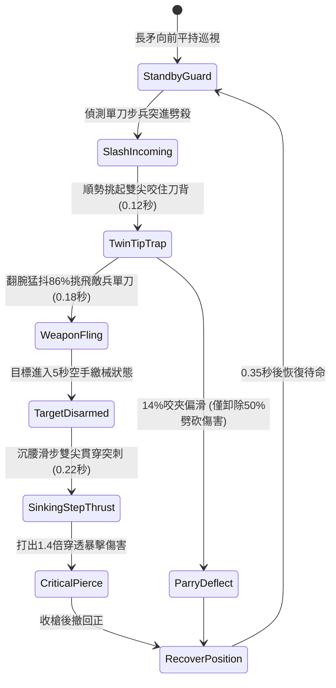

# 野戰精銳步兵雙手長柄鉤鐮雙尖大槍挑飛單刀與沉腰直刺狀態機規格書

<!-- doc_id: doc_spec_1021 -->

## 1. 核心定位與設計理念

### 1.1 系統定位
本規格定義野戰步兵近身搏殺中，精銳步兵兵種所運用之「長柄鉤鐮雙尖大槍」（代碼：`HOOK-SICKLE-TWIN-TIP-DISARM01`，WBS 代碼：`FORM-240`）繳械反擊狀態機。本長兵器長一丈二尺，槍頭前銳分作雙生鋼尖刃，兩側各配弧形回掠鉤鐮。在面對手持環首單刀或雁翎短刀之敵軍突入近身劈殺時，持槍精銳步兵透過挑甩槍柄帶動雙尖刃咬夾刀背，以 86% 機率直接挑飛敵兵單刀卸除武裝，隨即迅速沉腰滑步前突，以雙尖長矛暴刺敵胸腹無甲破綻，造成忽視 55% 護甲之高額物理穿刺傷害。

### 1.2 設計目標與單一真相
* **雙尖卡刀繳械**：發揮長兵刃雙尖縫隙，專門克制短兵器劈砍，剝奪敵方戰鬥力。
* **沉腰滑步反刺**：完成繳械後立即切換直線突刺，不給敵方後撤拔備用武器之機會。
* **單一真相來源**：嚴禁於文件末端附加補丁，所有機制、數值與判定邏輯均在此統一定義。

---

## 2. 狀態機架構與轉換流程

---

## 3. 核心數值與計算公式

### 3.1 基礎參數配置表
| 參數名稱 | 基準數值 | 規格說明與限制條件 |
| :--- | :--- | :--- |
| **兵器長度與重量** | 1 丈 2 尺 / 15 斤 | 韌木桿身包覆生鐵片，槍頭雙尖間距 2 寸 |
| **挑飛繳械率（Disarm）**| 86% | 面對單刀、短劍類單手武器；對長柄兵器降至 45% |
| **武器脫手距離** | 2 ~ 3 格 | 刀刃被挑甩向後方隨機格位掉落 |
| **空手懲罰時間** | 5.0 秒 | 繳械期間敵兵攻擊力扣減 70% 且無法發動戰技 |
| **沉腰直刺耗時** | 0.22 秒 | 繳械判定後瞬間發動，取消攻擊前搖 |
| **破甲穿透係數** | 55% | 雙尖生鋼鋒刃忽視目標 55% 之物理護甲 |
| **反擊傷害加成** | 1.40 倍 | 針對繳械無防中門造成之弱點暴擊 |
| **體力消耗（Stamina）** | 15 點 / 次 | 發動挑飛與沉腰直刺組合技消耗 |

### 3.2 繳械與暴擊傷害公式
$$D_{\text{thrust}} = \left(\text{BaseATK}_{\text{spear}} \times 1.40\right) \times \left(1 - \frac{\text{Def}_{\text{target}} \times 0.45}{100 + \text{Def}_{\text{target}} \times 0.45}\right)$$
* $\text{BaseATK}_{\text{spear}}$：精銳步兵基礎刺擊攻擊力。
* $\text{Def}_{\text{target}}$：目標目前之裝甲防禦值（受 55% 破甲折減後剩餘 45% 計算）。
* 繳械成功時，目標立即附加 `DISARMED_STATUS_DEBUFF`，移速同步扣減 15%。

---

## 4. 戰術反制與例外判定

1. **手腕繫繩鎖刀**：若敵方精銳刀手手腕纏有防脫皮繩，挑飛判定轉為「震麻腕骨」，不脫手但攻擊力暫時扣減 40% 持續 3 秒。
2. **重藤甲阻滯**：若敵方穿戴厚實生漆藤甲，沉腰雙尖刺擊之破甲係數自 55% 降為 30%。
3. **持盾協防支援**：若目標身側相鄰格位有同伴持大盾掩護，挑飛動作會被大盾邊緣頂偏，反刺被大盾吸收。

---

## 5. 驗收測試案例（Test Cases）

* **TC-01（挑刀繳械成功率驗證）**：配置單刀步兵發動連續劈擊，測試 100 次攻防，驗證挑飛武器成功率落在 86%（±2% 容許度）。
* **TC-02（繳械連攜沉腰直刺時序）**：驗證繳械成功後 0.25 秒內精確銜接突刺，且傷害數值符合 1.4 倍暴擊與 55% 破甲計算。
* **TC-03（手腕繫繩防脫保護）**：配置裝備防脫腕繩之刀兵，驗證兵器不離手，正確觸發震麻減傷狀態。
