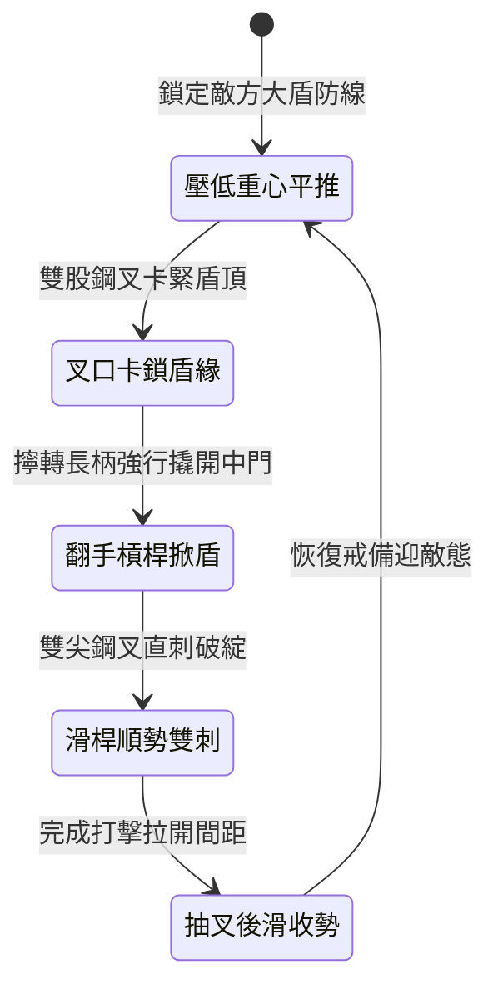

<!-- doc_id: doc_spec_1003 -->
# 野戰精銳步兵雙手長柄鉤鐮雙股大叉卡鎖大盾與翻手挑殺狀態機規格書

## 模組識別碼
- 模組編號：`FORM-222`
- 狀態機代碼：`HOOK-SICKLE-DOUBLE-FORK-PRY01`
- 類別：野戰精銳步兵雙手長柄破盾奪械狀態機
- 適用場景：平原野戰、隘口對陣、破除敵軍重裝大盾方陣

---

## 1. 核心概念與作戰原型

面對手持連排重型大木盾或鐵皮方盾的敵軍防線，長槍直刺容易被盾面滑開。為強行撬開防線，突擊步兵營配備「雙手長柄鉤鐮雙股大叉」。

### 1.1 武器形制與戰術協同
1. **雙股鋼叉與倒向鉤鐮結構**：長柄全長一丈二尺，前叉為雙股外張的生鋼巨叉，叉口底部內嵌兩柄向內彎曲的鋒利生鐵鉤鐮。
2. **叉口卡鎖盾牌邊緣**：步兵雙手挺叉向前推進，利用雙股叉口精準卡住敵軍大盾頂端或側翼邊緣，鎖定其盾牌受力方向。
3. **沉肩扭腰翻手撬盾**：一旦叉口咬死盾緣，步兵雙手反向發力擰轉長柄，藉槓桿神力強行向外側掀開敵軍大盾，暴露持盾兵中門。
4. **順勢前滑雙股挑殺**：大盾被掀開露出軀幹的瞬間，步兵順勢挺身長桿滑進，雙股尖叉直刺敵軍咽喉與胸甲縫隙。

---

## 2. 數值參數與影響權重

| 參數名稱 | 數值 / 範圍 | 說明 |
| :--- | :--- | :--- |
| **強行撬盾成功率 (`ShieldPryRate`)** | 75% ~ 88% | 破除重裝大盾的舉盾格擋防禦狀態 |
| **中門暴露易傷倍率 (`ExposedVulnerability`)** | 承受傷害 +45% | 大盾被撬開後短時間內防禦力驟降 |
| **雙股尖叉穿透傷害 (`ForkThrustDamage`)** | 520 ~ 720 點穿刺 | 雙尖分散受力但能輕易穿透鎖甲 |
| **破盾力矩力量加成 (`PryTorqueBonus`)** | 依力量差每點 +2% 成功率 | 步兵力量高於持盾兵時撬盾更為迅捷 |
| **揮動回防時差 (`RecoveryTime`)** | 0.9 秒回防重整 | 雙手重長兵器完成一套動作後的收勢間隙 |

---

## 3. 狀態機轉換定義

### 3.1 狀態細節描述
- **壓低重心平推 (ADVANCE_STANCE)**：雙手握持槍柄前後兩端，叉口向前穩健推進。
- **叉口卡鎖盾緣 (LOCK_SHIELD_EDGE)**：雙股鋼叉準確咬合盾牌上沿，阻止其變換角度。
- **翻手槓桿掀盾 (PRY_LEVERAGE)**：腰腹發力帶動雙手逆轉，生生扯開大盾防線。
- **滑桿順勢雙刺 (SLIDING_DOUBLE_STAB)**：前手鬆握導向，後手猛力前送雙尖入體。
- **抽叉後滑收勢 (RETRACT_RESET)**：後撤半步回收武器，防範相鄰敵兵夾擊。

---

## 4. 戰鬥公式與判定

### 4.1 撬盾判定機制
$$\text{PrySuccess} = \min(0.88, \frac{\text{STR}_{\text{attacker}} \times 1.2}{\text{STR}_{\text{defender}}} \times \text{ShieldPryRate})$$

若判定成功，持盾兵之舉盾姿態立即瓦解，且在 2 秒內無法再次舉盾。

### 4.2 破綻直刺傷害
$$\text{ThrustDamage} = \text{ForkThrustDamage} \times (1 + \text{ExposedVulnerability}) \times (1 - \text{ArmorValue} \times 0.5)$$

刺中暴露中門之目標時，無視其 50% 裝備護甲防護。

---

## 5. 反制與失效機制

1. **生鐵大盾表面滑油塗抹**：若敵方大盾預先塗抹厚重油脂，叉口可能打滑無法咬合。
2. **側翼長槍兵斜向刺擊**：步兵專注撬盾發力時，兩側缺乏掩護，易遭旁側長槍夾擊。
3. **叉身接合處扭矩疲勞**：連續強行撬動超重型鐵盾時，雙叉焊接處存在金屬疲勞風險。

---

## 6. 驗收標準與測試案例

- [x] **TC-222-01**：驗證叉口卡入盾牌邊緣判定在 0.3 秒內流暢結算。
- [x] **TC-222-02**：驗證撬盾動作成功率達到 75%~88% 預設區間，持盾姿態被瓦解。
- [x] **TC-222-03**：驗證後續雙尖突刺正確享受 +45% 傷害加成與忽視護甲效果。
