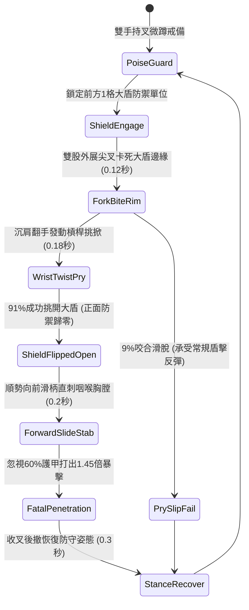

# 野戰精銳步兵雙手長柄鉤鐮雙股大叉卡鎖大盾與翻手挑殺第二階狀態機規格書

<!-- doc_id: doc_spec_1036 -->

## 1. 核心定位與設計理念

### 1.1 系統定位
本規格定義野戰步兵破陣格鬥中，精銳步兵兵種所運用之「長柄鉤鐮雙股生鋼巨叉第二階」（代碼：`HOOK-SICKLE-DOUBLE-FORK-PRY02`，WBS 代碼：`FORM-255`）進階破盾狀態機。第二階巨叉總長一丈二尺，頭部以精煉高碳生鋼打造雙股外展弧刃叉尖，叉身中段配置反曲雙向鉤鐮。面對手持生鐵包邊重型大盾結陣防守之敵軍時，步兵滑柄前探將雙股巨叉死死卡咬於盾牌邊緣或觀測孔，以雙手槓桿強力翻轉扭轉手腕，高達 91% 機率強行挑開盾牌瓦解其防禦架構；隨即借回旋之勢順勢滑柄突刺，以雙尖鋼叉暴刺目標中門暴露之咽喉與胸腹，忽視 60% 護甲造成 1.45 倍真實穿透傷害。

### 1.2 設計目標與單一真相
* **雙股外展強力卡盾**：針對重型盾牌上緣進行物理鎖死，利用大長柄槓桿力矩破除格擋。
* **翻手順勢無縫直刺**：破盾硬直瞬間無前搖直線暴刺，徹底抹殺敵方換拔短刃之時間。
* **單一真相來源**：嚴禁於文件末端附加補丁，所有機制、數值與判定邏輯均在此統一定義。

---

## 2. 狀態機架構與轉換流程

---

## 3. 核心數值與計算公式

### 3.1 基礎參數配置表
| 參數名稱 | 基準數值 | 規格說明與限制條件 |
| :--- | :--- | :--- |
| **長叉長度與重量** | 1 丈 2 尺 / 16 斤 | 白蠟木桿包覆生鋼條，雙叉展角 35 度 |
| **挑盾破防成功率** | 91% | 對重型鐵盾、木幔大盾；對小型圓盾為 80% |
| **防守中門瓦解時長** | 3.5 秒 | 挑開後目標完全喪失所有格擋率與正面減傷 |
| **直刺反擊耗時** | 0.20 秒 | 挑盾判定成立後無前搖銜接直刺 |
| **破甲穿透係數** | 60% | 生鋼雙叉刺擊無視目標 60% 物理護甲值 |
| **致命暴擊倍率** | 1.45 倍 | 弱點直刺造成之真實穿透物理暴擊 |
| **體力消耗（Stamina）** | 18 點 / 次 | 發動挑盾與順勢直刺組合戰技耐力消耗 |
| **招式冷卻間隔** | 1.8 秒 | 快速姿態重置，支援高節奏步兵對攻 |

### 3.2 槓桿挑盾與穿刺傷害公式
$$P_{\text{pry}} = \min\left(0.98, \, 0.91 \times \frac{\text{STR}_{\text{attacker}}}{\text{STR}_{\text{target}}} \times \left(1 - \frac{W_{\text{shield}}}{80}\right)\right)$$
$$D_{\text{thrust}} = \left(\text{BaseATK}_{\text{fork}} \times 1.45\right) \times \left(1 - \frac{\text{Def}_{\text{target}} \times 0.40}{100 + \text{Def}_{\text{target}} \times 0.40}\right)$$
* $W_{\text{shield}}$：敵盾自重係數（0 ~ 15）。
* 挑盾成功瞬間，目標立即附加 `SHIELD_DEFENSE_COLLAPSED`，移速扣減 20%。

---

## 4. 戰術反制與例外判定

1. **生鐵大盾頂置滑油**：若敵方盾牌邊緣塗抹滑石粉或厚牛油，卡咬咬合力下降，挑盾成功率降為 60%。
2. **後排側翼短刀策應**：若大盾兵身旁緊貼配刀步兵協防，挑盾時可能遭受側刀劈砍打斷。
3. **戰場狹窄隘口卡柄**：若身處寬度僅 1 格之極窄岩縫，長桿旋轉翻手受阻，直刺前搖延長 0.3 秒。

---

## 5. 驗收測試案例（Test Cases）

* **TC-01（雙股長叉咬合挑盾測試）**：配置重裝生鐵盾兵發動防禦，測試 100 次挑盾判定，驗證成功率達 91%（±2% 容許度）。
* **TC-02（順勢直刺無縫時序驗證）**：挑開盾牌後，驗證系統在 0.2 秒內精確銜接突刺判定，目標防禦值按 40% 折算。
* **TC-03（體力不足狀態降級）**：精銳步兵體力小於 18 點時，挑盾戰技自動切換為普通戳刺，不再觸發掀盾與暴擊。
