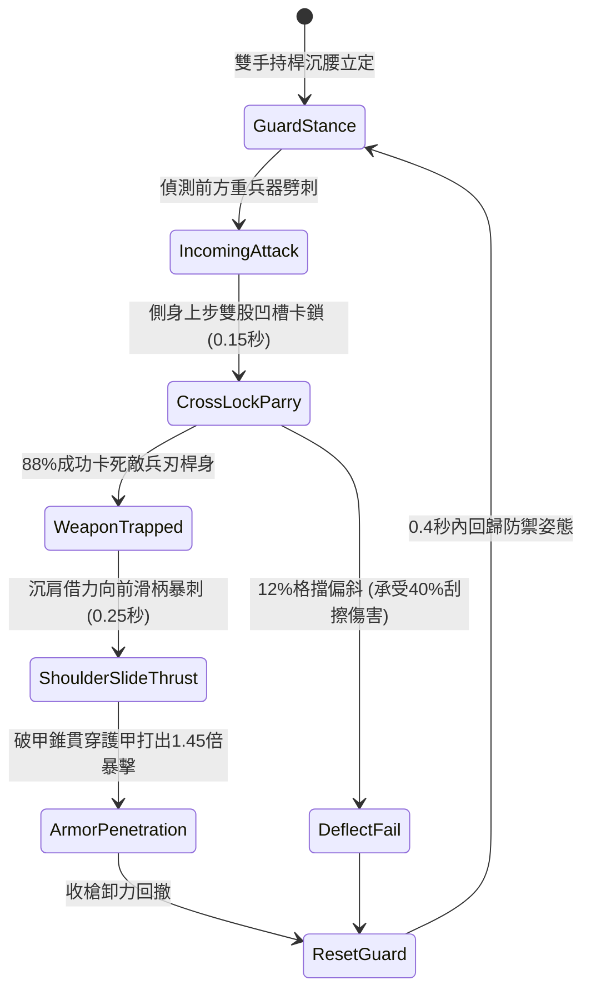

# 野戰精銳步兵雙手長柄鉤鐮雙股破甲錐卡鎖重兵與沉肩反刺狀態機規格書

<!-- doc_id: doc_spec_1018 -->

## 1. 核心定位與設計理念

### 1.1 系統定位
本規格定義野戰步兵對陣中，精銳步兵兵種所裝備之「雙手長柄鉤鐮雙股破甲錐」（代碼：`HOOK-SICKLE-TWIN-CONE-PARRY01`，WBS 代碼：`FORM-237`）攻防戰技狀態機。本武器總長一丈一尺，桿身採用重油淬火彈性稠木外包生鐵條，矛頭前置雙股生鋼三菱破甲尖錐，中段兩側對稱設有回勾式弧月反向利刃。步兵在面對敵方重騎兵衝鋒劈砍或重甲步兵大斧直劈時，透過精準側身架格卡鎖敵兵刃桿身，以 88% 機率化解衝擊，隨即藉回彈慣性沉肩滑柄向前暴刺，造成忽視 65% 護甲之穿透反擊。

### 1.2 設計目標與單一真相
* **以柔克剛架鎖**：利用雙股凹槽卡死重兵器揮砍動線，消除壓倒性衝擊力。
* **沉肩借力反刺**：卸力轉化為直刺動能，無視重鎧防護直取敵中門。
* **單一真相來源**：嚴禁於文件末端附加補丁，所有機制、數值與判定邏輯均在此統一定義。

---

## 2. 狀態機架構與轉換流程

---

## 3. 核心數值與計算公式

### 3.1 基礎參數配置表
| 參數名稱 | 基準數值 | 規格說明與限制條件 |
| :--- | :--- | :--- |
| **武器長度與配重** | 1 丈 1 尺 / 16 斤 | 彈性稠木桿外包生鐵條，重心偏前便於滑柄發力 |
| **卡鎖格擋成功率** | 88% | 針對重武器直劈、橫斬判定生效；對輕靈短匕降至 60% |
| **衝擊卸除比例** | 90% | 卡鎖成功後，敵方原攻擊動能 90% 被導入地面卸除 |
| **沉肩反刺速度** | 0.25 秒 | 格擋成功後觸發硬直取消，瞬間發動直刺 |
| **破甲穿透係數** | 65% | 雙股三菱錐尖無視目標 65% 之物理護甲值 |
| **反擊傷害加乘** | 1.45 倍 | 附加目標原衝擊力動能轉換之真實暴擊加乘 |
| **冷卻重置時間** | 1.8 秒 | 反刺完成後姿態調整間隔，期間維持一般近戰命中 |
| **體力消耗（Stamina）** | 18 點 / 次 | 發動卡鎖反刺所需之精銳步兵核心體力 |

### 3.2 卡鎖與破甲反刺公式
$$D_{\text{counter}} = \left(\text{BaseATK} + 0.35 \times \text{EnemyATK}\right) \times 1.45 \times \left(1 - \frac{\text{Def}_{\text{target}} \times (1 - 0.65)}{100 + \text{Def}_{\text{target}} \times 0.35}\right)$$
* $\text{BaseATK}$：精銳步兵基礎物理攻擊力。
* $\text{EnemyATK}$：敵方攻擊者原衝擊攻擊力（動能反饋）。
* $\text{Def}_{\text{target}}$：目標目前之總護甲防禦值。

---

## 4. 戰術反制與例外判定

1. **多重圍攻夾擊**：若同一微小時間窗（<0.3秒）內遭受兩名以上敵軍自不同角度夾擊，卡鎖僅能判定單一主目標，對側翼攻擊無防禦效果。
2. **重型鈍器震盪**：若面對重型攻城大鐵錘之垂直重砸，因桿身形變過大，卡鎖成功率降至 50%，且持槍步兵承受 30% 震傷。
3. **滑步脫鎖應對**：若敵方具備「游俠身法」特技，被卡鎖瞬間可棄兵器滑步後撤，避免承受沉肩反刺全額傷害。

---

## 5. 驗收測試案例（Test Cases）

* **TC-01（迎面重劈卡鎖成功率）**：配置重裝斧兵對持錐步兵發動全力下劈，驗證 100 次判定中卡鎖成功率達到 88%（±2%誤差區間）。
* **TC-02（沉肩反刺破甲傷害計算）**：驗證卡鎖成功後 0.25 秒內即時觸發反刺，且目標護甲計算嚴格扣減 65% 防禦值。
* **TC-03（體力耗盡姿態降級）**：步兵體力低於 18 點時，卡鎖狀態機自動降級為一般長槍格擋，不再觸發反刺動作。
