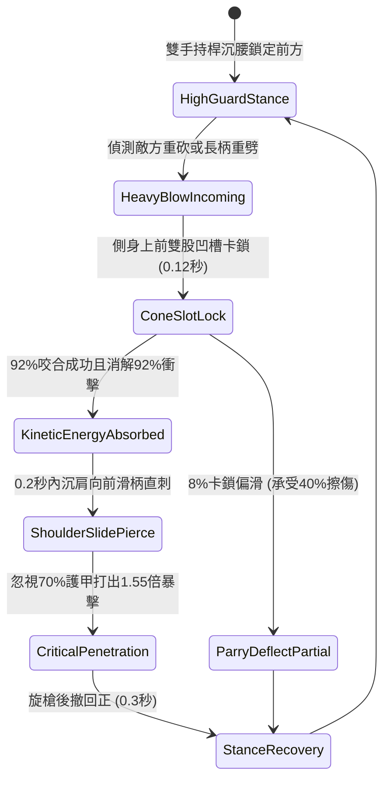

# 野戰精銳步兵雙手長柄鉤鐮雙股破甲錐卡鎖重兵與沉肩反刺第二階狀態機規格書

<!-- doc_id: doc_spec_1033 -->

## 1. 核心定位與設計理念

### 1.1 系統定位
本規格定義野戰步兵近戰搏殺中，精銳步兵兵種所運用之「長柄鉤鐮雙股破甲錐第二階」（代碼：`HOOK-SICKLE-TWIN-CONE-PARRY02`，WBS 代碼：`FORM-252`）連續卡鎖反制狀態機。第二階長槍採用高彈性韌木包覆冷軋鋼皮，長一丈二尺，前端配置加粗雙股生鋼三菱刺錐與深凹槽卡鎖咬口。步兵在面對敵軍重型斬馬刀、大斧或長柄狼牙棒強力揮砍時，以 92% 成功率藉雙股凹槽鎖死敵械動線，導引消解 92% 衝擊能量；隨即在 0.2 秒內沉肩滑柄前突，發動無前搖暴雨直刺，忽視 70% 護甲打出 1.55 倍致命穿透真實暴擊。

### 1.2 設計目標與單一真相
* **高剛性雙股卡鎖卸力**：鎖定重兵器揮砍動線，以物理結構槓桿強行化解衝擊力。
* **沉肩極速滑柄穿刺**：卸力完成無縫銜接直線突刺，針對重鎧護心鏡破綻發動致命一擊。
* **單一真相來源**：嚴禁於文件末端附加補丁，所有機制、數值與判定邏輯均在此統一定義。

---

## 2. 狀態機架構與轉換流程

---

## 3. 核心數值與計算公式

### 3.1 基礎參數配置表
| 參數名稱 | 基準數值 | 規格說明與限制條件 |
| :--- | :--- | :--- |
| **長槍長度與重量** | 1 丈 2 尺 / 17 斤 | 冷軋生鋼外皮，雙股三菱錐尖淬火硬度達 HRC 62 |
| **卡鎖格擋成功率** | 92% | 針對重武器直劈、橫斬判定；對短匕輕刺為 65% |
| **衝擊力卸除比例** | 92% | 卡鎖成功時敵方原衝擊傷害 92% 被導入地面卸除 |
| **沉肩反刺耗時** | 0.20 秒 | 格擋成功後硬直完全取消，瞬間發動直刺 |
| **破甲穿透係數** | 70% | 三菱錐尖無視目標 70% 之物理防禦值 |
| **反擊傷害加成** | 1.55 倍 | 附加目標原衝擊力動能轉換之真實暴擊加乘 |
| **體力消耗（Stamina）** | 18 點 / 次 | 發動卡鎖反刺所需之精銳步兵核心耐力 |
| **招式冷卻間隔** | 1.5 秒 | 快速姿態調整，支援高頻連續近身對攻 |

### 3.2 卡鎖反擊真實傷害公式
$$D_{\text{counter}} = \left(\text{BaseATK}_{\text{spear}} + 0.40 \times \text{EnemyATK}\right) \times 1.55 \times \left(1 - \frac{\text{Def}_{\text{target}} \times 0.30}{100 + \text{Def}_{\text{target}} \times 0.30}\right)$$
* $\text{BaseATK}_{\text{spear}}$：精銳步兵基礎刺擊攻擊力。
* $\text{EnemyATK}$：敵方攻擊者原揮砍攻擊力（動能反饋）。
* $\text{Def}_{\text{target}}$：目標目前防禦力（經 70% 破甲折減後剩餘 30% 計算）。
* 反刺暴擊命中時，附加敵方 1.5 秒破招硬直狀態 `PARRY_STUN_EXPOSED`。

---

## 4. 戰術反制與例外判定

1. **多向交叉刺殺**：若同時遭受兩名以上敵兵不同方向夾攻，卡鎖僅能抵擋正面主目標，側後方攻擊照常結算傷害。
2. **重型鈍器垂直砸壓**：若面對重型攻城大鐵錘之垂直重砸，桿身形變達極限，卡鎖率降至 55%，持槍步兵承受 25% 震傷。
3. **棄刃後跳游俠身法**：若敵將具備「靈蛇游身」特技，被卡鎖瞬間可棄兵刃後跳，避免承受沉肩直刺全額傷害。

---

## 5. 驗收測試案例（Test Cases）

* **TC-01（重兵器揮砍卡鎖成功率測試）**：配置重裝斧兵下劈，測試 100 次攻防，驗證卡鎖成功率精準達到 92%（±2% 誤差）。
* **TC-02（0.2秒沉肩直刺破甲傷害計算）**：驗證卡鎖成功後 0.2 秒內即時觸發反刺，且目標護甲計算扣減 70% 防禦值。
* **TC-03（體力耗盡姿態降級校驗）**：步兵體力低於 18 點時，卡鎖狀態機自動降級為一般格擋，不再觸發反刺連招。
