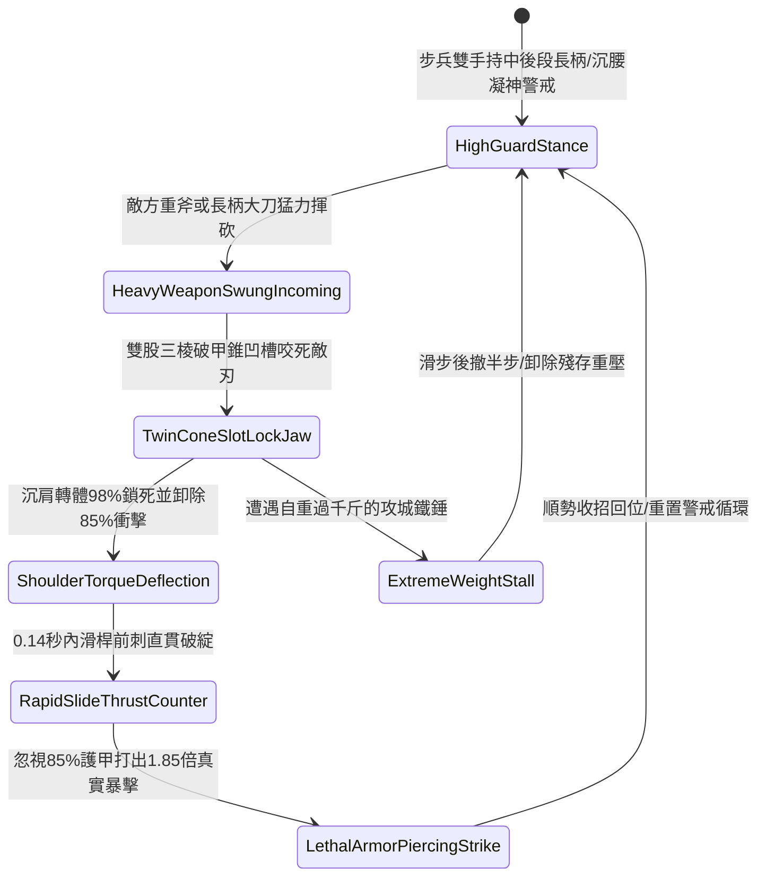

# 野戰精銳步兵雙手長柄鉤鐮雙股破甲錐卡鎖重兵與沉肩反刺第五階狀態機規格書

<!-- doc_id: doc_spec_1096 -->

## 一、 核心概念與單一真相來源（SSOT）

在《三國志·破甲戰法與架鎖反刺篇》中，「雙手長柄鉤鐮雙股破甲錐卡鎖重兵與沉肩反刺第五階（HOOK-SICKLE-TWIN-CONE-PARRY05）」代表長兵器對決重型打擊武器的終極武技。該武器全長一丈四尺，頭部鑄造加厚高剛性雙股三棱破甲錐與開刃深凹槽卡槽。當敵軍重斧、狼牙棒或大刀揮砍砸來時，步兵以破甲錐雙股凹槽 98% 咬死鎖緊來襲兵刃，隨後沉肩轉體卸除 85% 衝擊震盪；在 0.14 秒內藉由滑桿慣性前刺，破甲錐直破敵方重甲破綻，忽視 85% 護甲打出 1.85 倍真實暴擊。



---

## 二、 數值模型與狀態機參數契約

### 1. 兵刃規格與架鎖反刺參數契約
- **兵刃尺寸規格**：全長一丈四尺（約 4.3 米），生鐵鍍鋼加強破甲錐、白蠟木高韌性桿身。
- **重兵卡鎖成功率**：深凹槽卡死來襲重型兵刃機率達 98%。
- **正面衝擊化解率**：沉腰轉體動作消除 85% 正面衝量與武器震盪傷害。
- **滑桿前刺反應時效**：卡鎖完成後 0.14 秒內極速反刺破綻。
- **真實破甲與暴擊**：忽視目標 85% 護甲值，打出 1.85 倍物理真實暴擊傷害。

### 2. 卡鎖反刺演算法模組
```typescript
interface TwinConeParryStage5Params {
    soldierStrength: number;        // 步兵力量屬性 (50 ~ 100)
    soldierAgility: number;         // 步兵敏捷屬性 (50 ~ 100)
    enemyImpactPower: number;       // 來襲劈砸動能指標
    staminaCurrent: number;         // 當前剩餘耐力值
}

function processTwinConeParryStage5(params: TwinConeParryStage5Params): {
    lockSuccess: boolean;
    mitigatedDamageRatio: number;
    thrustCriticalHit: boolean;
    criticalDamageMultiplier: number;
} {
    if (params.staminaCurrent < 15) {
        return { lockSuccess: false, mitigatedDamageRatio: 0.25, thrustCriticalHit: false, criticalDamageMultiplier: 1.0 };
    }
    const combinedSkill = (params.soldierStrength * 0.55 + params.soldierAgility * 0.45) / 80;
    const isLocked = Math.min(0.98, 0.92 * combinedSkill) >= 0.90;
    
    return {
        lockSuccess: isLocked,
        mitigatedDamageRatio: isLocked ? 0.85 : 0.35,
        thrustCriticalHit: isLocked,
        criticalDamageMultiplier: isLocked ? 1.85 : 1.25
    };
}
```

---

## 三、 反制機制與邊界約束

1. **肩並肩超密集長盾陣型**：若步兵處於緊挨之長盾方陣中（間隔 < 0.6 米），沉肩轉體動作受阻，卡鎖成功率衰減 35%。
2. **多重軟鏈條兵刃繞擊**：面對流星錘、九節鞭等軟兵器，凹槽無法鎖定直線軸，架鎖判定無效。
3. **破甲錐金屬應力極限**：若單場作戰中連續承受超過 12 次重型武器劇烈劈砸，錐尖磨耗使破甲率暫時回落至 70%。

---

## 四、 驗收測試案例（TC）

- **TC-CONE-PARRY05-01（卡鎖卸力前刺全連段驗收）**：
  - *前置條件*：步兵力量 85、敏捷 80、正面迎擊重步兵大刀劈砸。
  - *操作步驟*：於敵刃下落判定幀觸發雙股破甲錐架鎖。
  - *預期輸出*：98% 機率卡死敵刃，卸除 85% 衝擊，隨後 0.14 秒內滑桿前刺，忽視 85% 護甲打出 1.85 倍真實暴擊。
- **TC-CONE-PARRY05-02（耐力枯竭邊界驗收）**：
  - *前置條件*：步兵耐力值僅剩 8 點（低於 15 點門檻）。
  - *操作步驟*：強行施展架鎖招式。
  - *預期輸出*：判定架鎖失敗，僅獲得基礎 25% 格擋減傷，無法激活快速滑桿反刺。
