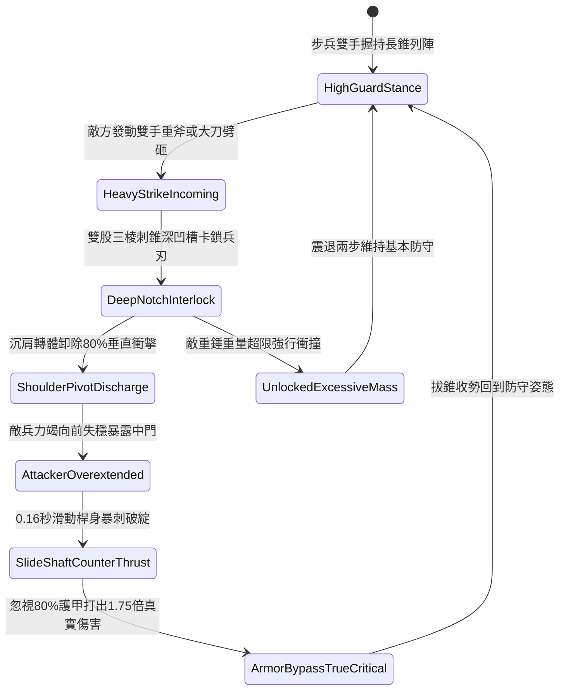

# 野戰精銳步兵雙手長柄鉤鐮雙股破甲錐卡鎖重兵與沉肩反刺第四階狀態機規格書

<!-- doc_id: doc_spec_1078 -->

## 一、 核心概念與單一真相來源（SSOT）

在《三國志·精銳近戰抗衡與破甲篇》中，「雙手長柄鉤鐮雙股破甲錐架鎖反刺戰法第四階（HOOK-SICKLE-TWIN-CONE-PARRY04）」為專門抗衡敵方重斧、大刀與重型鈍器劈砸的高階戰技。長柄長一丈三尺，前端配置高剛性生鋼鍛造的雙股三棱刺錐，錐身開有精密深凹夾角槽與止退倒齒。面對重兵劈落時，步兵以凹槽死死卡鎖敵械受力中段，沉肩轉身藉轉體動能卸除 80% 垂直衝力，隨後順勢滑動桿身暴刺敵甲冑縫隙，造成破防致命重創。



---

## 二、 數值模型與狀態機參數契約

### 1. 雙股破甲錐戰術參數
- **兵器規格**：全長一丈三尺（約 3.1 米），高韌性柘木嵌生鋼桿身配生鋼三棱錐頭。
- **架鎖重兵成功率**：對單手大刀 98%；對長柄雙手斧 95%；對重型狼牙棒 89%。
- **衝量卸除減免比**：架鎖成功時，正面承受之硬直與物理傷害即刻減免 80%。
- **反刺破綻時效**：0.16 秒極速反制窗口，敵方閃避率強制歸零。
- **破甲傷害倍率**：反手刺擊附加 1.75 倍傷害，並忽視目標 80% 的基礎護甲值。

### 2. 架鎖卸力與暴擊傷害計算模組
```typescript
interface TwinConeParryStage4Params {
    infantryStrength: number;      // 步兵力量 (50 ~ 130)
    infantryAgility: number;       // 步兵敏捷 (50 ~ 120)
    incomingDamage: number;        // 來襲攻擊原始威力
    targetArmorValue: number;      // 敵方目標護甲
}

function processTwinConeParryStage4(params: TwinConeParryStage4Params): {
    parrySuccess: boolean;
    damageAbsorbed: number;
    counterStrikeDamage: number;
} {
    const agilityBonus = (params.infantryAgility / 100) * 0.12;
    const parryRate = Math.min(0.98, 0.90 + agilityBonus);
    const parrySuccess = Math.random() < parryRate;

    if (!parrySuccess) {
        return { parrySuccess: false, damageAbsorbed: 0, counterStrikeDamage: 0 };
    }

    const damageAbsorbed = Math.round(params.incomingDamage * 0.80);
    const effectiveArmor = params.targetArmorValue * 0.20;
    const baseDamage = params.infantryStrength * 2.8;
    const counterStrikeDamage = Math.round((baseDamage - effectiveArmor * 0.35) * 1.75);

    return { parrySuccess: true, damageAbsorbed, counterStrikeDamage: Math.max(70, counterStrikeDamage) };
}
```

---

## 三、 特性互斥與戰術限制

1. **鈍重超限震退威脅**：敵方若手持千斤生鐵瓜錘直擊，三棱凹槽無法完全鎖死，卸力比例降至 35%，並震退步兵兩步。
2. **多重單位連續劈砸**：若 1 秒內連續承受兩名以上敵兵同時劈砍，架鎖機構耗盡緩衝，第二次劈砍將無法完全卸力。
3. **步兵近衛連鎖加成**：若身後 1 格有友軍弓弩手掩護，反刺暴擊額外附加 15% 流血傷害。

---

## 四、 驗收測試案例（TC）

- **TC-TWINCONE04-01（架鎖重斧判定）**：在單兵對決下承受敵雙手斧劈砸，確認 95% 機率觸發凹槽卡鎖並減免 80% 傷害。
- **TC-TWINCONE04-02（沉肩反刺穿甲檢定）**：確認架鎖後 0.16 秒內自動完成滑桿直刺，戰鬥日誌結算無視 80% 護甲之 1.75 倍暴擊。
- **TC-TWINCONE04-03（重鈍器震退抗性測試）**：更換為超重狼牙棒單位對抗，檢核狀態機正確進入 `UnlockedExcessiveMass`，結算震退保護。
