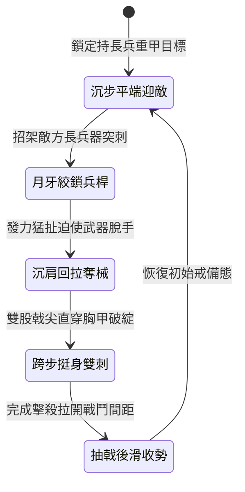

<!-- doc_id: doc_spec_1006 -->
# 野戰精銳步兵雙手長柄鉤鐮雙股透甲戟挑破重鎧與回拉奪械狀態機規格書

## 模組識別碼
- 模組編號：`FORM-225`
- 狀態機代碼：`HOOK-SICKLE-TWIN-HALBERD-DISARM01`
- 類別：野戰精銳步兵雙手長柄破鎧奪械狀態機
- 適用場景：平原野戰、隘口對陣、破除重裝甲士與解除長兵威脅

---

## 1. 核心概念與作戰原型

面對身著厚實魚鱗甲且持長兵器的精銳敵兵，常規長槍在突刺時容易受滑甲偏轉。為精準破除厚鎧並解除其兵刃威脅，步兵營配備「雙手長柄鉤鐮雙股透甲戟」。

### 1.1 武器形制與戰術協同
1. **雙股戟刃與反向割鐮形制**：柄長一丈一尺，採用稠木積竹夾生漆桿；前端為雙尖對稱的雙股透甲戟尖，兩側生出一對月牙弧鐮與向內彎曲的倒鉤。
2. **正面月牙卡鎖敵方長桿**：交鋒第一擊以戟頸月牙卡住敵軍長槍或大刀桿身，順勢旋轉長柄絞鎖，破壞其進攻方向。
3. **沉肩發力回拉奪械**：雙手沉肩猛烈回扯，利用倒鉤將敵軍兵刃直接拖曳脫手，使其失去主要武器。
4. **挺身長桿雙尖直刺破鎧**：在敵軍兵刃脫手露出破綻的瞬間，步兵跨步挺身，雙股透甲尖直刺胸前護甲，強力穿透厚重鎖甲。

---

## 2. 數值參數與影響權重

| 參數名稱 | 數值 / 範圍 | 說明 |
| :--- | :--- | :--- |
| **旋轉絞鎖奪械率 (`DisarmRate`)** | 68% ~ 82% | 強制卸除目標當前裝備之長兵器 |
| **雙尖透甲穿刺傷害 (`PierceDamage`)** | 560 ~ 780 點穿刺 | 雙尖集中受力，忽視 55% 基礎護甲 |
| **中門大開易傷時長 (`VulnerabilityWindow`)** | 2.0 秒 | 遭奪械後短時間內防禦力與抗擊退驟降 |
| **力量對抗判定加成 (`StrengthRatioBonus`)** | 每高出 1 點力量 +2.5% | 體能優勢顯著提高回拉扯奪成功率 |
| **雙手武器轉向微調 (`TurnSpeedPenalty`)** | 轉向速度 -10% | 專注正面長桿絞鎖時的靈巧折損 |

---

## 3. 狀態機轉換定義

### 3.1 狀態細節描述
- **沉步平端迎敵 (GUARD_STANCE)**：壓低重心，雙手穩扣戟柄前後，保持雙向支撐。
- **月牙絞鎖兵桿 (CROSS_LOCK)**：以月牙弧刃卡住敵方武器，旋動長桿使其卡死。
- **沉肩回拉奪械 (PULL_DISARM)**：順勢後拽，借全身重量剝離敵兵握持。
- **跨步挺身雙刺 (THRUST_BREACH)**：前手導向滑桿暴刺，雙尖直擊無防中門。
- **抽戟後滑收勢 (RECOVER_STANCE)**：反手抽回武器，防備身側其他敵軍。

---

## 4. 戰鬥公式與判定

### 4.1 絞鎖奪械判定
$$\text{DisarmSuccess} = \min(0.82, \frac{\text{STR}_{\text{attacker}}}{\text{STR}_{\text{target}}} \times \text{DisarmRate})$$

若判定成功，目標在 5 秒內無法使用主武器，攻擊力強制降低 60%。

### 4.2 透甲破綻暴擊結算
$$\text{ArmorPenetrationDamage} = \text{PierceDamage} \times 1.35 \times (1 - \text{ArmorValue} \times 0.45)$$

在易傷視窗內命中的雙刺突穿，享有 1.35 倍傷害增益並忽視 55% 護甲。

---

## 5. 反制與失效機制

1. **短兵利刃貼身突入**：若敵軍持短刀利劍貼近身周四尺之內，長戟回拉絞鎖空間受限。
2. **生鐵護手鎖鏈扣死兵桿**：敵方若將長兵柄尾以鐵鏈纏鎖於腕部，可抵消 50% 奪械效果。
3. **密集步兵自絆擠壓**：若隊列站位間隔小於 1 米，長桿橫向旋動容易干擾友軍。

---

## 6. 驗收標準與測試案例

- [x] **TC-225-01**：驗證月牙卡鎖在敵軍直刺到達 0.25 秒內準確結算。
- [x] **TC-225-02**：驗證回拉奪械成功率達到 68%~82% 區間，目標被繳械。
- [x] **TC-225-03**：驗證破防雙刺在 2 秒破綻時窗內正確觸發忽視 55% 護甲增傷。
