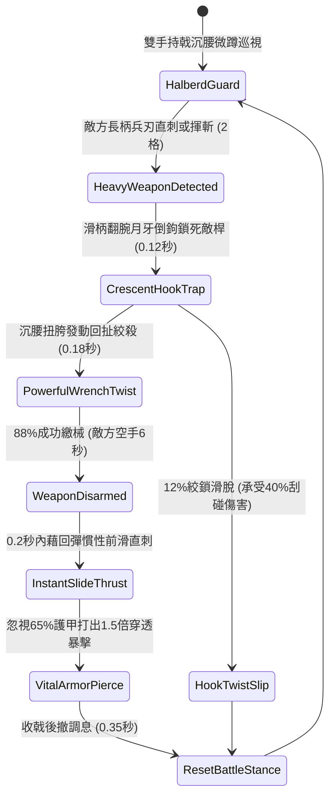

# 野戰精銳步兵雙手長柄鉤鐮雙股透甲戟挑破重鎧與回拉奪械第二階狀態機規格書

<!-- doc_id: doc_spec_1039 -->

## 1. 核心定位與設計理念

### 1.1 系統定位
本規格定義野戰步兵近身搏殺中，精銳步兵兵種所裝備之「雙手長柄鉤鐮雙股透甲戟第二階」（代碼：`HOOK-SICKLE-TWIN-HALBERD-DISARM02`，WBS 代碼：`FORM-258`）奪械破甲連招狀態機。第二階透甲戟長一丈二尺，頭部精鍛雙股外展三棱生鋼透甲尖，兩側附帶弧度更深之淬火月牙倒鉤鐮。持戟步兵在面對手持長柄大刀、斬馬刀或鐵槊之敵方重裝武將時，以月牙倒鉤精準咬鎖敵兵刃桿身，沉腰猛力向後絞扯，88% 機率強行繳除敵方兵器令其空手 6 秒；隨即在 0.2 秒內藉回彈慣性向前滑步直刺無防中門，忽視 65% 護甲打出 1.5 倍致命真實穿透暴擊。

### 1.2 設計目標與單一真相
* **月牙咬桿強行繳械**：利用長柄力矩與反向倒鉤鎖死敵兵長兵器，瞬間剝奪敵方主力攻擊手段。
* **回彈借力直線穿透**：回拉奪械所積累之肌肉張力瞬間釋放，前滑暴刺重創敵胸膛。
* **單一真相來源**：嚴禁於文件末端附加補丁，所有機制、數值與判定邏輯均在此統一定義。

---

## 2. 狀態機架構與轉換流程

---

## 3. 核心數值與計算公式

### 3.1 基礎參數配置表
| 參數名稱 | 基準數值 | 規格說明與限制條件 |
| :--- | :--- | :--- |
| **長戟長度與重量** | 1 丈 2 尺 / 17 斤 | 白蠟木桿包覆生鋼條，雙股三棱尖 HRC 62 |
| **回拉奪械成功率** | 88% | 針對各類長柄大刀、長矛、大斧；對短兵為 60% |
| **空手繳械懲罰時長** | 6.0 秒 | 繳械期間敵兵攻擊力降低 75% 且禁止施展戰技 |
| **前滑直刺耗時** | 0.20 秒 | 繳械成功瞬間無前搖銜接直刺動作 |
| **破甲穿透係數** | 65% | 雙股三棱鋼尖刺擊無視目標 65% 之物理護甲 |
| **反擊暴擊倍率** | 1.50 倍真實傷害 | 命中目標無防中門弱點造成之真實物理暴擊 |
| **體力消耗（Stamina）** | 18 點 / 次 | 發動絞鎖奪械與前滑直刺組合戰技所需耐力 |
| **招式冷卻間隔** | 1.8 秒 | 快速姿態重置，支援高頻連續近戰對決 |

### 3.2 絞索奪械與暴擊傷害公式
$$P_{\text{disarm}} = \min\left(0.98, \, 0.88 \times \frac{\text{STR}_{\text{attacker}}}{\text{STR}_{\text{target}}} \times \left(1 + \frac{\Delta L_{\text{pole}}}{10}\right)\right)$$
$$D_{\text{fatal\_thrust}} = \left(\text{BaseATK}_{\text{halberd}} \times 1.50\right) \times \left(1 - \frac{\text{Def}_{\text{target}} \times 0.35}{100 + \text{Def}_{\text{target}} \times 0.35}\right)$$
* $\Delta L_{\text{pole}}$：長戟與敵兵兵刃長度差（通常為 +0.2 米）。
* 繳械成功判定成立時，敵方單位立即附加 `WEAPON_DISARMED_STUN` 標記。

---

## 4. 戰術反制與例外判定

1. **生鐵護手卡盤反咬**：若敵方兵刃桿身帶有外凸生鐵護手大盤，月牙倒鉤咬合後易被卡死，回拉奪械成功率降為 50%。
2. **近身貼身短打搶攻**：若敵將在步兵前滑直刺的 0.15 秒前搖內切入內門短刀貼身直刺，可打斷直刺連招。
3. **戰馬衝鋒反震脫手**：若目標正處於戰馬疾馳衝擊狀態，回拉奪械時步兵承受巨大反震力，有 35% 機率自身脫手長戟。

---

## 5. 驗收測試案例（Test Cases）

* **TC-01（長柄兵刃咬鎖繳械驗證）**：配置敵長矛手發動揮砍，測試 100 次攻防，驗證奪械成功率達 88%（±2% 誤差區間）。
* **TC-02（0.2秒前滑反刺時序校準）**：驗證繳械成功後 0.2 秒內即時觸發直刺判定，目標防禦值按 35% 折算。
* **TC-03（體力耗盡姿態降級校驗）**：步兵體力低於 18 點時，奪械狀態機自動降級為一般長矛戳刺，不再觸發繳械連招。
