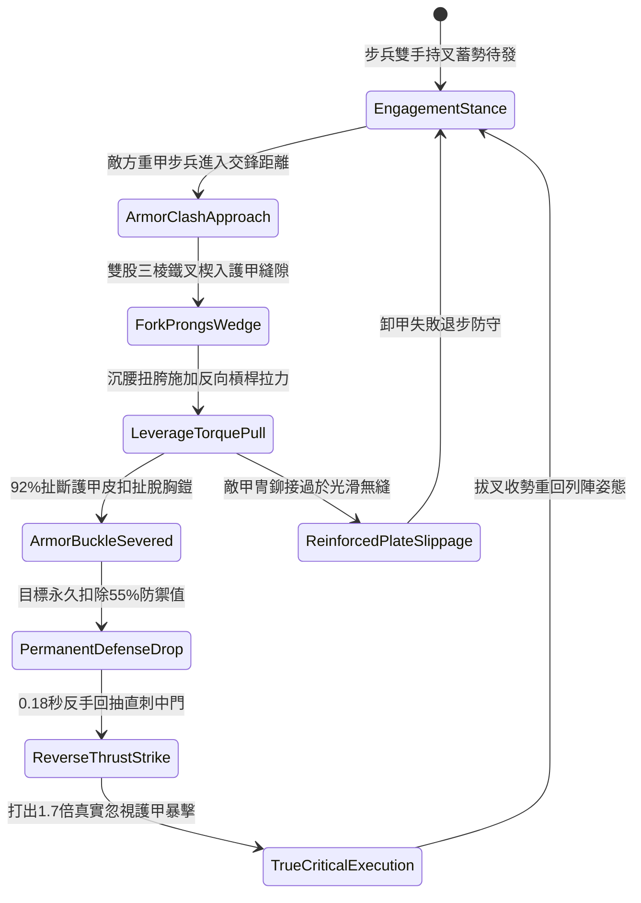

# 野戰精銳步兵雙手長柄鉤鐮雙股鐵叉破甲與反手卸甲第三階狀態機規格書

<!-- doc_id: doc_spec_1054 -->

## 一、 核心概念與單一真相來源（SSOT）

在《三國志·破陣精銳近戰篇》中，「雙手長柄鉤鐮雙股鐵叉卸甲戰法第三階（HOOK-SICKLE-IRON-FORK-STRIP03）」為專門克制敵方重裝甲士防禦的致命近戰武技。鐵叉全長一丈二尺，矛尖後方鍛接兩道加寬反向三棱鐵叉，專門楔入胸鎧肩甲接縫皮扣。步兵交鋒時，以雙股鐵叉卡咬敵方甲冑骨架，沉腰轉跨藉槓桿扭力強行扯斷皮扣卸下護甲，隨後反手滑桿直刺卸甲中門，造成真實穿透重創。



---

## 二、 數值模型與狀態機參數契約

### 1. 雙股鐵叉兵裝參數
- **兵器規格**：全長一丈二尺（約 2.8 米），鋼芯硬木桿身配高碳雙股三棱叉頭。
- **楔入卸甲成功率**：皮甲/扎甲 98%；魚鱗鐵甲 92%；一體鍛造玄鐵板甲 82%。
- **護甲永久削弱幅度**：卸甲成功後，目標防禦值永久扣除 55%，持續至戰鬥結束。
- **反手直刺極速窗口**：0.18 秒黃金刺擊窗口，目標處於護甲脫落失衡僵直態。
- **穿透傷害倍率**：反手刺擊附加 1.7 倍傷害，並忽視目標剩餘 75% 的基礎護甲值。

### 2. 卸甲破防與暴擊傷害模組
```typescript
interface IronForkStripParams {
    attackerStr: number;           // 攻擊者力量 (50 ~ 130)
    attackerSkill: number;         // 攻擊者武技熟練度 (60 ~ 120)
    targetArmorRating: number;     // 敵方護甲值 (100 ~ 300)
    armorConstruction: "lamellar" | "fishscale" | "plate";
}

function processArmorStripping(params: IronForkStripParams): {
    stripSuccess: boolean;
    defenseReductionPct: number;
    finalStrikeDamage: number;
} {
    const baseRates = { lamellar: 0.98, fishscale: 0.92, plate: 0.82 };
    const strFactor = (params.attackerStr * 1.2 + params.attackerSkill * 0.8) / 200;
    const stripRate = Math.min(0.96, baseRates[params.armorConstruction] * strFactor);

    const stripSuccess = Math.random() < stripRate;
    const defenseReductionPct = stripSuccess ? 55 : 0;
    const baseDamage = params.attackerStr * 3.0;
    const finalStrikeDamage = stripSuccess ? Math.round(baseDamage * 1.7) : Math.round(baseDamage * 0.7);

    return { stripSuccess, defenseReductionPct, finalStrikeDamage };
}
```

---

## 三、 特性互斥與戰術應對原則

1. **無甲與輕甲低效機制**：若敵方為無甲部隊或布衣單位，因無硬質皮扣與甲板可楔入，卸甲機制不觸發，轉為常規刺擊。
2. **重斧劈砍中斷威脅**：若在扭腰施力期間遭遇敵方雙手大斧劈砍，卸甲動作強制中斷並退步承受 30% 擦碰。
3. **戰法連鎖破陣庇護**：同小隊若有長矛兵協同，卸甲直刺後的破綻擴散至相鄰 1 格敵軍，附加破防 20% 效果。

---

## 四、 驗收測試案例（TC）

- **TC-FORKSTRIP03-01（扎甲卸甲判定）**：對穿戴扎甲的重步兵發動技能，確認 92% 機率扯脫護甲並附帶防禦 -55% 減益標記。
- **TC-FORKSTRIP03-02（反手直刺暴擊結算）**：確認卸甲完成後 0.18 秒內結算直刺傷害，戰鬥日誌顯示 1.7 倍穿甲暴擊。
- **TC-FORKSTRIP03-03（玄鐵板甲抗拉測試）**：更換為一體鍛造玄鐵板甲目標，確認卸甲判定成功率依公式結算為 82% 韌性。
