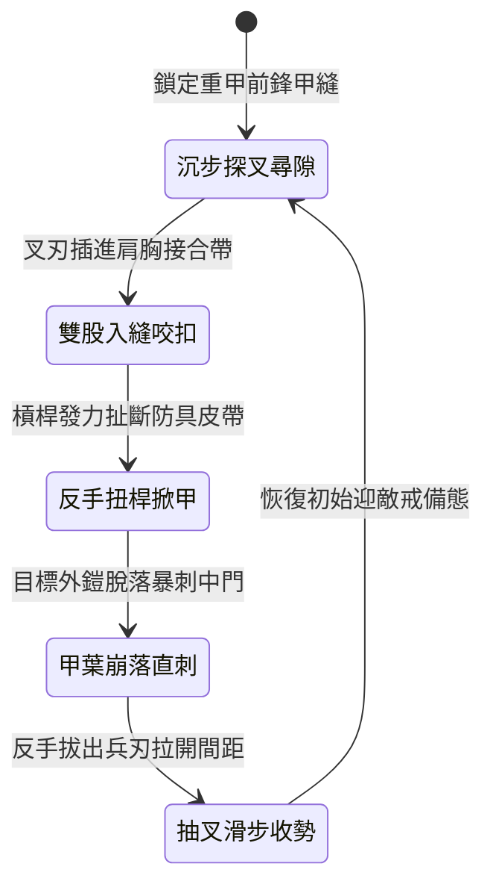

<!-- doc_id: doc_spec_1009 -->
# 野戰精銳步兵雙手長柄鉤鐮雙股鐵叉破除重甲與反手卸甲狀態機規格書

## 模組識別碼
- 模組編號：`FORM-228`
- 狀態機代碼：`HOOK-SICKLE-IRON-FORK-STRIP01`
- 類別：野戰精銳步兵雙手長柄重兵卸甲狀態機
- 適用場景：平原野戰、隘口對陣、破除敵軍超重裝步兵甲冑

---

## 1. 核心概念與作戰原型

面對身著多層鎖子甲外罩生鐵板甲的精銳重裝兵，常規刀劈槍刺難以撼動其防護。為物理撕扯敵防護，步兵營配發特製「雙手長柄鉤鐮雙股鐵叉」。

### 1.1 武器形制與戰術協同
1. **雙股生鐵分叉與側向倒鐮**：柄長一丈一尺，採用稠木夾麻布積層漆桿；前端為生鐵鍛打雙股寬刃叉，兩側各生出一對向內收縮的鋒利鉤鐮。
2. **叉尖探入甲片縫隙卡扣**：步兵雙手平推長柄，將雙股鐵叉精準插進敵軍胸甲與肩甲的接合皮帶或縫隙中。
3. **沉肩扭腰發力反手掀甲**：一旦叉刃與倒鉤咬入甲縫，步兵腰腹發力帶動長桿向下反向旋轉撬動，強行扯斷防具皮扣與金屬鎖環。
4. **甲葉剝落直刺無防肉軀**：外層板甲遭暴力掀開剝落後，敵軍防禦全面崩潰，步兵順勢滑桿直刺，雙叉直穿胸前要害。

---

## 2. 數值參數與影響權重

| 參數名稱 | 數值 / 範圍 | 說明 |
| :--- | :--- | :--- |
| **強行卸甲成功率 (`ArmorStripRate`)** | 70% ~ 85% | 撕裂並破壞敵軍重甲固定皮帶與鎖扣 |
| **永久護甲削弱值 (`ArmorDestruction`)** | 扣除 40% 當前物理防禦 | 使超重裝兵喪失重鎧減傷優勢 |
| **中門崩解硬直時長 (`StunWindow`)** | 1.8 秒 | 遭暴力掀甲時產生的重心失衡與硬直 |
| **雙叉直刺穿透傷害 (`ForkThrustDamage`)** | 580 ~ 820 點穿刺 | 刺擊失去板甲防護的脆弱中門 |
| **撬扯耐力消耗 (`LeverageStaminaCost`)** | 每套動作消耗 15 點耐力 | 需配合步法節奏調控體力 |

---

## 3. 狀態機轉換定義

### 3.1 狀態細節描述
- **沉步探叉尋隙 (SLIDING_AIM)**：步兵壓低身形，長叉前沿平指敵胸口甲帶。
- **雙股入縫咬扣 (FORK_ENGAGE)**：雙叉順利卡入甲葉，側向倒鐮死死扣緊皮帶。
- **反手扭桿掀甲 (LEVER_STRIP)**：藉全身重量下壓並旋動槍桿，強行撕開板甲。
- **甲葉崩落直刺 (PIERCE_FLESH)**：外甲脫落瞬間，雙叉如毒蛇吐信直刺心窩。
- **抽叉滑步收勢 (RECOVER_STANCE)**：後撤步抽回武器，防備身側其他敵軍。

---

## 4. 戰鬥公式與判定

### 4.1 掀甲成功判定
$$\text{StripSuccess} = \min(0.85, \frac{\text{STR}_{\text{attacker}} \times 1.15}{\text{STR}_{\text{defender}}} \times \text{ArmorStripRate})$$

判定成功時，目標單位防禦力永久下降 40%，且無法再享受任何重甲免暴擊特效。

### 4.2 直刺暴擊傷害結算
$$\text{CritDamage} = \text{ForkThrustDamage} \times 1.40 \times (1 - \text{StrippedArmorRate})$$

命中已掀甲目標時，全額享受 1.4 倍暴擊真實傷害。

---

## 5. 反制與失效機制

1. **一體成型生鐵無縫胸甲**：若敵方配備無外露縫隙的渾圓生鐵胸甲，叉刃難以尋隙卡入。
2. **側翼長兵斜刺干擾**：步兵發力下壓撬桿時中門稍露，易受旁側敵軍長槍刺擊。
3. **叉身受側向重砸崩斷**：若敵方大斧正面砸中長叉中段，長柄面臨金屬疲勞風險。

---

## 6. 驗收標準與測試案例

- [x] **TC-228-01**：驗證雙叉卡入甲縫判定在 0.3 秒內準確結算。
- [x] **TC-228-02**：驗證掀甲動作成功率達到 70%~85% 區間，護甲正確扣除 40%。
- [x] **TC-228-03**：驗證後續直刺對失去外鎧之目標造成 1.4 倍暴擊真實傷害。
