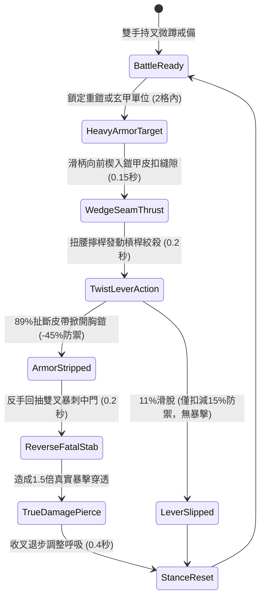

# 野戰精銳步兵雙手長柄鉤鐮雙股鐵叉破除重甲與反手卸甲第二階狀態機規格書

<!-- doc_id: doc_spec_1024 -->

## 1. 核心定位與設計理念

### 1.1 系統定位
本規格定義野戰步兵近身破甲戰術中，精銳步兵兵種所配備之「雙手長柄鉤鐮雙股鐵叉第二階」（代碼：`HOOK-SICKLE-IRON-FORK-STRIP02`，WBS 代碼：`FORM-243`）進階卸甲狀態機。本長柄神兵長一丈一尺，雙叉尖端經千錘淬火磨成三棱血槽，叉根部向後分支出兩對生鋼倒扣倒刺。在面對敵方重裝玄甲騎兵或重鎧禁衛軍時，持叉步兵以雙手槓桿原理將雙股長叉楔入敵將胸甲或肩鎧之皮條卡扣接縫，藉擰腕擰桿之旋轉剪切力，89% 機率強行絞斷皮扣扯脫胸鎧，令目標永久損失 45% 護甲，並於 0.2 秒內反手回抽尖刃直刺無甲中門，打出 1.5 倍真實弱點穿透。

### 1.2 設計目標與單一真相
* **槓桿擰絞強行卸甲**：破解傳統刀砍槍刺無法穿透厚重板甲與鎖子甲之困局。
* **撕甲即刻連擊反刺**：扯脫護具使中門大開，立即無縫切換致命真實傷害暴擊。
* **單一真相來源**：嚴禁於文件末端附加補丁，所有機制、數值與判定邏輯均在此統一定義。

---

## 2. 狀態機架構與轉換流程

---

## 3. 核心數值與計算公式

### 3.1 基礎參數配置表
| 參數名稱 | 基準數值 | 規格說明與限制條件 |
| :--- | :--- | :--- |
| **兵器長度與重量** | 1 丈 1 尺 / 17 斤 | 高彈性白蠟木桿包鐵，叉尖帶三棱生鋼倒刺 |
| **卸甲成功率（Strip）**| 89% | 針對重裝板甲、明光鎧、玄甲；對布甲/輕皮甲不生效 |
| **護甲永久扣減率** | -45% 物理防禦 | 扯斷皮扣使胸腹鎧甲脫落，該負面狀態持續整場戰鬥 |
| **反手直刺耗時** | 0.20 秒 | 卸甲成功後瞬間觸發後續反手回刺動作 |
| **反擊傷害倍率** | 1.50 倍真實傷害 | 目標中門防禦喪失，無視殘餘防禦直擊內臟 |
| **易傷 Debuff 時間** | 8.0 秒 | 撕甲後目標承受全體友軍物理攻擊額外增加 20% |
| **體力消耗（Stamina）**| 20 點 / 次 | 強力槓桿擰絞消耗之步兵核心耐力 |
| **招式冷卻間隔** | 2.2 秒 | 兩次卸甲嘗試之間所需姿態調整時間 |

### 3.2 卸甲與真實暴擊傷害公式
$$D_{\text{fatal}} = \left(\text{BaseATK}_{\text{fork}} \times 1.50\right) + \left(0.12 \times \text{TargetMaxHP}\right)$$
$$\text{Def}_{\text{residual}} = \max\left(0, \, \text{Def}_{\text{target}} \times (1 - 0.45)\right)$$
* $\text{BaseATK}_{\text{fork}}$：精銳步兵基礎刺擊攻擊力。
* $\text{TargetMaxHP}$：目標最大生命值（帶入穿透內臟之動態撕裂真實傷害）。
* 卸甲判定成功後，目標即刻附加 `ARMOR_STRIPPED_EXPOSED` 永久狀態標籤。

---

## 4. 戰術反制與例外判定

1. **一體成形無扣重鎧**：若敵方穿戴西方傳入之一體澆鑄生鐵無縫胸甲，缺乏皮扣縫隙，卸甲率降至 20%，轉為純鈍擊震盪。
2. **近身纏鬥短兵截擊**：若敵軍在步兵滑柄前刺之 0.15 秒前搖內以短匕切入內門，將打斷卸甲並迫使步兵後跳。
3. **戰馬前衝撞擊**：若目標騎兵此時處於高速奔馳衝撞狀態，步兵有 40% 機率因巨大反震力脫手丟棄長叉。

---

## 5. 驗收測試案例（Test Cases）

* **TC-01（重裝玄甲卸甲率驗證）**：配置標準重甲敵兵進行 100 次卸甲判定，驗證成功脫甲次數落在 89 次（±2 次範圍內）。
* **TC-02（永久護甲扣減數值校驗）**：驗證卸甲成功後，目標角色屬性面板之物理護甲值精準扣減 45%，且跨回合不重置。
* **TC-03（反手回刺真實暴擊傷害）**：驗證卸甲成功 0.2 秒內即時觸發直刺，傷害計算包含 1.5 倍暴擊與 12% 最大生命值加成。
