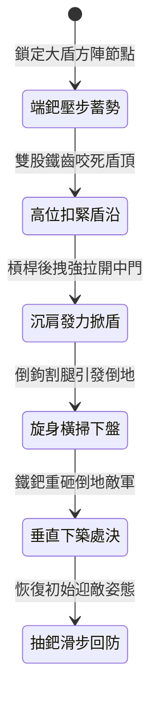

<!-- doc_id: doc_spec_1015 -->
# 野戰精銳步兵雙手長柄鉤鐮雙股鐵鈀掀翻大盾與橫掃下盤狀態機規格書

## 模組識別碼
- 模組編號：`FORM-234`
- 狀態機代碼：`HOOK-SICKLE-IRON-RAKE-SWEEP01`
- 類別：野戰精銳步兵雙手長柄重破防攻下盤狀態機
- 適用場景：平原野戰、隘口重陣、破除敵軍密集大盾陣列與擊倒重步兵

---

## 1. 核心概念與作戰原型

敵軍密結大盾方陣時，正面刺擊往往難以奏效，而長槍對下盤的掃擊又缺乏足夠的抓附力。突擊步兵營特配「雙手長柄鉤鐮雙股鐵鈀」，專門掀盾奪門並橫掃腿足。

### 1.1 武器形制與戰術協同
1. **雙股鐵鈀齒與倒向割鐮形制**：柄長一丈一尺，稠木夾麻布積層重桿；前端橫置雙股彎曲鐵鈀齒，兩側各探出一柄鋒利生鐵倒鉤鐮刀。
2. **高位扣盾強行掀翻**：步兵雙手高舉鐵鈀，鈀齒向下扣緊敵軍大盾上沿，腰腹沉肩向後猛拉，藉槓桿力生生掀開盾牌。
3. **低位旋身橫掃下盤**：在大盾被掀開的瞬間，步兵順勢下沉重心，雙手輪動長桿由外向內低位橫掃，兩側倒鉤鐮刀割切敵兵膝脛。
4. **目標失衡摔倒補刺處決**：敵兵腿足受割失去平衡摔倒在地，步兵借旋轉慣性調轉鈀身，鐵齒垂直下築直貫胸膛。

---

## 2. 數值參數與影響權重

| 參數名稱 | 數值 / 範圍 | 說明 |
| :--- | :--- | :--- |
| **扣盾掀翻成功率 (`ShieldPrySuccessRate`)** | 76% ~ 88% | 破除重盾防守姿態並強制繳盾 2 秒 |
| **橫掃下盤擊倒率 (`SweepKnockdownRate`)** | 75% ~ 86% | 迫使敵方前沿重步兵倒地失去架勢 |
| **鐵鈀垂直下築傷害 (`VerticalCrushDamage`)** | 620 ~ 850 點穿刺鈍擊 | 終結倒地目標，忽視 50% 物理防禦 |
| **橫掃覆蓋範圍 (`SweepArea`)** | 正前方橫向 2 格扇形 | 同時打擊相鄰兩名持盾步兵下盤 |
| **招式轉換銜接時差 (`ComboInterval`)** | 0.6 秒完成掀盾到掃腿 | 連貫流暢，不給敵方重整防線機會 |

---

## 3. 狀態機轉換定義

### 3.1 狀態細節描述
- **端鈀壓步蓄勢 (STEADY_STANCE)**：前手托柄後手扣尾，雙臂維持蓄勢推進。
- **高位扣緊盾沿 (LOCK_SHIELD_TOP)**：雙齒精準扣入盾牌上部木樑，阻止其移動。
- **沉肩發力掀盾 (LEVERAGE_PRY)**：全身力道向後下壓，生生扯開敵盾防線。
- **旋身橫掃下盤 (LOW_SWEEP_CUT)**：順勢轉腰低掃，鐮刀割裂敵方膝關節與腿甲。
- **垂直下築處決 (VERTICAL_FINISHER)**：趁敵翻倒，高舉長鈀垂直向下重重搗擊。
- **抽鈀滑步回防 (RECOVER_STANCE)**：後滑半步抽回武器，防備兩翼長兵反撲。

---

## 4. 戰鬥公式與判定

### 4.1 掀盾判定機制
$$\text{PryChance} = \min(0.88, \frac{\text{STR}_{\text{attacker}} \times 1.2}{\text{STR}_{\text{defender}}} \times \text{ShieldPrySuccessRate})$$

若判定成功，持盾目標在 2.5 秒內陷入「盾牌脫位」狀態，受到所有傷害增加 40%。

### 4.2 下盤橫掃倒地判定
$$\text{TripSuccess} = \min(0.86, \frac{\text{DEX}_{\text{attacker}}}{\text{DEX}_{\text{defender}}} \times \text{SweepKnockdownRate})$$

判定成功之敵軍強制倒地 1.8 秒，且倒地期間無法觸發格擋。

---

## 5. 反制與失效機制

1. **生鐵大盾頂部光滑斜面**：若敵方盾頂加裝生鐵光滑斜角，鈀齒容易打滑脫開。
2. **具裝重甲全覆蓋腿裙**：若敵方配有厚重全包覆生鐵甲裙，下盤橫掃傷害減免 40%。
3. **長兵側向協同架擊**：若持盾兵兩側有長槍兵協同防護，掀盾過程中步兵易遭側刺。

---

## 6. 驗收標準與測試案例

- [x] **TC-234-01**：驗證鐵鈀扣盾後在 0.3 秒內流暢掀開敵方大盾防禦。
- [x] **TC-234-02**：驗證低位橫掃對相鄰 2 格敵軍下盤擊倒率達 75%~86%。
- [x] **TC-234-03**：驗證垂直下築終結技對倒地目標造成忽視 50% 護甲之重擊傷害。
