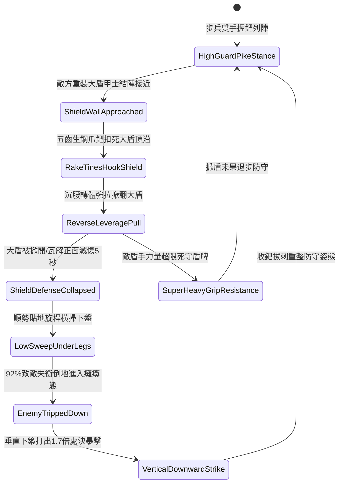

# 野戰精銳步兵雙手長柄鉤鐮雙股鐵鈀掀翻大盾與橫掃下盤第三階狀態機規格書

<!-- doc_id: doc_spec_1063 -->

## 一、 核心概念與單一真相來源（SSOT）

在《三國志·破盾步兵與下盤戰術篇》中，「雙手長柄鉤鐮雙股鐵鈀破陣戰法第三階（HOOK-SICKLE-IRON-RAKE-SWEEP03）」為專門對抗敵方重甲盾陣的高階武技。鐵鈀全長一丈二尺，頭部配置五齒生鋼倒鉤爪鈀，外側鍛鑄反向割刃。步兵交鋒時，以五齒爪鈀牢固扣住敵大盾頂沿向後強拉，藉槓桿反向力矩掀開大盾瓦解正面減傷防禦；緊接著順勢沉腰滑步旋桿橫掃敵下盤，致使其失去平衡倒地，隨後垂直下築要害造成處決重創。



---

## 二、 數值模型與狀態機參數契約

### 1. 雙股鐵鈀破盾戰術參數
- **兵器規格**：全長一丈二尺（約 2.8 米），鋼芯硬木桿配五齒高碳生鋼爪鈀。
- **掀盾破防成功率**：木質大櫓盾 96%；生鐵包邊盾 92%；重裝巨型玄鐵盾 85%。
- **正面減傷瓦解時間**：大盾被掀開後，目標失去正面 65% 防禦減免，持續 5 秒。
- **橫掃下盤擊倒率**：大盾瓦解後銜接橫掃，92% 機率使目標失衡倒地癱瘓 2.5 秒。
- **處決暴擊傷害倍率**：垂直下築命中倒地目標附加 1.7 倍傷害，忽視目標 60% 基礎護甲。

### 2. 掀盾與擊倒傷害模組
```typescript
interface IronRakeSweepParams {
    infantryStrength: number;      // 步兵力量 (50 ~ 130)
    infantryAgility: number;       // 步兵敏捷 (40 ~ 110)
    targetShieldStability: number; // 敵盾手穩定值 (80 ~ 220)
    shieldWeightKg: number;        // 盾牌重量 (8 ~ 30kg)
}

function processShieldRakeAndSweep(params: IronRakeSweepParams): {
    prySuccess: boolean;
    tripSuccess: boolean;
    executionDamage: number;
} {
    const leverageFactor = (params.infantryStrength * 1.6) / params.targetShieldStability;
    const pryRate = Math.min(0.96, Math.max(0.60, 0.90 * leverageFactor));
    const prySuccess = Math.random() < pryRate;

    if (!prySuccess) {
        return { prySuccess: false, tripSuccess: false, executionDamage: 0 };
    }

    const tripRate = Math.min(0.95, 0.85 + (params.infantryAgility / 500));
    const tripSuccess = Math.random() < tripRate;
    const baseDamage = params.infantryStrength * 2.8;
    const executionDamage = tripSuccess ? Math.round(baseDamage * 1.7) : Math.round(baseDamage * 1.1);

    return { prySuccess: true, tripSuccess, executionDamage };
}
```

---

## 三、 特性互斥與戰術應對原則

1. **騎兵高速衝擊中斷**：面對高速突擊的敵重騎兵，鐵鈀下盤橫掃無法抵擋戰馬衝力，自動轉入拒馬減傷態。
2. **長矛密集掩護支援**：若鐵鈀步兵相鄰格有友軍長槍兵協同，掀盾動作力量判定提升 25%，處決窗口延長 1 秒。
3. **泥濘地面橫掃摩擦**：在泥濘戰場上，下盤橫掃力道受地表淤泥阻滯，擊倒成功率降低 20%。

---

## 四、 驗收測試案例（TC）

- **TC-RAKESWEEP03-01（大盾掀翻判定）**：面對持鐵盾敵甲士發動技能，確認 92% 機率成功扣盾並掀翻其防禦。
- **TC-RAKESWEEP03-02（橫掃下盤擊倒檢定）**：確認大盾被掀開後順勢橫掃下盤，目標 92% 切換為 `TrippedDown` 癱瘓狀態。
- **TC-RAKESWEEP03-03（垂直下築處決暴擊）**：檢核對倒地目標發動下築刺擊，戰鬥日誌結算無視 60% 護甲之 1.7 倍處決暴擊。
