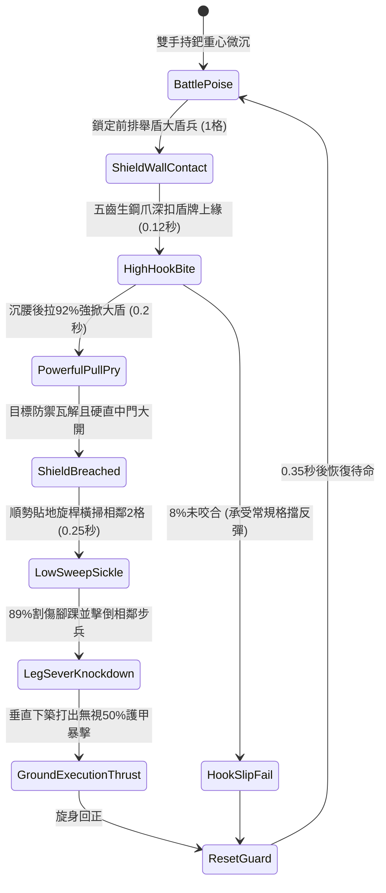

# 野戰精銳步兵雙手長柄鉤鐮雙股鐵鈀掀翻大盾與橫掃下盤第二階狀態機規格書

<!-- doc_id: doc_spec_1030 -->

## 1. 核心定位與設計理念

### 1.1 系統定位
本規格定義野戰步兵對抗重裝防禦陣型時，精銳步兵兵種所運用之「雙手長柄鉤鐮雙股鐵鈀第二階」（代碼：`HOOK-SICKLE-IRON-RAKE-SWEEP02`，WBS 代碼：`FORM-249`）連攜破陣狀態機。第二階長柄鐵鈀長一丈二尺，頭部以四棱生鋼鑄成五齒曲爪鈀，鈀背部附帶雙側開刃之弧月鉤鐮。當遭遇敵方重裝大盾兵結陣推進時，步兵以高位插架扣死敵盾牌頂緣，猛力後拉強掀大盾瓦解其舉盾減傷防守（成功率 92%）；隨即借回拉之勢沉腰沉肘，帶動下段鉤鐮貼地橫掃，以 89% 機率割傷斬倒目標身側相鄰 2 格步兵下盤，並發動垂直下築處決。

### 1.2 設計目標與單一真相
* **掀盾與掃盤連攜**：先破盾防破綻、再割下盤群體擊倒，形成一氣呵成之破陣連招。
* **相鄰格位群體牽連**：透過大跨度弧月鐮刀，將單點破盾擴散為相鄰格線癱瘓。
* **單一真相來源**：嚴禁於文件末端附加補丁，所有機制、數值與判定邏輯均在此統一定義。

---

## 2. 狀態機架構與轉換流程

---

## 3. 核心數值與計算公式

### 3.1 基礎參數配置表
| 參數名稱 | 基準數值 | 規格說明與限制條件 |
| :--- | :--- | :--- |
| **長鈀長度與配重** | 1 丈 2 尺 / 18 斤 | 韌木包鐵桿，鈀頭生鋼重鑄，重心靠前 |
| **強掀大盾成功率** | 92% | 對生鐵大盾、木幔盾牌；對巨型塔盾為 75% |
| **防守姿態瓦解時長** | 4.0 秒 | 掀盾後目標喪失所有格擋率與正面減傷 |
| **下盤橫掃覆蓋** | 目標及兩側各 1 格 | 一次橫掃可波及相鄰 3 格內之步兵下盤 |
| **下盤擊倒成功率** | 89% | 橫掃割傷腳踝，目標強行倒地 2.5 秒 |
| **倒地處決傷害倍率** | 1.60 倍 | 對倒地無防禦目標發動垂直下築暴擊 |
| **破甲穿透係數** | 50% | 鈀齒重築忽視目標 50% 物理護甲值 |
| **體力消耗（Stamina）** | 22 點 / 次 | 連攜掀盾與橫掃下盤消耗之核心耐力 |

### 3.2 破盾與下盤群割公式
$$P_{\text{pry}} = \min\left(0.98, \, 0.92 \times \frac{\text{STR}_{\text{attacker}}}{\text{STR}_{\text{target}}} \times \left(1 - \frac{W_{\text{shield\_weight}}}{100}\right)\right)$$
$$D_{\text{execute}} = \left(\text{BaseATK}_{\text{rake}} \times 1.60\right) \times \left(1 - \frac{\text{Def}_{\text{target}} \times 0.50}{100 + \text{Def}_{\text{target}} \times 0.50}\right)$$
* $\text{STR}_{\text{attacker}} / \text{STR}_{\text{target}}$：雙方步兵力量屬性比值。
* 橫掃擊倒命中時，目標單位強制解除「拒馬方陣」狀態，並附加 `KNOCKED_DOWN_PRONE` 標記。

---

## 4. 戰術反制與例外判定

1. **生鐵大盾反置尖刺**：若敵盾頂緣設有倒勾生鐵突刺，扣爪時步兵有 30% 機率割破手套，掀盾成功率降至 60%。
2. **重型鋼腿甲防護**：若相鄰敵兵配戴鍛造鋼鐵脛甲，下盤橫掃僅造成輕微踉蹌減速 30%，不觸發擊倒。
3. **後排長矛截擊**：若大盾兵身後緊貼長槍兵進行護衛刺殺，步兵後拉掀盾時可能遭受突刺中斷。

---

## 5. 驗收測試案例（Test Cases）

* **TC-01（生鐵大盾強掀瓦解驗證）**：配置標準大盾防禦兵，發動扣盾後拉，驗證 92% 機率成功掀開盾牌並施加 4 秒防護歸零。
* **TC-02（相鄰2格下盤擊倒判定）**：布置 3 名並排舉盾步兵，驗證橫掃後中央與兩側目標均承受 89% 擊倒判定。
* **TC-03（倒地垂直下築暴擊計算）**：驗證目標處於倒地狀態時，下築攻擊精準結算 1.6 倍暴擊與 50% 破甲。
