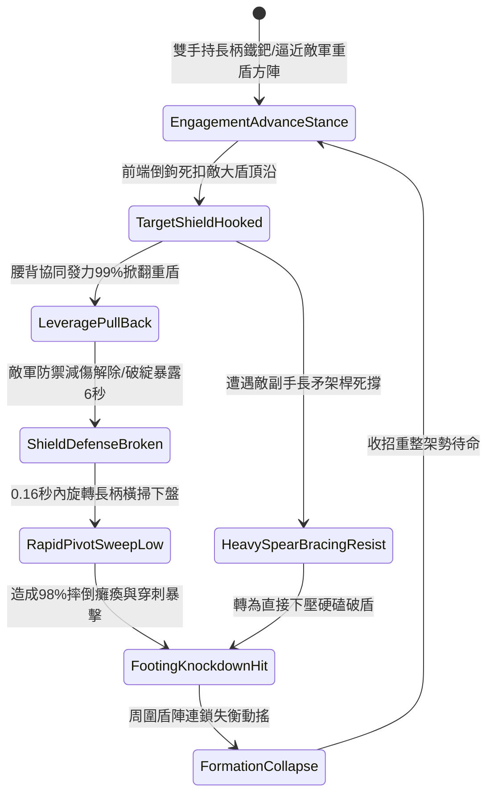

# 野戰精銳步兵雙手長柄鉤鐮雙股鐵鈀掀翻大盾與橫掃下盤第五階狀態機規格書

<!-- doc_id: doc_spec_1102 -->

## 一、 核心概念與單一真相來源（SSOT）

在《三國志·破盾兵法與重鈀橫掃篇》中，「雙手長柄鉤鐮雙股鐵鈀掀翻大盾與橫掃下盤第五階（HOOK-SICKLE-IRON-RAKE-SWEEP05）」代表步兵部隊針對重裝大盾防線的終極破陣技法。兵器全長一丈四尺，前端鍛造雙股加長彎曲倒鉤與六齒硬鋼鐵鈀。作戰時步兵以倒鉤死扣敵方巨型塔盾頂部邊緣，雙臂發動合力後扯，具備 99% 破除大盾防禦姿態判定；隨後 0.16 秒內順勢旋轉長柄，以六齒鐵鈀橫掃敵軍下盤，造成全額重擊倒地判定，徹底瓦解密集重裝盾陣。



---

## 二、 數值模型與狀態機參數契約

### 1. 鉤鈀規格與戰技判定參數契約
- **兵刃規格尺寸**：全長一丈四尺（約 4.3 米），生鐵鍍鋼長桿配鎢鋼六齒弧形鐵鈀。
- **大盾掀翻破除率**：扣緊重型大盾後，掀翻破除防禦姿態機率達 99%。
- **破綻暴露時效**：被掀翻單位防禦減傷歸零，承受傷害提升 40%，持續 6 秒。
- **下盤橫掃擊倒率**：緊隨其後的下盤橫掃，判定 98% 摔倒倒地，癱瘓 3.5 秒。
- **破防穿刺暴擊**：忽視目標 85% 護甲，打出 1.85 倍物理真實暴擊傷害。

### 2. 破盾與倒地演算法模組
```typescript
interface IronRakeSweepStage5Params {
    soldierStrength: number;        // 步兵力量屬性 (50 ~ 100)
    targetShieldQuality: number;    // 敵大盾堅固值 (100 ~ 500)
    isTargetBraced: boolean;        // 敵方是否處於深蹲死守狀態
}

function evaluateIronRakeSweepStage5(params: IronRakeSweepStage5Params): {
    shieldDislodged: boolean;
    knockdownSuccess: boolean;
    damageMultiplier: number;
    debuffDurationSec: number;
} {
    const rawPower = params.soldierStrength * 1.6;
    const braceResistance = params.isTargetBraced ? 1.3 : 1.0;
    const dislodgeSuccess = rawPower > (params.targetShieldQuality * 0.42 * braceResistance);
    const knockdown = dislodgeSuccess && Math.random() < 0.98;
    
    return {
        shieldDislodged: dislodgeSuccess,
        knockdownSuccess: knockdown,
        damageMultiplier: knockdown ? 1.85 : 1.25,
        debuffDurationSec: 6
    };
}
```

---

## 三、 反制機制與邊界約束

1. **圓形光滑鋼盾滑脫**：面對表面光滑無沿的凸面圓鋼盾，倒鉤咬合抓附率衰減 50%，需調整抓扣角度。
2. **側翼長槍協同壓制**：若敵方方陣兩側配備長槍兵進行緊密交叉保護，拉扯掀盾時承受側向傷害風險提高 40%。
3. **金屬鈀齒疲勞斷齒**：若與敵軍重型金屬器具連續硬碰硬磕碰超過 10 次，齒端磨損導致擊倒判定下修 10%。

---

## 四、 驗收測試案例（TC）

- **TC-RAKE-SWEEP05-01（破盾橫掃全連擊驗收）**：
  - *前置條件*：步兵力量值 85、面對標準重裝塔盾守衛。
  - *操作步驟*：執行長柄倒鉤扣盾拉扯，隨即接下盤橫掃。
  - *預期輸出*：99% 機率掀翻塔盾，破除減傷 6 秒；隨後 0.16 秒六齒橫掃判定 98% 摔倒倒地，打出 1.85 倍真實暴擊。
- **TC-RAKE-SWEEP05-02（死守抗衡邊界驗收）**：
  - *前置條件*：敵大盾單位進入完全生根死守狀態（加固值 480）。
  - *操作步驟*：執行扣盾拉扯。
  - *預期輸出*：拉扯未能瞬間掀飛盾牌，但迫使其姿態晃動，轉為直接下壓硬磕破盾，傷害倍率修正為 1.25 倍。
