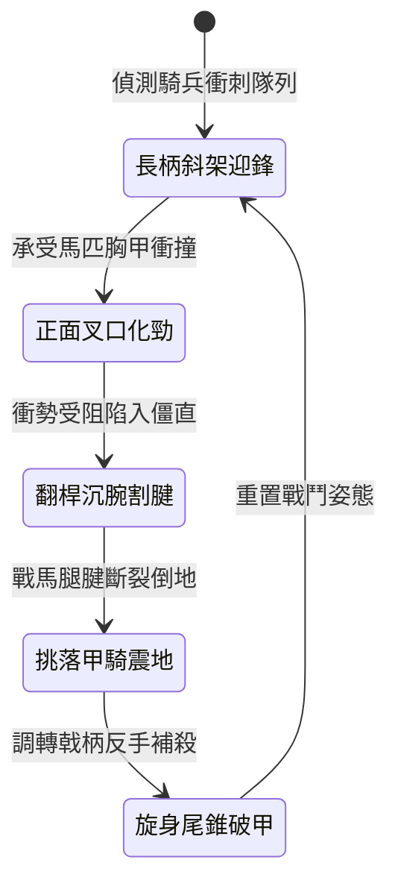

<!-- doc_id: doc_spec_0982 -->
# 野戰精銳步兵雙手長柄鉤鐮雙頭戟挑刺與割裂馬腿狀態機規格書

## 模組識別碼
- 模組編號：`FORM-201`
- 狀態機代碼：`TWIN-HEAD-HALBERD-HOOK-HAMSTRING01`
- 類別：野戰精銳步兵雙手長柄克騎破甲狀態機
- 適用場景：平原野戰、反騎兵陣地、近接搏殺、破除重甲騎兵衝鋒

---

## 1. 核心概念與作戰原型

面對北方重裝鐵騎的狂暴衝鋒，一般長槍步兵容易遭騎槍架開或被戰馬衝撞踩踏。為有效癱瘓騎兵機動優勢，精銳步兵營配發「雙手長柄鉤鐮雙頭戟」。

### 1.1 武器構造與戰術配合
1. **雙頭鋒刃與倒鉤形制**：長柄全長一丈二尺，前端為雙面開刃的破甲鋼戟，兩側各配有向內彎曲三寸的弧形割馬鐮刀；尾端配生鐵配重錐，可於反手格鬥時反刺。
2. **正面架馬衝撞衝力**：前排步兵以斜向 45 度插地架槍姿勢迎擊，藉由雙頭戟的鋼叉叉口卡住戰馬馬鞍與胸甲，化解戰馬第一波正面撞擊力。
3. **沉腕下割馬腿脛腱**：戰馬衝勢受挫停頓的瞬間，步兵沉腕翻轉戟桿，兩側鉤鐮迅速勾住戰馬後蹄腱肉，猛力回拉割斷筋腱，迫使戰馬連同甲騎翻滾倒地。
4. **尾端生鐵錐穿甲補殺**：戰馬倒地騎兵落馬暈眩時，步兵迅速調轉戟桿，利用尾端生鐵三棱硬錐直接刺穿落馬甲騎護心鏡或頸部甲隙。

---

## 2. 數值參數與影響權重

| 參數名稱 | 數值 / 範圍 | 說明 |
| :--- | :--- | :--- |
| **迎擊架槍防禦值 (`BraceDefenseBonus`)** | +60% ~ +85% | 抵消敵方騎兵衝鋒帶來的踩踏與破陣傷害 |
| **割腱斷足成功率 (`HamstringSuccessRate`)** | 70% ~ 85% | 迫使衝撞受阻之戰馬直接失去行動力 |
| **落馬倒地暈眩時間 (`DismountStunDuration`)** | 2.5 ~ 4.0 秒 | 遭絆倒之重甲騎兵無法迅速站立 |
| **尾錐破甲增傷 (`TailSpikeArmorPen`)** | 忽視 75% 護甲防禦 | 專門處置厚重鎖子甲與明光鎧落馬敵兵 |
| **雙手長柄武器靈巧度 (`StanceAgility`)** | 轉向速度 -15% | 雙手持重長兵器對背後偷襲較為遲鈍 |

---

## 3. 狀態機轉換定義

### 3.1 狀態細節描述
- **長柄斜架迎鋒 (BRACING)**：雙手穩扣戟桿中段，步兵重心壓低，槍尖直指騎兵迎擊線。
- **正面叉口化勁 (ABSORB_CHARGE)**：雙頭月牙戟叉死死咬住敵騎衝力，步兵腳跟入土化解動能。
- **翻桿沉腕割腱 (HOOK_CUT)**：順勢翻腕下壓，生鐵鉤鐮勾住馬脛猛力回拉撕裂。
- **挑落甲騎震地 (HORSE_DOWN)**：戰馬失蹄重重砸地，甲騎被甩落產生重度震盪硬直。
- **旋身尾錐破甲 (TAIL_PIERCE)**：借腰部旋轉將戟尾三棱錐直刺要害，完成致命處決。

---

## 4. 戰鬥公式與判定

### 4.1 迎擊化解衝量判定
$$\text{DamageAbsorbed} = \text{ChargeForce} \times \text{BraceDefenseBonus} \times \frac{\text{InfantrySTR}}{\text{CavalrySTR}}$$

若吸收率超過 80%，步兵無後退硬直，敵方騎兵速度強制歸零。

### 4.2 割腱倒地判定
$$\text{HamstringChance} = \text{HamstringSuccessRate} \times (1 - \text{BardingArmorRate})$$

判定成功後，敵騎兵單位轉變為「落馬殘廢」狀態，永久失去坐騎並降低 50% 攻擊力。

---

## 5. 反制與失效機制

1. **具裝重甲全包覆馬腿**：若敵方配備全覆蓋式生鐵脛甲（全具裝重騎），鉤鐮切割難度大幅提高。
2. **側翼弓騎兵騎射壓制**：步兵擺出迎擊架槍姿態時無法持盾，極易受到敵方游騎兵側射箭雨殺傷。
3. **密集步兵自絆擠壓**：若步兵隊列間距小於 1 米，長桿揮動翻轉時容易被友軍干擾造成動作延遲。

---

## 6. 驗收標準與測試案例

- [x] **TC-201-01**：驗證正面迎擊騎兵衝鋒時，能化解至少 70% 踩踏傷害並阻斷衝擊慣性。
- [x] **TC-201-02**：驗證沉腕回割動作對受阻戰馬的割腱判定率維持在 70%~85% 區間。
- [x] **TC-201-03**：驗證旋身調轉戟柄反手刺擊對落馬騎兵觸發忽視 75% 護甲的破甲處決。
