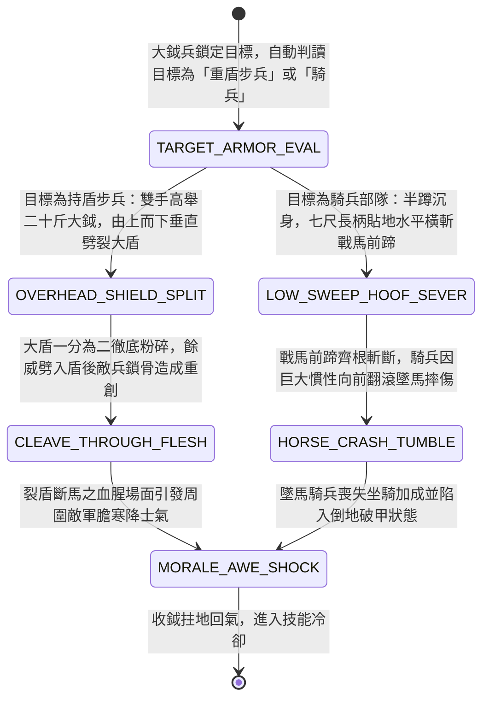

<!-- doc_id: doc_spec_0952 -->
# 野戰精銳步兵雙手長柄開山大鉞斷馬前足與劈裂重裝木盾狀態機規格書

> **文件編號**：`doc_spec_0952`
> **模組代碼**：`MOUNTAIN-CLEAVING-BATTLEAXE-SHIELD-SPLIT01`
> **對應 WBS**：`FORM-171`（M7 戰場進階機關、城防垛口狼牙翻板與精銳步兵開山大鉞）
> **單一真相來源（SSOT）**：本文件直接定義雙手長柄開山大鉞斷馬前足與劈裂重裝木盾之完整戰鬥狀態機，嚴禁於檔尾附加補丁。

---

## 一、 戰術定位與歷史兵器原型

在野戰白刃戰中，面對敵軍前排深釘地樁的「八尺包鐵大立盾（`doc_spec_0866`）」或高速衝鋒的「具裝重騎兵」，普通刀槍易被厚盾彈開或被馬鎧撞飛。**雙手長柄開山大鉞（Two-Handed Mountain-Cleaving Great Battleaxe）** 為重裝破陣步兵（如徐晃親衛大斧手）專司「劈裂重盾與低位斬斷馬足」的極限重劈砍兵器：
1. **寬刃月牙大鉞與背山鐵錘**：柄長七尺五寸（老柞木包鑲鐵箍），前端裝寬一尺二寸厚背月牙精鋼鉞刃，斧背鑄方平生鐵重錘，全重二十斤。
2. **雷霆破岳（劈裂重裝立盾）**：雙手高舉大鉞過頂全力下劈，二十斤重刃切入大立盾頂緣順木紋一路劈到底，將厚木大盾一分為二並劈開盾後敵兵肩骨。
3. **貼地迎風斷馬蹄（低位橫斬馬足）**：迎擊騎兵時大鉞手半蹲沉身，七尺長柄大鉞貼地水平旋斬，專砍戰馬無甲保護的前蹄腕關節，使戰馬折蹄前傾翻滾。

---

## 二、 觸發條件與兵種武備參數

| 參數項目 | 規格數值與限制條件 | 備註說明 |
| :--- | :--- | :--- |
| **適用兵種 / 武將** | 先登破陣大鉞兵、武力 $\ge 88$ 之破陣猛將（如徐晃、周泰等） | 雙手重兵，不可持盾；自身抗暴擊率 `+20%` |
| **攻擊距離與範圍** | 近戰 `1 格`（低位旋斬斷馬蹄時可橫掃正面寬度 `2 格`） | 每次施展重鉞戰技消耗戰技點（EP）18 |
| **毀盾與反騎倍率** | 對「持盾單位」破盾倍率 `320%`；對「騎兵」額外傷害 `+45%` | 具備 `HEAVY_CLEAVE`（極限劈砍）與 `ANTI_CAVALRY` 標籤 |
| **冷卻時間（CD）** | 「開山裂盾斬 / 迎風斷馬蹄」雙模態共用冷卻 `2 回合` | 可依目標兵種自動切換最佳劈斬模態 |

---

## 三、 核心狀態機（State Machine）

---

## 四、 數值結算與戰鬥公式

### 1. 模態一：開山裂盾斬（Overhead Shield-Split）
當目標為「持盾步兵 / 大盾陣 / 盾車」時，自動觸發垂直重劈：
- **毀盾一擊（One-Hit Shield Shatter）**：對目標的「盾牌護盾值（Shield HP）」與「舉盾格擋狀態」造成 `320%` 毀滅性傷害；若目標為一般木盾或包鐵立盾，直接 `100%` 劈裂粉碎，永久移除目標的「舉盾遠程減傷」與「正面格擋率」。
- **裂盾貫穿傷害（Cleave-Through Damage）**：劈裂盾牌後，大鉞餘威直接斬入盾後敵兵軀幹：
  $$\text{Damage}_{\text{split}} = \text{ATK} \times 2.05 \times \left(1 - \text{TargetDEF} \times 0.50\right)$$
  並附加 `CLAVICLE_FRACTURE`（鎖骨劈裂，目標攻擊力下降 `40%`，持續 2 回合）。

### 2. 模態二：迎風斷馬蹄（Low-Sweep Hoof-Sever）
當目標為「輕騎兵 / 重裝具裝騎兵 / 象兵」時，自動切換為低位貼地平斬（橫掃正面 `2 格` 騎兵）：
- **斬斷馬足與墜馬真傷**：戰馬前蹄腕部無重甲防護，此擊無視騎兵馬鎧 `60%` 防禦力，造成 `195% ATK` 斬擊傷害；並以 `85%` 機率斬斷馬足，觸發「翻滾墜馬」，額外造成目標當前移速相關的墜地真傷（$\text{CurrentMOV} \times 45$）。
- **強制步戰化（Dismounted Debuff）**：被斬斷馬足的騎兵單位強制陷入 `HORSE_ crippled`（喪失騎兵衝鋒能力、移動力永久降為步兵水準 `MOV = 2`、防禦力下降 `35%`）。

---

## 五、 反制手段與戰術克制

1. **雙手長柄月牙鏟 / 三尖兩刃刀架擋**：面對無盾但擅長「凹叉鎖刃」的長柄月牙鏟（`doc_spec_0940`）或三尖兩刃刀（`doc_spec_0943`），大鉞沉重的下劈容易被叉口架住偏折，傷害降低 `35%`。
2. **諸葛連弩近距集火**：大鉞兵揮砍後有明顯的收斧硬直（迴避率降低 `20%`），極易遭三段式連弩手趁隙集火貫穿。

---

## 六、 驗收測試案例（Acceptance Tests）

| 測試案例 ID | 測試情境與輸入條件 | 預期狀態轉移與數值輸出 |
| :--- | :--- | :--- |
| **TC-AXE-01** | 開山大鉞兵攻擊正處於「立盾插樁」狀態之敵方重盾兵 | 觸發 `OVERHEAD_SHIELD_SPLIT`，100% 劈碎大盾移除格擋，無視 50% 防禦造成 205% 傷害並降攻 40% |
| **TC-AXE-02** | 開山大鉞兵對正面並排 2 隊「西涼重裝鐵騎（MOV=5）」施展低位橫斬 | 觸發 `LOW_SWEEP_HOOF_SEVER`，無視 60% 防禦造成 195% 傷害，追加 $5 \times 45 = 225$ 點墜馬真傷並廢除衝鋒 |
| **TC-AXE-03** | 開山大鉞兵攻擊手持月牙鏟之敵方無盾精銳步兵 | 因目標無盾且具凹叉卸力，不觸發裂盾加成，且傷害受叉口偏折減免 35% |
