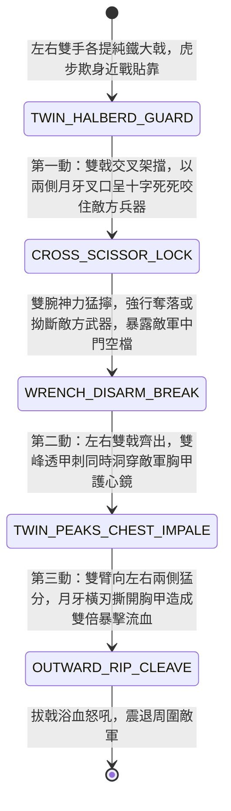

<!-- doc_id: doc_spec_0961 -->
# 野戰精銳步兵雙手長柄雙鐵戟十字絞鎖奪兵與雙峰穿胸破甲狀態機規格書

> **文件編號**：`doc_spec_0961`
> **模組代碼**：`TWIN-IRON-HALBERDS-CROSS-LOCK-PIERCE01`
> **對應 WBS**：`FORM-180`（M7 戰場進階機關、城防狼牙擺錘與精銳步兵雙鐵戟）
> **單一真相來源（SSOT）**：本文件直接定義雙手雙鐵戟十字絞鎖奪兵與雙峰穿胸破甲之完整戰鬥狀態機，嚴禁於檔尾附加補丁。

---

## 一、 戰術定位與歷史兵器原型

在三國近身步戰與護衛突擊中，《三國志·典韋傳》載典韋「好持大雙戟與長刀……提一雙戟八十斤」，吳國甘寧、孫策帳下猛士亦善使大雙戟。**雙手雙鐵戟（Twin Heavy Iron Halberds）** 為極限臂力猛將與近衛死士專用的「攻防一體、絞鎖奪兵與雙峰暴殺」奇門重兵：
1. **左雄右雌八十斤熟鐵雙戟**：雙手各持一柄長五尺、重達二十至四十斤（雙戟合重四十至八十斤）的純熟鐵短柄大戟；戟頭由中央透甲長刺與側面向上彎曲的月牙小枝（橫刃）構成，無木桿折斷之虞。
2. **雙戟十字絞鎖奪兵（Cross-Halberd Scissor Lock）**：面對敵方劈來的大刀或刺來的長矛，雙臂交叉舉戟迎擊，利用左右兩支鐵戟的「月牙小枝叉口」呈十字剪刀狀死死卡住敵方兵器刃背，雙腕猛然發力一擰，直接將敵方兵器拗斷或連人帶兵拽倒奪械。
3. **雙峰貫耳與穿胸破甲（Twin-Peaks Chest-Piercing）**：鎖開敵方中門後，左右雙鐵戟如雙龍出海般同時向前猛刺敵軍雙胸（或左右太陽穴），雙重透甲尖刺叠加衝擊，瞬間洞穿重甲護心鏡，再向兩側猛力一分撕裂胸膛。

---

## 二、 觸發條件與兵種武備參數

| 參數項目 | 規格數值與限制條件 | 備註說明 |
| :--- | :--- | :--- |
| **適用兵種 / 武將** | 虎衛雙戟死士、近衛重裝力士、武力 $\ge 92$ 之絕世猛將（如典韋等） | 雙手各持一鐵戟；自帶「死戰不退」免疫恐懼特性 |
| **攻擊距離與範圍** | 近戰貼身 `1 格`（剩餘短戟可作五步內投擲絕殺，射程 `2 格`） | 施展「十字絞鎖接雙峰穿胸」消耗戰技點（EP）20 |
| **招架與雙擊特性** | 近戰十字招架率 `45%`；普通攻擊與戰技皆為 **左右雙戟二連擊** | 具備 `SCISSOR_DISARM`（十字奪兵）與 `TWIN_PIERCE` 標籤 |
| **冷卻時間（CD）** | 「十字絞鎖雙峰刺」主動技冷卻 `2 回合` | 每場戰鬥限 1 次可將左戟全力擲出（必中秒殺殘血敵將） |

---

## 三、 核心狀態機（State Machine）

---

## 四、 數值結算與戰鬥公式

### 1. 第一動：十字絞鎖奪兵（Cross-Scissor Lock & Disarm）
當雙鐵戟兵對貼身 `1 格` 敵軍發動主動戰技，或在被動承受近戰攻擊觸發十字招架時：
- **100% 鎖死兵器與破防**：雙戟月牙叉口交叉咬死敵兵，強制附加 `HALBERD_SCISSOR_DISARMED`（十字絞鎖奪械：目標攻擊力下降 `55%`、無法觸發任何武器特效與反擊，且因中門大開使物理防禦力下降 `35%`，持續 2 回合）。

### 2. 第二、三動：雙峰穿胸與橫分撕裂（Twin-Peaks Impale & Rip）
奪械破防後，左右雙戟在同一次行動中連續打出「雙峰直刺」與「向外橫分」兩段高破甲傷害：
$$\text{Damage}_{\text{twin}} = \text{ATK} \times \left(1.30_{\text{LeftHalberd}} + 1.30_{\text{RightHalberd}}\right) \times \left(1 - \text{TargetDEF} \times 0.45\right)$$
- **雙戟齊中必暴加成**：若左右兩戟同時命中同一目標，第三動「向外橫分」自動觸發 **100% 暴擊**，額外撕裂目標最大兵力 `12%` 的真實物理傷害。
- **五步飛戟絕殺（Desperate Javelin Throw）**：若雙鐵戟部隊自身兵力低於 `30%`，可對 `2 格` 內的敵方武將擲出左手鐵戟，造成 `260% ATK` 無視防禦的必中貫穿傷害（擲出後自身改為單手執右戟作戰，攻擊力 `-15%` 直至撿回）。

---

## 五、 反制手段與戰術克制

1. **二格長柄兵器隔位風箏**：雙鐵戟長僅五尺（`1 格` 近身極限霸主），若敵方以丈八蛇矛（`doc_spec_0958`）或二格長槍隔著前排肉盾在 `2 格` 外刺擊，雙鐵戟無法觸發十字絞鎖奪兵。
2. **鼓風毒煙與泥濘遲滯**：雙鐵戟加雙層重甲極耗體力，在泥濘地形或毒煙車（`doc_spec_0938`）籠罩下移動力降為 `1 格`，容易被遠程部隊放風箏。

---

## 六、 驗收測試案例（Acceptance Tests）

| 測試案例 ID | 測試情境與輸入條件 | 預期狀態轉移與數值輸出 |
| :--- | :--- | :--- |
| **TC-TWIN-01** | 雙鐵戟兵貼身對敵方「手持大砍刀之重裝先鋒」施展十字絞鎖 | 100% 附加 `HALBERD_SCISSOR_DISARMED`（敵攻擊 -55%、封禁反擊、防禦 -35%） |
| **TC-TWIN-02** | 絞鎖破防後緊接雙峰穿胸與向外橫分 | 左右雙戟合共打出 $2.60$ 倍（無視 55% 防禦）必暴傷害，並追加 12% 最大兵力撕裂真傷 |
| **TC-TWIN-03** | 雙鐵戟兵兵力降至 25%（`<30%`），對 2 格外殘血敵將發動「五步飛戟」 | 左戟擲出必中敵將，造成 260% 無視防禦貫穿傷，自身轉為單戟態（攻擊 -15%） |
