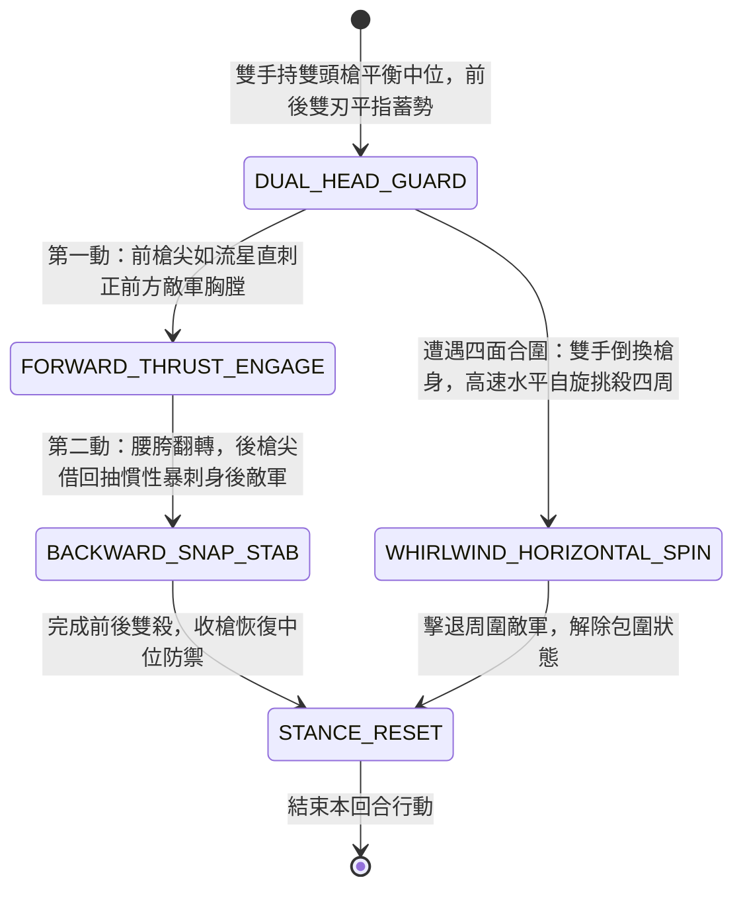

<!-- doc_id: doc_spec_0979 -->
# 野戰精銳步兵雙手長柄雙頭兩段槍前後連刺與迴旋挑殺狀態機規格書

> **文件編號**：`doc_spec_0979`
> **模組代碼**：`TWIN-HEAD-SPEAR-DUAL-THRUST-WHIRL01`
> **對應 WBS**：`FORM-198`（M7 戰場進階機關、城防活動防壁合攏與精銳步兵雙頭槍）
> **單一真相來源（SSOT）**：本文件直接定義雙頭兩段槍前後連刺與迴旋挑殺之完整戰鬥狀態機，嚴禁於檔尾附加補丁。

---

## 一、 戰術定位與歷史工程原型

在陣列混戰或遭受敵軍前後包夾時，傳統單頭長槍轉向笨重，一旦身後有敵軍貼近，槍手往往來不及調轉槍頭即遭突襲。《武備志》與傳統武術記載「雙頭兩段槍（雙頭槍）」為專司「前後兼顧、雙向突刺與迴旋挑殺」的精銳長兵：
1. **中置握把與前後對稱雙矛頭**：全槍長一丈二尺，中心段設有兩尺長防滑纏絲握把，前後兩端各安裝一具長一尺二寸的精鋼三棱透甲錐槍頭，槍桿平衡極佳。
2. **前突後刺連動發力（Dual-Direction Thrust）**：向前直刺前敵的同時，利用手臂回撤與腰部旋扭慣性，尾部槍尖借勢向身後暴刺而出，瞬間瓦解身後偷襲之敵。
3. **中央旋軸大舞花挑殺（Whirlwind Spear-Sweep）**：被多名敵兵圍困時，雙手於腰間快速倒換握把，雙頭槍如風車般高速水平自旋，前後雙槍刃化為圓形刀幕，挑開敵兵武器並劃傷四周敵軍。

---

## 二、 觸發條件與兵種武備參數

| 參數項目 | 規格數值與限制條件 | 備註說明 |
| :--- | :--- | :--- |
| **適用兵種 / 武將** | 精銳雙頭槍衛、敏捷型游擊名將（武力 $\ge 88$、敏捷 $\ge 85$） | 雙手持握，兼具前後 `1 格` 雙向攻擊力 |
| **攻擊距離與範圍** | 前後各 `1 格`；施展「迴旋大舞花」時波及自身周圍八格（`3 × 3`） | 施展「雙向連刺 / 迴旋挑殺」消耗戰技點（EP）18 |
| **防背刺特性** | **免疫背刺傷害加成**；遭受背後攻擊時自帶 `50%` 先制反刺 | 具備 `ANTI_FLANK` 與 `WHIRLWIND_SWEEP` 標籤 |
| **冷卻時間（CD）** | 主動戰技冷卻 `2 回合` | 被動：常駐提升自身反擊傷害 `30%` |

---

## 三、 核心狀態機（State Machine）

---

## 四、 數值結算與戰鬥公式

### 1. 前突後刺連動傷害（Forward & Backward Dual-Thrust）
在同一次戰技行動中，對正前方 `1 格` 與正後方 `1 格` 敵軍同時結算穿刺傷害：
$$\text{Damage}_{\text{front}} = \text{ATK} \times 1.65 \times \left(1 - \text{FrontDEF} \times 0.40\right)$$
$$\text{Damage}_{\text{back}} = \text{ATK} \times 1.45 \times \left(1 - \text{BackDEF} \times 0.40\right)$$
- 若身後無敵軍，則兩段傷害全部集中於正前方目標，打出 `2.80 倍` 雙頭連環刺。

### 2. 迴旋挑殺與擊退（Whirlwind Sweep & Knockback）
當施展「迴旋大舞花」時，對周圍 `3 × 3` 八個格子的敵軍造成全方位橫挑傷害：
- 造成 `120% ATK` 傷害，並以 `60%` 機率將周圍敵軍擊退 `1 格`，打碎敵方包圍夾擊陣型。

---

## 五、 反制手段與戰術克制

1. **超長兩丈長矛陣列推進**：雙頭槍長一丈二尺，面對更長的一丈八尺長矛方陣（`doc_spec_0928`）正面推進時，在刺中敵軍前會先受長矛阻擋。
2. **重弓遠程集火射擊**：雙頭槍重在近身格鬥與防包夾，缺乏防矢大盾遮蔽，開闊地遭集火射擊損耗較大。

---

## 六、 驗收測試案例（Acceptance Tests）

| 測試案例 ID | 測試情境與輸入條件 | 預期狀態轉移與數值輸出 |
| :--- | :--- | :--- |
| **TC-TWINHEAD-01** | 雙頭槍手前後各有 1 隊敵軍貼身夾擊 | 自動發動前後連刺，前敵受 165% 傷，後敵受 145% 傷，免疫敵方夾擊背刺加成 |
| **TC-TWINHEAD-02** | 正前方有敵將，身後無敵軍 | 前後兩段合一，對正前方敵將打出 2.80 倍連刺爆發傷害 |
| **TC-TWINHEAD-03** | 遭 4 隊敵軍四面包圍，啟動「迴旋大舞花」 | 對 3x3 範圍敵軍造成 120% 橫挑傷，60% 機率將包圍敵軍震退 1 格解除合圍 |
