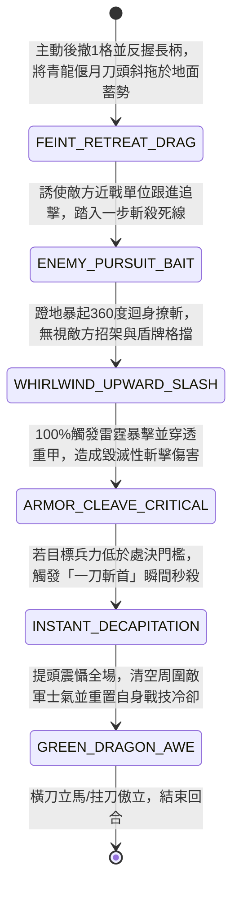

<!-- doc_id: doc_spec_0955 -->
# 野戰精銳步兵雙手長柄青龍偃月刀拖刀蓄力迴旋斬與破甲斬首狀態機規格書

> **文件編號**：`doc_spec_0955`
> **模組代碼**：`GREEN-DRAGON-GLAIVE-DRAG-SLASH01`
> **對應 WBS**：`FORM-174`（M7 戰場進階機關、城防滾筒絞殺與精銳步兵拖刀迴旋斬）
> **單一真相來源（SSOT）**：本文件直接定義雙手長柄青龍偃月刀拖刀蓄力迴旋斬與破甲斬首之完整戰鬥狀態機，嚴禁於檔尾附加補丁。

---

## 一、 戰術定位與歷史兵器原型

在三國武將單挑與精銳重步兵（如關家校刀手）的野戰對決中，面對善於正面招架的敵軍將領或重甲先鋒，正面強攻耗時費力。**雙手長柄青龍偃月刀（Green-Dragon Crescent Glaive）** 以沉重的寬背彎刀與獨特的「拖刀計（Drag-Blade Feint & Whirlwind Decapitation）」聞名：
1. **吞口青龍寬背重刃**：柄長七尺，刀身如彎月，刀背厚實飾有吞口金龍與鋸齒背刃，柄尾配三棱鐵鐏，實戰標準全重二十四斤。
2. **詐敗拖刀蓄勢（Drag-Blade Feint）**：交戰時故意賣破綻轉身後撤，雙手反握刀柄使偃月刀頭斜拖地面滑行；敵軍以為我方力怯敗退而欺身追擊，實則我方腰背正藉拖行慣性蓄滿迴旋動能。
3. **迴身滿月斬首（Whirlwind Decapitation）**：待敵踏入一步死線瞬間，猛然暴起蹬地迴身，二十四斤偃月刀自地面由下往上劃出 $360^\circ$ 滿月寒光，借敵前衝之勢與迴旋離心力，一刀將敵護心鏡連同頭顱齊肩斬斷。

---

## 二、 觸發條件與兵種武備參數

| 參數項目 | 規格數值與限制條件 | 備註說明 |
| :--- | :--- | :--- |
| **適用兵種 / 武將** | 精銳校刀手、大刀重步兵、武力 $\ge 90$ 之頂級名將（如關羽、關平等） | 雙手長柄重刀，自帶「威懾」光環（周圍敵軍暴擊率 `-15%`） |
| **攻擊距離與範圍** | 近戰 `1 格`（迴旋滿月斬時可橫掃周圍八方或正面半圓 `3 格`） | 施展「拖刀迴旋斬」消耗戰技點（EP）25 |
| **蓄力與暴擊特性** | 進入「拖刀態」後，下一次迴旋斬 **必中且 100% 暴擊**，暴擊傷害 `+50%` | 具備 `DECAPITATE`（斬首處決）與 `COUNTER_BURST` 標籤 |
| **冷卻時間（CD）** | 「拖刀迴旋斬」主動技冷卻 `3 回合` | 若成功斬殺敵軍武將或整隊步兵，冷卻時間直接減少 `2 回合` |

---

## 三、 核心狀態機（State Machine）

---

## 四、 數值結算與戰鬥公式

### 1. 詐敗拖刀蓄勢與誘敵跟進（Drag-Blade Feint & Bait）
施展技能第一階段，部隊向後撤退 `1 格` 並進入 `DRAG_BLADE_CHARGING`（拖刀蓄勢態，持續 1 回合）：
- **誘敵追擊**：正前方的敵方近戰部隊有 `80%` 機率誤判我方敗退，強制向我方後撤留下的空格追擊跟進（此追擊使敵方自身防禦力暴露，DEF 暫時下降 `25%`）。
- **先制反斬觸發**：一旦敵軍踏入我方正前方 `1 格` 並試圖發動攻擊，我方會在敵方攻擊判定生效前，**100% 先制觸發** `WHIRLWIND_UPWARD_SLASH`（迴身滿月斬）。

### 2. 迴身滿月斬與一刀斬首處決（Whirlwind Slash & Decapitation）
迴身撩斬由下往上切入，直接繞過敵方正面盾牌，對正面扇形 `3 格` 造成必中暴擊傷害：
$$\text{Damage}_{\text{dragon}} = \text{ATK} \times 2.35 \times \text{CritMult}(2.0) \times \left(1 - \text{TargetDEF} \times 0.45\right)$$
- **無視格擋與破甲**：此擊 `100%` 無視敵方「舉盾格擋」與「兵器招架（Parry）」，並穿透 `55%` 物理防禦力。
- **斬首處決門檻（Decapitation Threshold）**：若主目標在承受此刀後剩餘兵力低於最大兵力的 `25%`（面對武力低於自身 15 點以上的敵將時，門檻放寬至 `35%`），立即觸發 `INSTANT_DECAPITATION`（一刀斬首），直接將剩餘兵力歸零秒殺，並使周圍 `2 格` 敵軍士氣暴跌 `30` 點。

---

## 五、 反制手段與戰術克制

1. **拒不追擊並以遠程弓弩射擊**：若敵方識破拖刀計，按兵不動拒絕跟進追擊，改以後排弓弩手遠程射擊，可使拖刀蓄勢無法觸發「先制反斬」（次回合僅能化為普通 `180%` 揮砍）。
2. **藤甲或重型雙馬連枷硬撼**：若敵方並未孤軍追擊，而是以雙馬連枷車或陷馬坑限制校刀手後撤空間（背後無空格可退），將無法施展拖刀計。

---

## 六、 驗收測試案例（Acceptance Tests）

| 測試案例 ID | 測試情境與輸入條件 | 預期狀態轉移與數值輸出 |
| :--- | :--- | :--- |
| **TC-GLAIVE-01** | 校刀手施展拖刀計後撤 1 格，敵方重甲刀盾兵跟進追擊並出刀 | 在敵攻擊生效前 100% 先制觸發 `WHIRLWIND_UPWARD_SLASH`，無視格擋與 55% 防禦造成 $2.35 \times 2.0$ 倍暴擊傷害 |
| **TC-GLAIVE-02** | 主目標敵將（STR=72，低於我方 STR=96 達 24 點）受斬後剩餘兵力為 32%（`<35%`） | 觸發 `INSTANT_DECAPITATION` 一刀斬首秒殺，周圍 2 格敵軍士氣 -30，技能冷卻縮減 2 回合 |
| **TC-GLAIVE-03** | 校刀手背後緊貼山壁或友軍（無後撤 1 格之空間） | 因無拖刀後撤空間，技能無法啟動 `FEINT_RETREAT_DRAG` |
