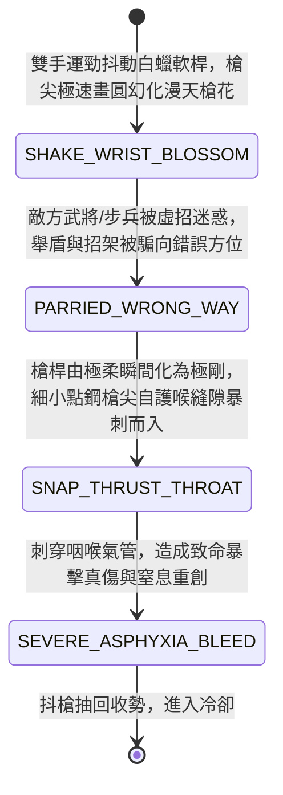

<!-- doc_id: doc_spec_0973 -->
# 野戰精銳步兵雙手長柄點鋼槍抖花惑敵與迎喉暴刺狀態機規格書

> **文件編號**：`doc_spec_0973`
> **模組代碼**：`STEEL-POINT-SPEAR-BLOSSOM-FEINT-THROAT-STAB01`
> **對應 WBS**：`FORM-192`（M7 戰場進階機關、城防穿刺攻城塔與精銳步兵點鋼槍）
> **單一真相來源（SSOT）**：本文件直接定義雙手長柄點鋼槍抖花惑敵與迎喉暴刺之完整戰鬥狀態機，嚴禁於檔尾附加補丁。

---

## 一、 戰術定位與歷史工程原型

在三國名將單挑與精銳突擊步兵戰技中，槍為「百兵之王」（《三國志》載趙雲、張郃、姜維皆善使巧槍）。與沉重的丈八蛇矛（`doc_spec_0958`）或開山鉞不同，**雙手長柄點鋼槍（Refined-Steel Point Spear / Dian-Gang-Qiang）** 走的是「極致槍速、抖腕化九影與專攻護喉空門」的巧刺流派：
1. **白蠟軟桿配寸半點鋼槍尖**：槍長一丈一尺，桿選油浸三年彈性極佳的老白蠟木，槍尖僅長寸半，以淬火精鋼鍛造成細小如蜂刺的三棱透甲錐，重量極輕，利於極速變相。
2. **抖腕槍花化九影（Spear-Blossom Feint）**：手腕高速晃動白蠟桿，彈性桿身使極小的槍尖在敵將眼前幻化出七至九朵亂晃的耀眼寒星，敵軍根本無法辨識真正刺來的方位，導致招架與舉盾動作完全偏斜。
3. **金雞點頭暴刺咽喉（Throat-Seeking Critical Thrust）**：就在敵軍格擋被虛招引開的剎那，槍桿一繃一送，毒蛇般自敵軍面甲護喉（咽喉軟甲縫隙）暴刺而入，一槍封喉。

---

## 二、 觸發條件與兵種武備參數

| 參數項目 | 規格數值與限制條件 | 備註說明 |
| :--- | :--- | :--- |
| **適用兵種 / 武將** | 白毦兵、精銳巧槍近衛、敏捷與武力雙高猛將（如趙雲、張郃、姜維） | 雙手長兵，速度與暴擊兼備 |
| **攻擊距離與範圍** | 近戰 `1 ~ 2 格`（極速穿透，可鎖定敵陣中單體武將） | 施展「漫天槍花暴刺」消耗戰技點（EP）18 |
| **虛招惑敵與鎖喉暴擊** | 攻擊前 **100% 破除目標招架**；對「咽喉」弱點暴擊率 `+45%` | 具備 `FEINT_CONFUSE` 與 `THROAT_SEEK` 雙標籤 |
| **冷卻時間（CD）** | 主動戰技冷卻 `2 回合` | 被動：常駐提升自身近戰閃避率 `25%` |

---

## 三、 核心狀態機（State Machine）

---

## 四、 數值結算與戰鬥公式

### 1. 槍花惑敵與格擋剝奪（Spear Blossom & Guard Strip）
在點鋼槍刺出前，自動進行「敏捷判定（AGI / DEX Check）」：
- **100% 破除招架**：若攻擊者武藝值（STR/AGI 加權）高於目標，目標本回合的「格擋率（Block Rate）」與「招架率（Parry Rate）」直接歸零，且閃避率下降 `40%`。

### 2. 迎喉暴刺傷害（Throat-Seeking Critical Thrust）
細小點鋼尖直接命中咽喉薄弱縫隙：
$$\text{Damage}_{\text{throat}} = \text{ATK} \times 2.10 \times \text{CritMult}(2.2) \times \left(1 - \text{TargetDEF} \times 0.25\right)$$
- **無視厚甲（Seam Bypass）**：由於攻擊的是護喉縫隙，無視目標胸甲 `75%` 的物理防禦力。
- **刺穿氣管窒息（Tracheal Asphyxia）**：命中後目標附加 `THROAT_PUNCTURE`，無法大聲呼喊指揮，其統率光環失效 `1 回合`，且每回合流失最大兵力 `8%`。

---

## 五、 反制手段與戰術克制

1. **重裝全封閉面甲（全覆式生鐵冑）**：若敵方穿戴全封閉無縫鐵面甲，點鋼槍尖無法直接刺入肉中，暴擊率加成減半。
2. **大範圍橫掃重兵器（大鉞 / 甕金錘）**：點鋼槍走的是輕靈路線，面對不講技巧的二十斤大鉞（`doc_spec_0952`）大範圍橫劈，難以正面硬碰。

---

## 六、 驗收測試案例（Acceptance Tests）

| 測試案例 ID | 測試情境與輸入條件 | 預期狀態轉移與數值輸出 |
| :--- | :--- | :--- |
| **TC-STEEL-01** | 巧槍將領對處於招架姿態的敵將發動「槍花惑敵」 | 100% 騙開敵方格擋與招架（招架率歸零），閃避率下降 40% |
| **TC-STEEL-02** | 槍花後暴刺敵將咽喉，觸發暴擊 | 觸發 $2.2$ 倍暴擊乘數，無視 75% 防禦造成致命傷害，附加統率光環失效與流血 |
| **TC-STEEL-03** | 目標穿戴全覆式生鐵面甲硬抗點鋼槍刺擊 | 暴擊加成減半（由 +45% 降至 +22.5%），傷害受到面甲適當減免 |
