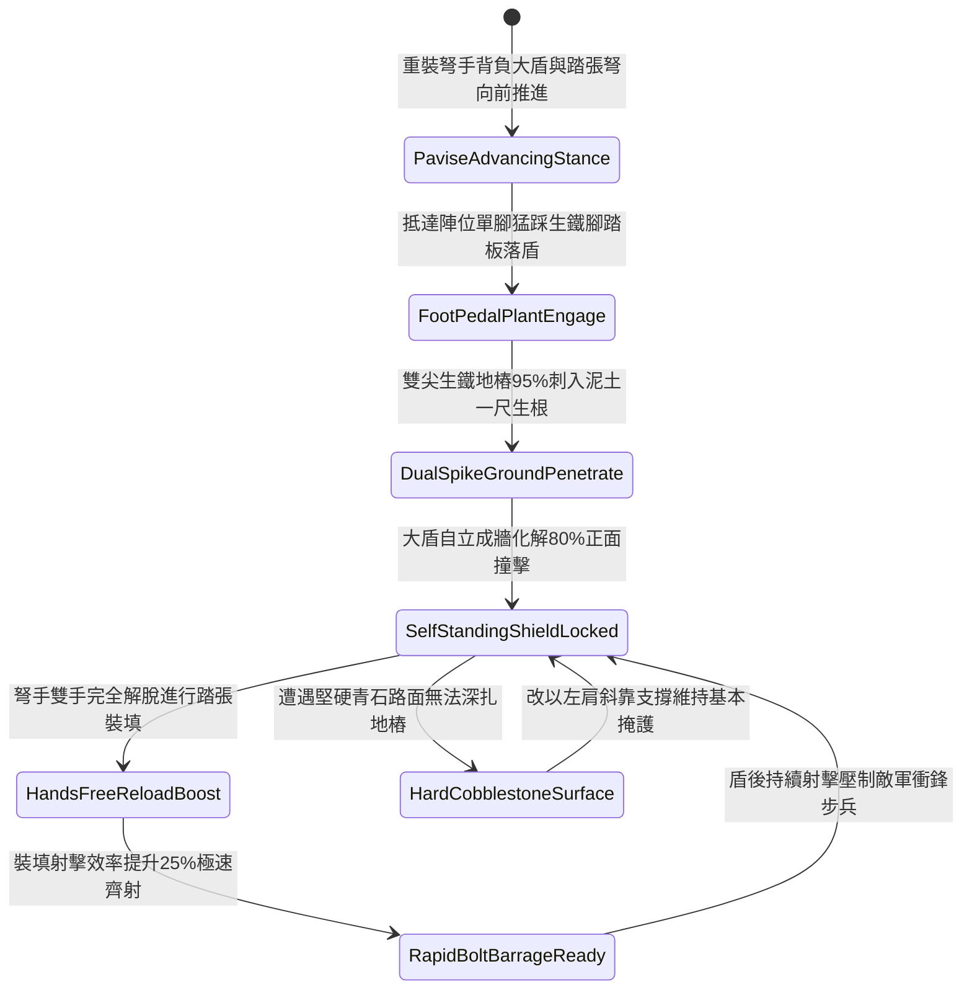

# 野戰重裝弩兵大盾底端生鐵雙尖地樁踏張自固第一階狀態機規格書

<!-- doc_id: doc_spec_1135 -->

## 一、 核心概念與單一真相來源（SSOT）

在《三國志·重步兵大盾與踏張弩協同戰術篇》中，「野戰重裝弩兵大盾底端生鐵雙尖地樁第一階（INFANTRY-PAVISE-SPIKE-ANCHOR01）」代表陣地弩手於無掩體野戰環境下快速構築單兵防護工事的標準裝備。該大盾（立牌）高五尺、寬二尺半，盾面為加厚松木蒙生牛皮，底端左右兩側鉚接一尺長冷鍛生鐵雙尖地樁，並配備專供弩手單腳踩踏借力的生鐵腳踏板。弩手落盾時單腳踏下腳踏板，95% 將雙尖地樁扎入泥土生根，將正面 80% 震動與流箭衝擊力導入大地，使大盾具備自立穩定性，弩手得以騰出雙手快速踏張上弦，裝填射擊效率提升 25%。



---

## 二、 數值模型與狀態機參數契約

### 1. 弩兵自固大盾參數契約
- **大盾規格尺寸**：高 5 尺、寬 2.5 尺、厚 1.5 寸，生牛皮蒙松木面，總重量 28 斤。
- **生鐵雙尖地樁**：底端雙尖冷鍛生鐵樁，長 1 尺、方徑 8 分，配備寬 4 寸金屬踏板。
- **入土生根成功率**：在常規泥土或草地地形踩踏，判定 95% 機率穩固扎入。
- **正面抗衝擊化解率**：承受正面箭矢齊射或輕步兵衝撞，化解 80% 震盪動能。
- **雙手解脫裝填加成**：大盾自立後，弩手裝填踏張弩動作耗時縮減 25%，命中率提升 15%。

### 2. 大盾踏張自固判定演算法模組
```typescript
interface PaviseSpikeStage1Params {
    terrainFirmness: number;       // 地質堅實度 (0.0: 鬆沙 ~ 1.0: 堅土)
    soldierStepForceKg: number;    // 弩手踏步踩力 (kg)
    isFootPedalPressed: boolean;   // 是否踩壓生鐵腳踏板
    incomingArrowForce: number;    // 來襲箭雨衝擊力
}

function evaluatePaviseSpikeStage1(params: PaviseSpikeStage1Params): {
    shieldAnchoredSelfStanding: boolean;
    absorbedShockRatio: number;
    crossbowReloadTimeBonusPct: number;
} {
    if (!params.isFootPedalPressed || params.terrainFirmness < 0.2) {
        return { shieldAnchoredSelfStanding: false, absorbedShockRatio: 0.30, crossbowReloadTimeBonusPct: 0 };
    }
    const success = Math.random() < 0.95;
    
    return {
        shieldAnchoredSelfStanding: success,
        absorbedShockRatio: success ? 0.80 : 0.45,
        crossbowReloadTimeBonusPct: success ? 25 : 5
    };
}
```

---

## 三、 反制機制與邊界約束

1. **岩石硬化路面尖樁無法刺入**：若陣地處於堅硬花崗石或硬化城磚路面，雙尖地樁無法入土，大盾無法自立，需單手扶持。
2. **騎兵正面全力衝撞**：面對奔馳重騎兵正面高速直衝，單兵大盾地樁入土深度有限，有 30% 機率連盾帶樁被撞飛。
3. **長柄鐵鉤勾扯盾頂**：敵軍長槍兵若使用長柄鐵鉤死扣大盾頂沿向後拉拽，地樁受槓桿力有 25% 拔出翻倒。

---

## 四、 驗收測試案例（TC）

- **TC-PAVISE-SPIKE01-01（野戰草地踩踏自立與裝填驗收）**：
  - *前置條件*：正常泥土地質、重裝弩手踏踩腳踏板落盾、敵步兵遠程箭雨壓制。
  - *操作步驟*：踩壓踏板使雙尖地樁刺入泥土。
  - *預期輸出*：95% 機率大盾自立穩固，化解 80% 衝擊，弩手雙手完全解脫，踏張弩裝填速度提升 25%。
- **TC-PAVISE-SPIKE01-02（鬆軟流沙地質邊界驗收）**：
  - *前置條件*：陣地處於極度鬆散流砂地形（地質堅實係數 0.15）。
  - *操作步驟*：踩踏地樁落盾。
  - *預期輸出*：地樁無法生根扣緊，大盾隨受力向後傾倒，裝填加成歸零。
